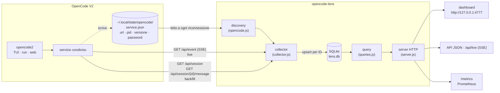
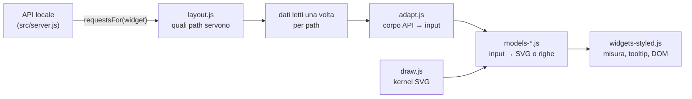

# Architettura

🌐 Italiano · [English](en/architettura.md) · [Français](fr/architettura.md)

OpenCode V2 fa girare un servizio condiviso in background: la TUI, `opencode2 run` e il client web parlano tutti con lui. La lens si collega allo stesso servizio come un client in più, in sola lettura verso OpenCode (non scrive mai niente nel suo servizio), e non sta mai nel mezzo tra OpenCode e i provider.

Accanto al nucleo girano i **moduli** (`modules/<id>/`, vedi [moduli.md](moduli.md)), tutti spenti di partenza. All'avvio `src/main.js` li scopre con `discoverModules`, il `ModuleRegistry` avvia solo quelli in `LENS_MODULES` dando a ciascuno il suo `ctx` (`src/module-kit.js`: viste strette di collector, store e log, mai l'oggetto intero), e il server monta route, file statici (`/modules/<id>/<file>`) e famiglie di metriche dei moduli attivi dopo quelle del nucleo. Il nucleo non importa mai codice di un modulo.

## 1. Discovery

La lens legge `~/.local/state/opencode/service.json` (o `$XDG_STATE_HOME/opencode/service.json`, lo stesso percorso usato da `@opencode-ai/client`), che contiene url, pid, versione e password. Lo rilegge a ogni riconnessione, perché porta e password possono cambiare quando il servizio riparte; un `401` azzera l'endpoint e forza una nuova discovery.

L'autenticazione è Basic, utente `opencode`. Lo stato di salute arriva da `/api/health` (la documentazione cita `/api/info`, che nella beta risponde 404: la lens prova entrambi).

Con `OPENCODE_SERVER_URL` (e `OPENCODE_SERVER_PASSWORD`) la discovery viene saltata e la lens usa quel server, per esempio un `opencode2 serve` o un `--standalone`. Vedi [configurazione.md](configurazione.md).

## 2. Live: `/api/event`

Il collector resta in ascolto su `GET /api/event` e scrive subito ciò che arriva:

| Evento | Uso |
|---|---|
| `session.step.started` | modello, provider, variante e agente dello step; `data.started` è la richiesta al provider (se manca, vale l'orario dell'evento, senza segnalare un drift); se lo stesso ID riparte prima di finire, è un nuovo tentativo (azzera primo output e fine dello stream) |
| `session.text.started`, `session.reasoning.started` (e `session.tool.input.started`) | primo output dell'ultimo tentativo dello step |
| `session.step.streamed` | fine dello stream del provider (non il primo token: arriva quando il modello ha finito di rispondere) |
| `session.step.ended` | token, costo ed esito (`finish`) |
| `session.step.failed` | errore dello step |
| `session.retry.scheduled` | retry, salvato tra i segnali |
| `session.tool.input.started`, `session.tool.called`, `session.tool.success`, `session.tool.failed` | ciclo di vita delle chiamate ai tool |
| `session.usage.updated` | totali di sessione |
| `session.created`, `session.renamed`, `session.deleted` | anagrafica della sessione (progetto, cartella, sessione padre, titolo) |
| `session.execution.interrupted` | segnale con il motivo (`user`, `superseded`, `inactivity`, `shutdown`), applicato al run il cui `idle` ha lo stesso id dell'evento (`evt_…` → `msg_…`) |
| `session.usage.recorded` | segnale con `source`; con `source: "title"` anche un task interno esatto di tipo titolo |
| `session.compaction.started`, `.ended`, `.failed` | segnali con `reason` (`auto`, `manual`) e, per `ended`, il modello; `ended` e `failed` con il consumo diventano un task interno esatto di tipo compaction, con l'id del messaggio `compaction` e l'istante di `started`. Se la lens non ha visto `started`, non indovina l'id: quel consumo lo porta la lettura dei messaggi, o resta nella stima |
| `session.execution.failed`, `session.retry.scheduled` | segnali |

Lo stream viene considerato morto se per 60 secondi non arriva nulla, nemmeno un heartbeat; la riconnessione usa un backoff da 1 a 30 secondi.

A ogni evento la lens controlla che esistano i campi su cui si basa (il "contratto" di `OPENCODE_READER` in `collector.js`, con le regole comuni dei lettori in `src/reader.js`). Se mancano, registra un drift dell'API: avviso nella dashboard, in `/api/status` e in `/metrics`. Come campione dell'evento conserva solo la sua forma (chiavi e tipi dei valori), mai i valori, che possono contenere prompt o output dei tool. Un evento di sessione senza `sessionID` viene segnalato come drift e ignorato. Lo stesso contratto copre le risposte REST, elemento per elemento: `GET /api/session` (`id`, `cost`, `tokens`, `time.updated`) e i messaggi `message:assistant`, `message:compaction`, `message:user`, `message:idle` (`finish` non è richiesto; un assistant ancora aperto o fallito, con `error`, può non avere `cost` e `tokens`); un elemento si conta una volta sola, anche se riletto. Vedi [troubleshooting.md](troubleshooting.md).

## 3. Backfill autorevole

Alla connessione e ogni 2 minuti (`LENS_SCAN_INTERVAL`) il collector scorre `GET /api/session`. Ogni sessione con totali, timestamp o titolo cambiati rispetto all'ultimo sync viene risincronizzata leggendo i messaggi (`GET /api/session/{id}/message`), dal più recente fino al punto di ripresa salvato, meno 10 minuti di margine (vedi sotto). Lo stesso avviene, con 1,5 s di ritardo, quando un run finisce (`session.execution.*`, `session.idle`, fine compaction, rinomina).

Gira un solo scan alla volta. Il resync completo (`--resync`) chiesto mentre uno scan è in corso parte appena quello finisce, e solo dopo la rilettura completa la lens scrive «resync completato».

Così i numeri tornano esatti anche dopo una disconnessione o se la lens era spenta. Il messaggio assistant è la fonte autorevole: i suoi valori prevalgono su quelli arrivati dal live. Uno step di cui arriva solo la fine (`step.started` perso durante una disconnessione o un riavvio) resta senza inizio, e quindi senza durata, finché il backfill non lo porta.

**Il lettore e il punto di ripresa.** Le regole con cui la lens legge una sorgente stanno in `src/reader.js`, un modulo foglia senza import: la versione del lettore, il contratto dei campi e il punto di ripresa (watermark). OpenCode le usa con `OPENCODE_READER` (`collector.js`), IBM Bob con il lettore del suo modulo (`ctx.readers`, `modules/bob/server/source.js`); l'I/O resta a ciascuna sorgente. La versione è salvata nella meta (`opencode_reader`; per Bob la meta del modulo, `module:bob:data:…`): un lettore con una versione diversa segna tutto da rileggere. Per OpenCode la versione è 1, assunta anche quando la meta manca, quindi l'aggiornamento non rilegge nulla. Il punto di ripresa di una sessione (`sessions.msg_watermark`) è la fine del messaggio assistant finito più recente oppure, se è più vecchio, l'inizio (`time.created`) del più vecchio messaggio ancora aperto: un assistant senza `time.completed` o una compaction con `status: "running"`. Il sync successivo rilegge quindi la sessione fino a quel messaggio (meno i 10 minuti di margine) e lo trova finito: uno step lungo, aperto quando il sync lo ha letto, non si perde più. Per questo il punto di ripresa può anche scendere. Un messaggio aperto da più di 24 ore è un orfano (per esempio dopo un crash di OpenCode) e non trattiene il punto di ripresa. La regola si regge su due proprietà verificate su OpenCode 2.0.26: la lista dei messaggi è ordinata per `time.created` e un messaggio finito non cambia più; un test di integrazione le controlla. Bob usa lo stesso lettore con un margine di 60 secondi e senza il pavimento degli aperti: i suoi messaggi non hanno uno stato «aperto» (vedi `bob-probe --checks` in [configurazione.md](configurazione.md#ibm-bob)).

Per ogni sessione il sync:

1. prende un'istantanea dei totali **prima** di leggere i messaggi;
2. scrive step, tool e prompt a blocchi di 500 messaggi, una transazione per blocco, mentre arrivano le pagine: una sessione lunghissima non ferma la lens per centinaia di millisecondi. Run, riconciliazione e punto di ripresa stanno nell'ultima transazione, così un sync interrotto a metà lascia i blocchi già scritti (upsert idempotenti) e il sync successivo rilegge tutto;
3. scrive le compaction esatte dai messaggi `compaction` che hanno modello e consumo;
4. confronta l'istantanea con *Σ step + Σ task interni già registrati*. Un delta positivo è lavoro fatto da OpenCode senza uno step visibile e senza una riga esatta (titolo visto a lens spenta, versioni vecchie) e diventa un **task interno stimato** («altro», `kind` NULL); un delta negativo è transitorio (uno step o un titolo live arrivati prima che OpenCode aggiornasse i totali) e viene ignorato fino al sync successivo, colonna per colonna: le colonne positive della stessa riga si registrano comunque.

Una riga esatta (titolo o compaction) che arriva **dopo** una stima che già la conteneva, per esempio nella rilettura completa della migrazione, la assorbe. Si toglie dalle stime della sessione registrate dopo il consumo, di preferenza da una sola che la copre tutta, altrimenti colonna per colonna dalla più vecchia, mai sotto zero; una stima rimasta a zero si cancella. Così i task interni non vengono mai contati due volte e Σ step + Σ task interni torna uguale ai totali di OpenCode.

## 3b. Prompt, run e dettagli dei tool

Lo stesso sync legge dai messaggi:

- i **prompt** (messaggi `user`): solo lunghezza e numero di allegati;
- i **run**: dal primo prompt dopo il run precedente al messaggio `idle` che lo chiude, con il suo `outcome`; i prompt inviati a run in corso restano nello stesso run. Se il sync incrementale si è fermato al watermark prima di rileggere l'inizio del run (un run lungo, su più pagine di messaggi), l'inizio viene dal database: il primo prompt o step della sessione dopo il run precedente. Per i messaggi nel formato di prima di metà ottobre 2026 (niente `idle`, niente `time.streamed`, utente senza `metadata`/`files`/`agents`) il run è dedotto da prompt a prompt;
- per ogni chiamata tool: la sessione del subagente lanciato (`metadata.sessionId` dei tool `task`/`subagent`), i byte di testo restituiti, se l'ha eseguita il provider (`executed`) e se il comando shell era un `git commit` riuscito.

Dal vivo arrivano in più i **permessi** (`permission.asked`, `permission.replied`), che OpenCode non conserva una volta risposti, e la modalità di consegna dei prompt (`session.inbox.enqueued`).

Quando lo schema del database cambia (oggi è la versione 6: `SCHEMA_VERSION` in `src/schema.js`, salvata in `PRAGMA user_version`), la lens migra all'avvio in una transazione. Un database più vecchio della v5 (`REREAD_BELOW` in `schema.js`) segna anche tutte le sessioni da rileggere: il primo scan ricostruisce lo storico senza perdere nulla. La v3 toglie i run che la 0.3.0 deduceva per errore sulle sessioni attuali e aggiunge gli indici di `tools` per il dettaglio della sessione. La v4 aggiunge agli step richiesta, primo output e fine dello stream (`requested`, `first_output`, `streamed`), ai run il motivo dell'interruzione (`reason`) e ai task interni tipo, modello e motivo (`kind`, `provider`, `model`, `variant`, `reason`); la rilettura riempie i tempi degli step e le compaction dai messaggi, mentre titoli e motivi delle interruzioni del passato restano sconosciuti (OpenCode non conserva gli eventi). La v5 aggiunge la tabella `skill_uses` (l'uso delle skill, vedi «L'uso delle skill») e il meta `skill_loads_since`; la rilettura di tutte le sessioni riempie la storia dei canali `skill`, `activated` e `lens-preset`. La v6 aggiunge `counter_offsets` (ciò che le righe cancellate contavano in `/metrics`, vedi [§4](#4-idempotenza)) e `daily_steps`, `daily_tools` (le somme per giorno degli step e dei tool potati dalla retention): un'operazione O(1), senza rilettura per un database v5. Il passaggio di versione tiene anche fuori una lens più vecchia: la 0.36 o precedenti rifiutano un database v6 (ignorerebbero gli offset e riscriverebbero le righe potate), quindi dopo l'aggiornamento non si torna indietro senza la copia di sicurezza ([aggiornamento.md](aggiornamento.md#ripristinare-una-copia-di-sicurezza)).

## 4. Idempotenza

Ogni scrittura è un upsert per ID:

| Tabella | Chiave |
|---|---|
| `steps` | ID del messaggio assistant (i retry riusano lo stesso ID e incrementano `attempts`) |
| `tools` | `messaggio:call` |
| `internal_usage` | stime: `sessione:n`, un delta per riga, numerate tra loro; titolo: id dell'evento `session.usage.recorded`; compaction: id del messaggio `compaction` |
| `signals` | ID dell'evento OpenCode |
| `prompts` | ID del messaggio utente |
| `runs` | ID del messaggio `idle` che chiude il run (`<prompt>:derived` per i run dedotti dalle sessioni vecchie) |
| `permissions` | ID della richiesta di permesso |
| `sessions` | ID della sessione |
| `skill_uses` | `messaggio:call` (tool `skill`), `messaggio:call:i` (la riga del preset di un `execute`), `messaggio` (messaggio `skill`), `messaggio:skill:<id>` (`skills[]` del messaggio utente), `mcp:<uuid>` (consegna del MCP) e `mcp:<uuid>:<skill>` (una skill consegnata); le righe del collector con l'upsert che riempie solo i campi mancanti (`COALESCE`), quelle del MCP con `INSERT … ON CONFLICT DO NOTHING` |

Live e backfill possono sovrapporsi, e un resync completo può ripassare tutto, senza contare due volte. In più il collector scarta gli eventi con un id già visto (gli ultimi 10.000), così un evento ripetuto dallo stream non compare due volte nemmeno nel feed live; i duplicati sono contati in `opencode_lens_duplicate_events_total`. A parte le stime di task interni già assorbite, che non cambiano i contatori, le righe si cancellano solo passando da `Store.deleteCompensated` ([Chi tocca il database](#chi-tocca-il-database)), oggi soltanto con la retention facoltativa di step e tool ([Retention dei dettagli](configurazione.md#retention-dei-dettagli)): ciò che le righe cancellate contavano resta in `counter_offsets`, così i contatori di `/metrics` non calano. Quando possono ancora calare è in [metriche.md](metriche.md#contatori-che-non-calano).

`npm run verify` (`scripts/verify.mjs`) controlla che, per ogni sessione, *Σ step + Σ task interni* coincida con costo e token riportati da OpenCode e che il numero di step coincida con i messaggi assistant. Va lanciato a sessioni ferme: uno step in corso risulta non allineato.

Con la retention attiva (`LENS_RETENTION_DAYS`) gli step e i tool di un giorno potato si sommano prima in `daily_steps` e `daily_tools` (per giorno locale, sessione, provider, modello, variante e agente; i tool per nome), nella stessa transazione della cancellazione. La meta `retention_until` dice fin dove si è potato: lo Store non riscrive step e tool più vecchi (`stepFromMessage`, `tool`), così un resync non li riporta e non li conta due volte; `retention_from` è l'inizio della riga potata più vecchia, da cui parte «Tutto». `reconcileInternal` e `npm run verify` sommano `daily_steps` agli step: *Σ step + Σ step potati + Σ task interni* resta uguale ai totali di OpenCode.

### L'uso delle skill

La tabella `skill_uses` conta quante volte OpenCode carica una skill o un preset. Ha quattro canali, e ogni caricamento si scrive da **un solo** posto, per non contarlo due volte:

| Canale | Chi lo scrive | Cosa si legge (e nient'altro) |
|---|---|---|
| `skill`: il tool nativo `skill` | il collector, dalle parti dei messaggi | `state.input.id` (o `state.input.name`, forma vecchia); `state.metadata.directory` (o `dir`, forma vecchia) solo per ricavare `origin` (`lens` se sta sotto la cartella `skills/` della lens, altrimenti `native`) e la versione, mai salvato come percorso |
| `activated`: skill attivata dall'utente | il collector, dal backfill | il campo `skill` del messaggio `type: "skill"` e `skills[].id` del messaggio utente, mai `text` |
| `lens-preset`: il tool `preset` | la riga del preset, il collector (parte `lens_preset`, oppure `execute` con `toolCalls[]` di `lens.preset`); le righe per skill, il MCP | `state.input.name` della parte `lens_preset`; `input.name` e `status` dei soli toolCalls `lens.preset` |
| `lens-prompt`: il comando `/lens:<id>` | il MCP (`prompts/get`): riga del preset e righe per skill | id del preset e skill consegnate (con `full` e `version`); la sessione quando il client manda `_meta["ai.opencode/sessionID"]` |

Il collector non scrive righe per skill per `lens-preset`: non sa quali skill il MCP abbia consegnato (intere, tagliate, omesse), e risolverle sui preset di oggi riscriverebbe la storia. Perciò i conteggi per skill dentro i preset partono dal giorno dell'aggiornamento (meta `skill_loads_since`), mentre `skill`, `activated` e la riga del preset hanno la storia intera grazie alla rilettura. Una parte `skill` ancora in streaming (`input` è testo parziale) si salta; una terminata senza `id` né `name` non lascia righe e registra una deriva dell'API; una senza `time` prende l'istante del suo messaggio (`completed`, altrimenti `created`) e, se manca anche quello, non lascia righe, perché un istante vuoto farebbe fallire la lettura dell'intera sessione; un toolCall `lens.preset` ancora `running` dentro un `execute` finito non conta. Un caricamento è solo una riga `completed`, ovunque (pagina, `last`, metriche): `error` conta come errore; `session.skill.activated` è nel contratto degli eventi. I caricamenti nativi (`origin: native`) si salvano e arrivano in `/metrics`, ma non entrano nella pagina Skill. Le righe non si cancellano mai; il preset si salva per **id**: vedi [Uso delle skill](metriche.md#uso-delle-skill). Le righe `mcp:<uuid>` le scrive la rotta `POST /api/skill-loads` del modulo Skill tramite `ctx.skillLoads.record`: con Skill spento risponde 404 e l'MCP non ne conta la consegna, mentre le righe del collector continuano ad arrivare.

## 5. La dashboard: stili, modelli e adattatori

La pagina è fatta di moduli ES senza build. Tre strati, dal dato al disegno:

- **Stili.** Ogni tipo di widget con più modelli ha in `STYLE_SETS` (layout.js) l'elenco degli stili che ammette: gli id dei modelli (`G1`, `B3`, `T5`…) e, dove esiste, la resa classica (`classic`, `columns`/`line`, `semi`/`ring`). La validazione della disposizione usa lo stesso elenco, quindi server e pagina concordano su cosa è ammesso. Un widget senza `style` usa il primo dell'elenco. Le impostazioni delle tabelle (`cols`, `kinds`) sono di un tipo di impostazione «insieme»: un array senza doppioni di valori ammessi.
- **Richieste.** `requestsFor(widget, filtri, now)` restituisce i path di cui un widget ha bisogno **secondo il suo stile** (per esempio B8 e C21 chiedono anche `/api/breakdown` del periodo prima, di pari lunghezza; C1 `/api/daily?days=31`). La pagina li legge una volta sola per path, anche se più widget li condividono, e solo per la vista visibile.
- **Adattatori** (`adapt.js`). Funzioni pure, corpo dell'API → input del modello. Non toccano il DOM né la rete; il colore di una serie (lo slot) lo passa chi chiama, perché dipende dai modelli presenti nella pagina.
- **Modelli.** Una funzione pura `draw(input, { w, h, uid, label })` per i grafici (stringa SVG, oppure `{ empty: "motivo" }`) e `build(input, cfg, { rows, … })` per le tabelle (una descrizione di righe). Ogni modello dichiara `name`, la misura minima `min` e `compactBelow`: la larghezza sotto cui passa a una forma ridotta, o `null` se scala soltanto. Le tabelle non hanno `min`: la loro altezza la decide il numero di righe, ricavato dall'altezza del widget (`runsPage`).
- **Kernel di disegno** (`draw.js`). `esc()` per ogni testo che finisce in una stringa SVG; `gid(box, nome)` per gli id di gradienti e filtri, prefissati con l'id del widget, così due carte con lo stesso stile non si rubano i gradienti; `svgDoc()` per l'involucro con `viewBox` = misura reale della carta in px, quindi niente ingrandimento: testi e tratti restano in px fissi.
- **Widget con stili** (`widgets-styled.js`). `styled(tipo, classic)` monta la testata (titolo, e l'id dello stile quando va mostrato), una `<figure>` e, per i prompt, il paginatore. A ogni refresh adatta i dati, misura la figura e ridisegna: la stringa SVG di un modello entra con `innerHTML`, e perciò i modelli non scrivono mai un attributo `style` (la CSP lo blocca) né testo non escapato. I tooltip sono un solo ascoltatore delegato sugli elementi con `data-tip`. Se il tipo ha un render classico e lo stile è `classic`, il widget è quello di sempre.
- **Tabelle.** `models-tables.js` produce descrizioni (`table`, `cards`, `log`, `pareto`, celle con pillole, barre, calore, sparkline); `widgets-tables.js` le monta con `el()`, il testo solo via `textContent` e le quote delle barre via CSSOM (`style.setProperty`), mai in un attributo `style` nel markup. Le impostazioni (`cols`, `density`, `only`, `kinds`, `time`, `session`) si applicano sopra i valori di partenza della famiglia (`TABLE_DEFAULTS`); un elenco vuoto vale come i valori di partenza.
- **Galleria.** `derive.js` genera una carta per ogni coppia (tipo, stile) di `STYLE_SETS`, con le impostazioni del widget corrispondente nelle disposizioni predefinite e la misura predefinita dello stile (`STYLE_SIZES`, `sizeOf`), e la pagina le monta con lo stesso `styled()` e gli stessi adattatori delle viste: quello che vedi in Galleria è esattamente quello che otterresti scegliendo lo stile.

I moduli dei modelli sono puri e girano anche in Node: `test/models-*.test.js` li prova, con l'aiuto di `test/models-helpers.js`, su dati finti, vuoti e con un solo punto e a tre misure (220×150, 480×240, 1100×300), con due istanze: nessuna eccezione, nessun `NaN`, nessun attributo `style`, testo ostile escapato, ogni token di colore definito in `style.css`, corpi del testo tra 10 e 12 px e al più una cifra grande, id dei gradienti sempre prefissati dall'istanza.

**Pagine e page-kit.** `public/app.js` è solo router e wiring: tiene lo `state` condiviso e le preferenze, crea l'oggetto `app` e lo passa alle factory dei moduli della dashboard (`createGrid`, `createLive`, `createGallery`, `createStatus`, `createShell`, `createSettingsPage`, `createNovitaPage`), monta le pagine col director e le mostra a ogni `hashchange`. Il wiring è per iniezione: i moduli non importano `app.js` né si importano fra loro, e usano `app` solo dentro le funzioni che restituiscono. Quello che le pagine hanno in comune sta nel page-kit, in due file:

- **`public/kit.js`**, puro e testato in Node: orologio, timer, storage e visibilità della scheda gli arrivano da fuori.
  - `createPrefs`: le preferenze del browser sotto `lens:`, in JSON (`get`, `set`) o in testo grezzo (`text`, `setText`, `remove`); `localStorage` si cerca a ogni chiamata, dentro try/catch, e senza storage le letture danno il valore di partenza. `createChoice`: una scelta persistita e normalizzata, come i periodi di Vibe Coding, Security, Skill e Bob.
  - `createSaveGate`: i contatori `pendingSaves` e `seq` sullo stato della pagina, perché una lettura partita prima di un salvataggio non riscriva il documento sullo schermo (`canApply`; progetti di Vibe Coding e preset di Skill).
  - `createRedraw`: i ridisegni delle bacheche di Vibe Coding e Skill, rimandati finché c'è un menu aperto, un nome in modifica o un trascinamento; `flush` disegna una volta sola l'ultimo chiesto. `askFocus(valore, ttl)` dice cosa rimettere a fuoco dopo il ridisegno, per un tempo limitato.
  - `createDirector`: le pagine della barra laterale, una alla volta. Una pagina è `{ id, refreshMs, quiet, setup, show, refresh, hide }`: `setup` gira una volta sola e collega i controlli senza leggere; `show` legge e disegna all'apertura; `refresh` è il poll; `hide` gira quando si lascia la pagina (oggi nessuna lo usa). Il poll si arma solo per la pagina visibile, dopo la sua `show`, si ferma con la scheda in background e si cancella al cambio di pagina. Le pagine devono essere esattamente quelle di `PAGES` (`derive.js`), altrimenti il caricamento fallisce.
  - `pageError`: la riga «Impossibile leggere …» del banner, per una lettura di pagina o un poll falliti (le pagine `quiet`, come Sistema, mostrano l'errore da sé).
- **`public/kit-dom.js`**: `bindRadio`, i gruppi di pulsanti `.seg` (click, frecce ←/→, tabIndex a rotazione), con le opzioni che tengono i tre comportamenti di prima: i filtri di Analisi premono il pulsante, i periodi delle pagine scelgono, i due gruppi di Bob rispondono solo al click.

Al caricamento i moduli della dashboard non fanno lavoro: DOM, `matchMedia`, `localStorage`, timer e observer stanno dentro le factory o in `setup`, così si importano anche in Node senza DOM (`test/kit.test.js`). Le chiavi `lens:*` sono le stesse di sempre, con lo stesso formato, e `localStorage` compare solo in `kit.js` e in poche voci motivate (un test a cricchetto: l'elenco può solo accorciarsi). I file restano tutti in `public/`, senza sottocartelle, perché il server serve solo file statici piatti. Lo stesso vale per i moduli: i file di `modules/<id>/public/` escono da `/modules/<id>/<file>`, solo se il modulo è attivo (vedi [moduli.md](moduli.md)).

## 6. Lingua e formato

L'italiano è la lingua di base: nel codice il testo italiano è anche la chiave del catalogo, `t("Adesso")`. `public/i18n.js` (puro, condiviso da browser, server e test) offre `t`, `tn` (plurali), `tc` (stesso testo con significati diversi), `N_` (segna un testo da tradurre più tardi) e `Localized` (un errore il cui testo si traduce al momento di mostrarlo). I cataloghi sono `public/lang-en.js` e `public/lang-fr.js`; una voce mancante mostra il testo italiano.

- **Browser.** `public/boot.js` è l'entrypoint: legge `/api/lang` (le scelte `LENS_LANG` e `LENS_LOCALE` di Impostazioni), risolve `auto` con `navigator.languages`, carica il catalogo, ricostruisce i formattatori di `ui.js` e traduce il testo statico di `index.html` (attributi `data-i18n*`), poi importa `app.js`. Una lingua non supportata diventa inglese.
- **Server.** Ogni richiesta porta la lingua e il formato scelti dalla pagina in `X-Lens-Lang` e `X-Lens-Locale`; `src/i18n-request.js` li tiene in un contesto per richiesta (`AsyncLocalStorage`), così i testi destinati alle persone (errori, descrizioni, stato) escono nella lingua giusta. Senza intestazioni restano in italiano. Log, `/metrics` e l'output dello strumento MCP restano in italiano.
- **Novità.** `readChangelog(lang)` legge `CHANGELOG.en.md` o `CHANGELOG.fr.md`; una versione non ancora tradotta mostra la voce italiana.
- **Controlli.** `test/i18n-catalog.test.js` verifica che ogni testo del codice abbia la sua traduzione, senza voci orfane, con gli stessi segnaposto e le stesse etichette HTML, e che le parole del glossario restino in inglese. Vedi [traduzioni.md](traduzioni.md).

## Chi tocca il database

Il database della lens ha un solo proprietario: `src/store.js`, con `src/schema.js`. `schema.js` dice *cosa* c'è: tabelle, indici, versione, colonne e indici che aggiungono le migrazioni, espressioni su cui stanno gli indici. `store.js` dice *come*: apre il file, applica lo schema, fa le migrazioni e tutte le scritture. Gli altri moduli passano per i metodi dello `Store`: conteggi, informazioni sul database, letture delle tracce OTLP, statement di Bob.

- **Lettori dichiarati.** `src/queries.js` legge sulla connessione dello Store (`store.db`), in sola lettura; `src/module-kit.js` è il secondo, il lettore dei moduli (`ctx.reader`, vedi [moduli.md](moduli.md)). Nel loro SQL non c'è `INSERT`, `UPDATE … SET`, `DELETE`, `REPLACE`, `ALTER`, `CREATE` né `DROP`, e lo stesso vale per il lato Node dei moduli (`modules/<id>/server/`), che non tocca il database se non da `ctx.reader`. Prendono le espressioni di tempo da `schema.js`, così una query non si allontana dal suo indice.
- **Connessioni separate ammesse.** `modules/bob/server/bobdb.js` apre il `bob.db` di IBM Bob in sola lettura (non riceve `ctx`; con la sonda `modules/bob/scripts/bob-probe.mjs` è l'unico file di `modules/` ammesso per `new DatabaseSync(` e `.prepare(`, con il motivo «solo bob.db, sola lettura»). Le tabelle `bob_*` della lens le scrive il modulo con `ctx.writer`. `src/source-views.js` apre una seconda connessione in sola lettura al database della lens, con viste TEMP per «Solo» e «+» di una sorgente (vedi [moduli.md](moduli.md)). In «Solo» `daily_steps` e `daily_tools` sono viste vuote e `meta` è una vista senza `retention_from`: i giorni potati di OpenCode non entrano nei numeri della sorgente. Una lettura nuova di `Queries` su una tabella della lens va aggiunta allo stesso modo. `scripts/verify.mjs` apre il database in sola lettura: lo Store farebbe migrazioni sul database reale.
- **Cancellazioni.** Le righe escono dal database solo da `Store.deleteCompensated(snapshot, remove, margins)`, con i tre argomenti obbligatori. Le DELETE stanno nel corpo di `#prepareDeletes()` (step e tool per intervallo di tempo; oggi le usa solo la retention, con `pruneSlice`), che si raggiunge solo da lì. Nella stessa transazione l'helper prende `Queries.counterSnapshot()` prima e dopo la cancellazione (snapshot e margini li passa chi chiama, perché lo Store non può importare `queries.js`) e scrive in `counter_offsets` quanto ha perso ogni serie counter e summary. Fuori dall'helper restano due DELETE motivate: quella della migrazione v3 dei run dedotti per errore (solo su database più vecchi della v3, dove lo snapshot non si può fare) e `internalDelete`, che toglie solo una stima già assorbita a zero da una riga esatta nella stessa transazione e non cambia i contatori. Una migrazione futura che cancella righe va fatta dopo l'avvio, con lo snapshot, non dentro `#migrate()`.
- **Il processo MCP** (`opencode-lens mcp`) non apre il database e non carica `node:sqlite`: è un client dell'API HTTP.
- **L'app macOS** (`extras/macos/`, [app-macos.md](app-macos.md)) non apre il database: è un client HTTP della lens su loopback.

Tre test tengono ferme queste regole:

- `test/db-owner.test.js`: `.prepare(`, `store.db`, `new DatabaseSync(` e `db.exec(` compaiono solo nei file ammessi, ognuno con il suo motivo. Una voce che non serve più fa fallire il test, così gli elenchi possono solo accorciarsi. Il test guarda anche `modules/<id>/server/**`, ma nessun file di `modules/` è ammesso per `.prepare(` e `store.db` (R1 e R2); le sole eccezioni, per R1, R3 e R4, sono `modules/bob/server/bobdb.js` e `modules/bob/scripts/bob-probe.mjs`, che aprono `bob.db` in sola lettura. I lettori dichiarati (`queries.js`, `module-kit.js`) e il lato Node dei moduli non scrivono (R5), salvo il controllo dello scrittore in `module-kit.js` e il `server/writes.js` di un modulo con `tables.js` (il suo SQL per `ctx.writer`). La regola R6 dello stesso test: `DELETE FROM`, `INSERT OR REPLACE`, `REPLACE INTO` e `DROP TABLE` (maiuscole o minuscole) compaiono solo in `src/store.js`, dentro `#prepareDeletes()` (riconosciuto per posizione, non per testo) o come una riga intera dell'elenco motivato, una volta sola ciascuna; `#prepareDeletes()` si chiama solo da `deleteCompensated()`. È un controllo testuale: non vede SQL costruito a pezzi.
- `test/query-plans.test.js`: in ogni metodo di `Queries` (le letture di Bob, `modules/bob/server/queries.js`, le controlla allo stesso modo il test del modulo), una lettura che filtra su un'espressione con indice usa quell'indice (`EXPLAIN QUERY PLAN`: `SEARCH … USING INDEX`, mai `SCAN` della tabella). Le espressioni si leggono dagli indici su `COALESCE(...)` di `sqlite_master`, non dal codice. Ogni metodo ha un minimo di letture riconosciute, e un metodo nuovo va controllato o escluso con un motivo.
- `test/import-cycles.test.js`: nessun ciclo di import statici in `src/` e `scripts/`; in `public/` solo il ciclo noto (`layout.js` ↔ `migrate.js`): i moduli della dashboard ricevono `app` per iniezione e non ne aggiungono. Le foglie (`log.js`, `period.js`, `reader.js`, `schema.js`, `url.js`, `version.js` e, dell'MCP, `mcp/errors.js`, `mcp/text.js`, `mcp/instructions.js`) non importano altri moduli della lens. Il processo MCP non carica `store.js`, `queries.js`, `otlp.js`, `collector.js`, `server.js` né `node:sqlite`, né dalla facciata `src/mcp.js` né da ciascun modulo di `src/mcp/` preso da solo; nessun modulo di `src/mcp/` importa la facciata.

## Componenti

| File | Ruolo |
|---|---|
| `src/main.js` | entrypoint: controllo versione di Node, `--help`, `--check`, `--resync`, avvio e chiusura ordinata |
| `src/config.js` | variabili d'ambiente, percorsi di default, obbligo di `LENS_TOKEN` fuori da localhost |
| `src/opencode.js` | client del servizio: discovery, Basic auth, paginazione a cursore, parser SSE di `/api/event` |
| `src/collector.js` | ciclo di connessione, gestione eventi live, contratto API (`OPENCODE_READER`, con `src/reader.js`), scan e sync per sessione, che riparte dal punto di ripresa ([§3](#3-backfill-autorevole)) |
| `src/reader.js` | il protocollo dei lettori, una foglia senza import: `defineReader` (nome, versione salvata nella meta `<nome>_reader`, versione assunta senza meta, margine, età massima di un messaggio aperto, contratto), `adoptReader` (una versione diversa segna tutto da rileggere), `contractMisses` (i campi del contratto che mancano: un drift) e `Watermark` (da dove leggere, dove fermarsi e il punto di ripresa, con il pavimento degli aperti). `collector.js` lo usa con `OPENCODE_READER`, IBM Bob con il lettore del suo modulo (`ctx.readers`, `modules/bob/server/source.js`); l'I/O resta a ciascuna sorgente |
| `src/store.js` | il proprietario del database ([Chi tocca il database](#chi-tocca-il-database)): apre SQLite (WAL), applica lo schema di `schema.js` e fa le migrazioni, upsert idempotenti, riconciliazione dei task interni. Espone le letture che servono ad altri moduli: conteggi (`counts`), informazioni sul database (`databaseInfo`), run, step, tool e genealogia per le tracce OTLP; le tabelle dei moduli (`moduleTables` nel costruttore: le crea `applyModuleTables` dopo la migrazione del nucleo, errori in `moduleTableErrors`) e `changed`, da cui parte `ctx.live`; l'unica via per cancellare righe (`deleteCompensated`, con `counter_offsets`), la potatura di un giorno (`pruneSlice`, con il riepilogo in `daily_steps`/`daily_tools` e la guardia `retention_until` di `stepFromMessage` e `tool`), `writeStamp` (cambia a ogni scrittura, anche di un altro processo) |
| `src/schema.js` | cosa è il database, senza import: DDL di tutte le tabelle del nucleo e degli indici, `SCHEMA_VERSION`, `REREAD_BELOW` (un database più vecchio rilegge le sessioni), colonne e indici che aggiungono le migrazioni; le espressioni chiave, su cui sta un indice o che usano più moduli (`STEP_TS`, `TOOL_TS`, `PERMISSION_TS`, `STEP_START`, `MODEL_KEY`), con i builder per una tabella con alias (`stepTs`, `toolTs`, `stepStart`); le colonne di ogni tabella (`TABLE_COLUMNS`, per le viste delle sorgenti e per `ctx.sql.COLUMNS`) e le tabelle di OpenCode (`OPENCODE_TABLES`) |
| `src/queries.js` | lettore dichiarato, in sola lettura sulla connessione dello Store; aggregazioni per la dashboard: riepilogo, serie storiche, breakdown, tool, sessioni, `/metrics`; per `/metrics` somma `counter_offsets` alle serie (`families`), dà i valori di ogni serie prima e dopo una cancellazione (`counterSnapshot`) e i margini di arrotondamento delle serie REAL (`counterMargins`); il riepilogo conta i giorni potati; sessioni e run anche per chiave (keyset, `cursor`) |
| `src/retention.js` | la retention facoltativa (`LENS_RETENTION_DAYS`): 60 s dopo l'avvio e poi ogni 6 h pota i giorni più vecchi del limite (dalla mezzanotte locale), un giorno per transazione con `Store.pruneSlice`, lasciando libero l'event loop tra un giorno e l'altro; calcola una volta per esecuzione i margini di arrotondamento delle serie REAL (`Queries.counterMarginsAsync`, a blocchi di 10 000 righe) e li ricalcola se nel frattempo qualcun altro ha scritto. Vedi [Retention dei dettagli](configurazione.md#retention-dei-dettagli) |
| `src/server.js` | server HTTP: dashboard statica, API JSON, `/api/live` (SSE), `/metrics`, controlli su Host, metodo e token; le uniche scritture sono `POST /api/settings`, `POST /api/dashboard`, `POST /api/presets` e l'aggiornamento (`POST /api/update`, `POST /api/update/apply`) con l'app macOS (`POST /api/macos-app/install`), solo da loopback (con le stesse regole di Origin e di token delle altre scritture); le `POST` dei moduli attivi (oggi `POST /api/vibe-projects`, `POST /api/skills`, `POST /api/skills/<id>`, `POST /api/skill-presets`, `POST /api/skill-loads`) passano da `writeRefusal` e dal limite del corpo che dichiara il modulo, e una route di modulo risponde con un oggetto (200) o con `Reply` (`ctx.reply`); una `POST` può avere un corpo grezzo (`body: { type: "raw", types, max }`, i content-type confrontati senza distinguere le maiuscole: 415 se diversi, 413 con `connection: close` se troppo grande) o un prefisso (`POST /api/x/*`, con `rest` come per le `GET`), e una `POST` su un percorso `/api` di un modulo spento, o che nessuno serve, risponde 404 (i percorsi del nucleo restano 405) |
| `src/core-paths.js` | i percorsi `/api` che il nucleo serve (`CORE_PATHS`: `exact`, `prefixes`, `writes`), senza import: il registro dei moduli scarta la route di un modulo che ne tocca uno, con qualunque metodo. `test/core-paths.test.js` la confronta con `src/server.js` |
| `src/modules.js` | il registro dei moduli: `discoverModules` legge `modules/<id>/module.js` e ne giudica il manifesto; `ModuleRegistry` avvia solo i moduli in `LENS_MODULES` (`create(ctx)`, `start()`), li ferma, raccoglie route, famiglie di metriche e cataloghi, e calcola gli avvisi dopo un aggiornamento (`hasData`). Un modulo che non si carica o non parte va in `error`, la lens e gli altri vanno avanti. Il nucleo non importa mai codice di un modulo per nome Per ogni modulo trovato, acceso o spento, chiama `configure(ctx)` (le variabili che il manifesto dichiara in `settings`, con `ctx.env` ristretto e `ctx.paths`; il risultato diventa `ctx.settings`) e mette in `error` quello con impostazioni non valide; `files()` accetta anche `kind: "read"` (percorsi assoluti solo letti). Per ogni modulo chiede anche `tables()` (il suo `tables.js`, controllato da `module-tables.js`, prima dello Store), dà a `start()` asincrono 10 secondi, distingue `unconfigured` da `error` e raccoglie `status()` e `state()` (`statuses()`, `states()`). Le `POST` di un modulo possono avere corpo grezzo o prefisso; `files()` accetta anche `kind: "dir"` e scarta ciò che coincide con `CORE_FILES` o `CORE_DIRS`; e i campi MCP del manifesto si validano con `src/module-mcp-fields.js`. |
| `src/module-kit.js` | `moduleContext`: il `ctx` congelato che un modulo riceve in `create`, `hasData` e `files` (viste strette di collector, store e log, `meta` con il prefisso `module:<id>:`); è l'unica porta lato Node. Per il database dà `reader`, un lettore dichiarato: solo `SELECT` e `WITH`, giudicato con `EXPLAIN` prima di eseguirlo e poi eseguito sotto `PRAGMA query_only`, con la cache dei testi limitata a 256; con `sql`, `time`, `tokensOf`, `budgets.month`, `range`, `i18n`, `jsonStore` e `reply` un modulo non importa nulla dal nucleo. Vedi [moduli.md](moduli.md) `settingsContext` costruisce il `ctx` di `configure` (`env` ristretta alle variabili del modulo più `HOME` e `XDG_*`, `paths`, `i18n`). Dà anche `writer` (solo con `tables`: `statement` e `tx`, con il controllo dell'`EXPLAIN`), `readers`, `live` e `sql.COLUMNS`. Dà anche `zip` (la lettura degli zip e il piano di estrazione), `skillLoads` (`record(payload) → { rows }`, le consegne del MCP in `skill_uses`) e `paths.dataDir`. Dà anche `prices` (il listino `LENS_MODEL_PRICES`). |
| `src/module-html.js` | `injectModules`: mette in `public/index.html` voci di menu, markup e foglio di stile dei moduli attivi, e niente se non ce n'è |
| `src/module-tables.js` | `checkModuleTables` giudica il `tables.js` di un modulo (elenco chiuso di istruzioni, parole rifiutate, controllo su un database in memoria) e `applyModuleTables` lo esegue per lo Store, un `SAVEPOINT` per modulo; vedi [moduli.md](moduli.md#le-tabelle-di-un-modulo) |
| `src/sql-text.js` | lo scanner di letterali e commenti SQL (`sqlStatements`), usato dal controllo delle tabelle, da `ctx.reader`, da `ctx.writer` e dalle `select` di una sorgente |
| `src/source-views.js` | le sorgenti alternative dei moduli: controlla le `select` di `source()`, apre le due connessioni in sola lettura con le viste TEMP di «Solo» e «+» e le prova una per una |
| `public/module-kit.js`, `public/module-list.js`, `public/settings-modules.js` | `/module-kit.js`, l'unica porta lato browser (`t`, `el`, `get`, `table`…); la lettura dell'elenco dei moduli attivi; la sezione Moduli di Impostazioni e l'avviso dei moduli spenti con dati |
| `src/mcp.js` | la facciata di `opencode-lens mcp`: ri-esporta dai moduli di `src/mcp/` 21 nomi, per `main.js` (`mcp`, `mcp install`) e per i test |
| `src/mcp/` | `opencode-lens mcp`: server MCP su stdio per OpenCode, protocollo JSON-RPC scritto a mano (revisioni 2025-11-25 e 2026-07-28), strumenti `budget`, `errors`, `usage`, `sessions`, `security` e `preset` (gli ultimi due sono dei moduli Security e Skill e ci sono con il modulo attivo), più i prompt dei moduli con `mcpPrompts` (con Skill, uno per ogni preset di skill: `prompts/list`, `prompts/get`), le righe dei moduli nelle istruzioni (con Skill, in coda l'elenco dei preset) e `notifications/prompts/list_changed` quando cambiano (controllo ogni 30 s). È un processo a parte e un client dell'API HTTP: non apre il database (lo `Store` fa migrazioni) e su stdout scrive solo frame JSON-RPC. Non è di sola lettura: dopo un `prompts/get` o un `tools/call preset` riusciti manda `POST /api/skill-loads` sul loopback (id del preset e delle skill consegnate, mai testi); con una lens spenta, vecchia (404) o lenta la consegna arriva lo stesso al modello e il conteggio si perde in silenzio. Porta e token dal plist, con `plutil` di `settings.js`; il riepilogo delle sessioni scorre `/api/sessions` col cursore (`x-next-cursor`) e ripiega su `offset` con una lens che non lo manda. I moduli: `run.js` (avvio e `mcp install`), `protocol.js` (JSON-RPC, puro: entra un messaggio, esce la risposta), `stdio.js` (trasporto a righe su stdin e stdout), `client.js` (client HTTP della lens), `config.js` (porta, token, plist e riga di installazione), `tools.js` (gli strumenti), `periods.js` (i loro periodi), `prompts.js` (l'aggregatore dei prompt dei moduli, con la sorveglianza dei cambi e le righe asincrone delle istruzioni) e tre foglie: `errors.js` (le classi d'errore, una volta sola, così `instanceof` vale tra i moduli), `text.js` (numeri, date e testo ripulito per il modello), `instructions.js`. Il server (`main.js`) e `mcp-status.js` caricano solo `config.js` |
| `src/mcp/modules.js`, `src/mcp/module-kit.js` | gli strumenti MCP dei moduli. `modules.js` legge i manifesti di `modules/<id>/module.js` (non il registro del nucleo, che carica `node:sqlite`), chiede a `GET /api/modules` quali moduli sono attivi (all'avvio e ogni 30 secondi), carica `tools(kit)` da `modules/<id>/mcp/` ed elenca solo gli strumenti dei moduli attivi, tenendo l'ultimo stato noto se la lens non risponde. Uno strumento di un modulo spento risponde che il modulo è spento; quando l'elenco cambia manda `notifications/tools/list_changed` (OpenCode non lo rilegge: serve riavviarlo). `module-kit.js` costruisce il `kit` congelato che ricevono gli strumenti. Per i moduli con `mcpPrompts` carica anche `prompts(kit)` (`PromptSource`) e ne tiene l'insieme per `src/mcp/prompts.js`; i testi per un modulo spento, in errore o da configurare sono tre, uguali per strumenti e prompt, e i campi MCP del manifesto passano da `src/module-mcp-fields.js` |
| `src/log.js` | log su stdout/stderr con livello (`LENS_LOG_LEVEL`) |
| `src/version.js` | cartella e versione della lens (`APP_DIR`, `VERSION` da `package.json`), senza moduli della lens; deve stare in `src/`, perché `APP_DIR` è la cartella sopra il file |
| `src/url.js` | `redactUrl`: un endpoint senza credenziali né query, da mostrare o scrivere nei log; senza import |
| `src/period.js` | periodi dei budget, senza import: `periodBounds` (giorno dall'ora di reset, settimana, mese), `MIDNIGHT`, `DAY_MS`; il processo MCP e Impostazioni li usano senza caricare le query |
| `src/prices.js` | il listino prezzi per modello: `parsePrice`, `formatPrice`, `baseModel` (toglie `#variante`) e `priceList`, congelato, con `of(modello)` ed `estimate(modello, tipi)` in dollari per milione di token; è il `ctx.prices` dei moduli |
| `modules/sistema/server/system.js` | la pagina Sistema (`/api/system`), nel modulo Sistema: CPU da `os.cpus()`, memoria, disco con `fs.statfs`, e su macOS `vm_stat`, `sysctl`, `pmset` e `launchctl list`; processi da `ps -o comm` (mai gli argomenti) e porte da `lsof`, solo per i client di questo computer. `/api/system/live` dà CPU e memoria ogni 2 secondi: la storia degli ultimi 4 minuti è in memoria, la CPU da `os.cpus()` e la memoria da `vm_stat` solo mentre la pagina è guardata. Comandi con timeout di 3 s e cache (3 s `ps`, 15 s gli altri); un comando che manca dà `null` |
| `modules/security/server/audit.js` | la pagina Security (`/api/security`, `/api/security/<guard>`): scopre i guard DLP per convenzione di nome (`<nome>.audit.jsonl` nella cartella dati di OpenCode e in `security/`, poi `<nome>.json` e `plugins/<nome>*` nella cartella di configurazione), legge l'audit riga per riga con limiti e tipi (righe illeggibili contate, audit oltre 20 MiB letto in coda), ripulisce la policy (chiavi segrete omesse, stringhe tipo chiave mascherate), calcola salute e confronto con le chiamate viste da Lens e riduce le righe per i client di rete. Sola lettura, nessun link simbolico seguito, cache per data di modifica e dimensione; fornisce anche il gauge `opencode_lens_security_events`. Vedi [sicurezza.md](sicurezza.md) |
| `modules/security/server/index.js`, `modules/security/server/settings.js` | il lato Node del modulo Security: `create` monta `GET /api/security` e `GET /api/security/*` e la famiglia `opencode_lens_security_events`; `configure` ricava le cartelle degli audit e della configurazione da `LENS_SECURITY_DIRS` e `LENS_SECURITY_CONFIG_DIR` (altrimenti la cartella dati e quella di configurazione di OpenCode); `hasData` guarda soltanto se c'è un audit e `files()` elenca le cartelle con `kind: "read"`. Le query sul database usano `ctx.reader`, con `json_each` per le liste |
| `modules/security/mcp/tools.js` | lo strumento MCP `security` (`tools(kit)`), che parla con `/api/security` della lens e non importa niente |
| `modules/security/public/security-page.js`, `security-model.js`, `security-charts.js` | la pagina Security (`#security`): pulsanti dei guard, tessere, tabella degli eventi con dettaglio, salute e policy; il modello (periodo, verdetto, righe della salute, esiti) è puro e testato in Node. I testi che vengono dall'audit entrano solo con `textContent`, i colori solo da classi CSS |
| `src/about.js` | versione (da `version.js`), percorsi scritti e letti, variabili effettive senza segreti, informazioni sul database (`store.databaseInfo()`): la pagina Impostazioni (`/api/about`) |
| `src/settings.js` | modifica delle variabili dalla pagina Impostazioni: lettura e scrittura di `EnvironmentVariables` del plist con `plutil`, validazione con `config.js`, ricarica del LaunchAgent (`/api/settings`); compone `LENS_MODEL_LIMITS` dalla card «Budget per modello»; compone anche `LENS_MODEL_PRICES` dalla card «Listino prezzi» |
| `src/update.js` | aggiornamento da zip (Impostazioni › Aggiornamento): verifica del pacchetto (una cartella, file richiesti, niente `.git`, symlink o percorsi che escono), confronto delle versioni e anteprima, estrazione in `update/` accanto al database; `apply` lancia l'`install.sh` dello zip in un helper staccato (come `reloadService`) con l'ambiente ripulito, e ricava lo stato dell'ultimo aggiornamento da `update/last.json` e `last.exit` |
| `src/module-update.js` | lo zip dei moduli dell'utente nello stesso campo di Impostazioni › Aggiornamento (`ModuleUpdater`): riconosciuto dalla forma (alla radice solo cartelle `<id>/` con `module.js`), verificato con `planEntries` ed estratto con `extractPlan` di `src/update.js` in `update/upload-*`, senza importare niente dei moduli (l'anteprima è statica); `apply`, dopo la conferma, giudica ogni modulo con `checkUserModule` sulla copia estratta (un errore: `400` e niente installato), poi copia ogni modulo accanto al suo posto nella cartella dei moduli dell'utente, sposta la cartella vecchia in `.backup/<id>-<data>/` e mette la nuova con un `rename`, poi riavvia la lens con `Settings.restart()` se gira sotto launchd. Non firmato: l'anteprima lo dice. `server.js` smista `POST /api/update` e `/api/update/apply` tra questo e `Updater` |
| `src/macos-app.js` | l'app macOS facoltativa (Impostazioni › Aggiornamento › App macOS): versione dell'app installata contro quella della lens, `extras/macos/app.sh check` in cache per un minuto, e `app.sh install` o `update` in un helper staccato con l'ambiente di `update.js`, stato in `update/app.json`, `app.exit`, `app.log`; si lancia solo alle condizioni dell'aggiornamento da zip e mai insieme a lui. L'unico file di `src/` che nomina l'app |
| `src/zip.js` | lettore zip minimo per gli aggiornamenti: indice centrale, voci stored e deflate con limite sulla dimensione dichiarata e controllo CRC; niente ZIP64 né cifratura |
| `src/opencode-config.js` | modelli della configurazione globale di OpenCode (`~/.config/opencode`, JSONC), con cache sulla data di modifica: quali budget per modello sono attivi e quali storici |
| `src/presets.js` | preset personali dei modelli di dashboard in `dashboard-presets.json` accanto al database: lettura validata con `public/presets.js` (un file rotto dà un elenco vuoto e un avviso nel log), scrittura atomica (`/api/presets`) |
| `modules/skill/server/library.js` | la libreria di skill (`SkillStore`): ogni skill in `skills/<id>/<n>/` accanto al database, una cartella per versione, e l'indice `skills.json` (id, nome, descrizione, versione corrente, versioni con data, origine, file e byte). Lo zip si legge e l'estrazione si pianifica con `ctx.zip` (le funzioni di `zip.js` e `update.js`) (nomi sicuri, niente symlink, estrazione in una cartella temporanea e poi `rename`, flag `wx`); import da zip o da un `SKILL.md` solo, in tre modi (`version`, `overwrite`, `new`); rollback, eliminazione di una versione o della skill; ogni versione ha un `hash` del contenuto (sha256 di file ordinati, byte e modi: un import identico alla versione in uso non crea una versione e risponde `unchanged`) e `mdChars` (caratteri del corpo di `SKILL.md`, per il peso dei preset); all'avvio `reconcile` toglie dall'indice le versioni senza cartella, adotta le cartelle di versione valide che l'indice non conosce (senza seguire link), ripristina una sovrascrittura interrotta, spazza i resti temporanei e non tocca un indice che non sa leggere. Limiti: 100 skill, 20 versioni per skill, 2000 voci per zip, 64 MiB scompattati, `SKILL.md` fino a 1 MiB. Del frontmatter si leggono solo `name`, `description` e `metadata`; una skill non viene mai eseguita |
| `modules/skill/server/presets.js` | i preset di skill in `skill-presets.json` accanto al database, sullo stesso `JsonStore` di `presets.js`: un file rotto dà un elenco vuoto, un avviso nel log e una copia `skill-presets.bad.json`; scrittura atomica (`/api/skill-presets`) |
| `modules/vibecoding/` | il modulo Vibe Coding (vedi [moduli.md](moduli.md)). `server/vibe-queries.js` calcola `/api/vibe-coding` (prima `vibeCoding` in `queries.js`) leggendo il database solo con `ctx.reader`; `server/projects.js` tiene i progetti in `vibe-projects.json` accanto al database, sul `ctx.jsonStore` (sullo stesso `JsonStore` di `presets.js`: un file rotto dà un elenco vuoto, un avviso nel log e una copia `vibe-projects.bad.json`; scrittura atomica) e dichiara `hasData` e `files`; `server/index.js` monta `GET /api/vibe-coding`, `GET` e `POST /api/vibe-projects`. Le regole (validazione, spostamento delle cartelle, previsione e cifre) sono in `public/vibe-projects.js`, `public/vibe-forecast.js` e `public/vibe-figures.js` del modulo, pure e condivise con il server
| `modules/skill/public/preset-rules.js`, `modules/skill/public/skill-presets.js` | le regole dei preset di skill, pure e condivise con il server: validazione (`validateSkillPresets`: id scelto da te, nome unico, brief, skill), aggiunta, modifica, duplicazione, eliminazione, `missingSkills` (le skill di un preset che la libreria non ha più) e il peso (`presetWeight`, con lo stesso tetto di 40 000 caratteri dell'MCP, fissato da un test) e l'ordine (`moveSkill`, `toggleSkill`), più `placeSkill` per i trascinamenti: aggiunge, sposta, copia, toglie e riordina e restituisce il documento nuovo, così il vecchio resta per «Annulla». Le regole che usa anche il server del modulo (limiti, id, validazione, `missingSkills`) stanno in `preset-rules.js`, senza import; `skill-presets.js` aggiunge le modifiche e il peso |
| `modules/skill/public/skill-import.js`, `modules/skill/public/zip-writer.js` | l'import di più file e di cartelle dal browser, senza DOM: `groupItems` raggruppa i file in skill (ogni cartella con un `SKILL.md`), `buildSkillZip` ne fa uno zip, `walkEntries` percorre le cartelle trascinate; `zip-writer.js` è uno scrittore zip puro (voci stored, CRC-32, nomi UTF-8, modo Unix) riletto in test con `src/zip.js`. La rotta di caricamento non cambia: una richiesta per skill |
| `modules/skill/public/skills-page.js`, `modules/skill/public/skills-hero.js`, `modules/skill/public/skills-board.js`, `modules/skill/public/skills-drawer.js`, `modules/skill/public/skill-figures.js`, `modules/skill/public/skill-presets-dialog.js` | la pagina Skill (`#skill`): hero con sei riquadri, bacheca (colonna Libreria e una colonna per preset, trascinamento, menu da tastiera, «Annulla»), pannello laterale di una skill e pannello «Importa…» (file, cartelle, più elementi) con i tre modi, l'elenco degli esiti e il velo di rilascio su tutta la pagina; il dialogo dei preset si apre da «Modifica» e «+ Nuovo preset». `skill-figures.js` è puro: calcola riquadri, «mai usate», filtri e ordini. I testi che vengono dai dati entrano solo con `textContent`. Da un altro computer la pagina è in sola lettura |
| `modules/skill/` | il modulo Skill (vedi [moduli.md](moduli.md#skill)). `server/index.js` monta `GET` e `POST` di `/api/skills`, `/api/skills/<id>`, `/api/skill-presets` e `/api/skill-loads`, e `GET /api/skill-usage` (risposte, codici e testi sono quelli di quando erano del nucleo); `server/data.js` dà `hasData` e `files()` leggendo soltanto (mai un `SkillStore` né il `read()` di un `jsonStore`, che riscrivono); `server/usage.js` calcola l'uso; `server/ids.js` ripete gli id di `src/skill-ids.js`; `mcp/tools.js` offre lo strumento `preset` e, con `mcpPrompts`, un prompt `/lens:<id>` per ogni preset. Le consegne del MCP entrano in `skill_uses` con `ctx.skillLoads` |
| `src/skill-uses.js`, `src/skill-ids.js` | restano del nucleo: l'origine di una skill e la validazione e la scrittura di una consegna in `skill_uses` (`ctx.skillLoads`), e gli id (`SKILL_ID`, `MAX_ID`, `PRESET_ID`), perché il collector scrive `skill_uses` anche con Skill spento |
| `src/module-mcp-fields.js` | foglia senza import: valida i campi MCP del manifesto (`mcp`, `mcpTools`, `mcpInstructions`, `mcpExamples`, `mcpPrompts`) per il registro e per il processo MCP |
| `src/dashboard.js` | disposizione della dashboard v2 in `dashboard-v2.json` accanto al database: lettura validata (se manca, migra in memoria `dashboard.json` v1, che non scrive mai), scrittura atomica, copia `dashboard-v2.prev.json` al primo salvataggio con stili o impostazioni nuove, ripristino che cancella solo il file v2 (`/api/dashboard`) |
| `src/model-catalog.js` | limiti di contesto dei modelli dal catalogo del servizio OpenCode (`GET /api/model`): riletto al più ogni 10 minuti, controllato con il contratto API come gli eventi; serve al riempimento del contesto del prompt in corso, dopo i limiti della configurazione di OpenCode |
| `src/changelog.js` | parser di `CHANGELOG.md` (scritto a mano o da release-please) per la pagina Novità (`/api/changelog`) |
| `src/otlp.js` | export facoltativo OTLP/HTTP JSON: metriche dalle stesse famiglie di `/metrics` (stato delta persistente, per nome ed etichette in ordine canonico; un calo manda 0), tracce per run in ordine di registrazione, run → step → tool, lette con i metodi dello Store |
| `public/` | dashboard senza build né librerie esterne, in moduli ES: `index.html`, `style.css` e i moduli qui sotto |
| `public/app.js` | router e wiring della dashboard: lo `state` condiviso e le preferenze (`createPrefs`), l'oggetto `app` passato per iniezione alle factory dei moduli qui sotto, i filtri di Analisi (`bindSeg`), il selettore della sorgente (`sources.js`), il director delle pagine (`#adesso`, `#analisi`, `#monitor`, `#prompt`, `#sessioni`, `#galleria`, `#security`, `#skill`, `#impostazioni`, `#novita` e quelle dei moduli attivi, come `#sistema` e `#vibecoding`) con `showView` a ogni `hashchange`, l'avvio e il collegamento di «Personalizza dashboard» e dei modelli. Niente timer né `localStorage`, al più 600 righe (due test) |
| `public/sources.js` | il selettore generico delle sorgenti («OpenCode · + {label} · Solo {label}»): puro, con la preferenza `source`, i tipi live e lo stato vuoto dei widget |
| `public/kit.js` | il page-kit, la parte pura e testata in Node (§5): preferenze del browser (`createPrefs`), scelte persistite (`createChoice`), salvataggi contro letture (`createSaveGate`, `canApply`), ridisegni rimandati delle bacheche (`createRedraw`, `askFocus`), il director delle pagine (`createDirector`: `setup`, `show`, `refresh`, `hide`, poll solo per la pagina visibile), la riga d'errore del banner (`pageError`) |
| `public/kit-dom.js` | il page-kit, la parte DOM: `bindRadio`, i gruppi di pulsanti `.seg` |
| `public/shell.js` | la barra laterale: tema, pausa e «Aggiorna», «Riduci a icone», contatori, menu degli schermi stretti; le icone dei titoli, la dimensione dei widget e lo schermo intero di Monitor |
| `public/shell-status.js` | lo stato della lens: il badge in fondo alla barra laterale, il banner, il piè di pagina, le righe di contesto sotto i titoli di Adesso, Analisi e Monitor e l'orologio di Monitor, ridisegnati ogni 5 s |
| `public/dashboard-grid.js` | le griglie dei widget (Adesso, Analisi, Monitor, le pagine Prompt e Sessioni, le carte della Galleria): disposizione e dati letti, montaggio e aggiornamento dei widget con i loro stati, un `ResizeObserver` per carta, i cursori delle pagine di prompt e sessioni (`learnCursors`, `forgetCursors`) |
| `public/dashboard-live.js` | le letture dal vivo della griglia visibile (tutta, o solo ciò che tocca un tick), il feed, lo stream `/api/live` con la riconnessione, la pausa e i timer: 60 s, ritorno alla scheda, cronometri di 1 s |
| `public/gallery-page.js` | la pagina Galleria: una carta per ogni (tipo, stile), una scheda per vista, ricerca, «Solo non in uso», confronto degli stili, «Aggiungi a …» durante «Personalizza dashboard» |
| `public/settings-page.js` | la pagina Impostazioni: fatti della lens, file, «Nel browser» (le chiavi `lens:*`), le schede MCP e Aggiornamento (`settings-mcp.js`, `settings-update.js`); le sonde di Bob sono nel pannello del modulo (`modules/bob/public/settings.js`), il modulo delle variabili del LaunchAgent e dei budget |
| `public/settings-service.js` | il riquadro Servizio di Impostazioni › Generale: `serviceState` (pura) ricava da `restart` di `/api/settings` se «Riavvia la lens» si può premere e perché no; il clic (conferma, `POST /api/restart`, attesa del nuovo processo) è in `settings-page.js` |
| `public/settings-macos-app.js` | il blocco App macOS di Impostazioni › Aggiornamento: `appCardState` (pura) ricava stato, pulsante e note da `/api/macos-app`; rilegge ogni 2 s durante una compilazione |
| `public/novita-page.js` | la pagina Novità: il changelog con filtri e ricerca, ciò che è nuovo dall'ultima visita, il ritmo dei rilasci, la versione nella barra laterale col suo punto |
| `public/live-refresh.js` | cosa rilegge un tick live, puro e testato in Node: `KIND_PATHS` (tipo di modifica → endpoint), `PATH_MIN_MS` (cadenza minima per endpoint) e `planRead` (letture, debiti e prossima scadenza) |
| `public/layout.js` | modello della disposizione v2 (tre viste, ognuna con la sua griglia), puro e condiviso con il server: catalogo dei tipi, `STYLE_SETS` (gli stili di ogni tipo), disposizioni predefinite, validazione (v1 o v2, impostazioni a valore singolo, a elenco o libere; risultato sempre v2, con Monitor di partenza se manca), geometria della griglia (compattazione, scambio), righe per pagina delle tabelle, `requestsFor` (le API che servono a un widget secondo il suo stile) |
| `public/migrate.js` | migrazione pura e deterministica del layout v1 nelle due viste; il catalogo v1 è congelato qui |
| `public/registry.js` | tipo di widget → render, per tutti i moduli dei widget; i tipi con stili passano da `styled()`; un tipo senza render (da una versione più nuova) resta nel layout senza disegnarsi |
| `public/widgets.js` | render classico dei widget (andamento a colonne o linea, riepilogo, calendario, tabella, tool, sessioni, gauge, feed): struttura montata una volta, dati aggiornati a ogni refresh; stati vuoto, errore e caricamento |
| `public/widgets-adesso.js` | i widget di Adesso: Oggi (hero), Per modello oggi, Indicatori, Prompt in corso |
| `public/widgets-runs.js` | i widget dei prompt: lista, distribuzione e Interazione |
| `public/session-detail.js` | dettaglio della sessione con la timeline, condiviso da Sessioni e dalla lista dei prompt |
| `public/draw.js` | kernel di disegno SVG dei modelli, puro: escape del testo (`esc`), id univoci per istanza (`gid`), gradienti e bagliori, curve monotone, scale con tacche «belle», archi, etichette senza sovrapposizioni |
| `public/adapt.js` | adattatori puri: dal corpo di un'API (`/api/hourly`, `/api/budget`, `/api/daily`, `/api/rhythm`, `/api/runs`…) all'input di un modello, con lo slot di colore passato da chi chiama |
| `public/models-time.js`, `models-dist.js`, `models-gauges.js`, `models-models.js`, `models-summary.js` | i modelli SVG del catalogo (G, B, C): ognuno è `{ name, min, compactBelow, draw(input, box) }`, una funzione pura che restituisce una stringa SVG o `{ empty }`. `models-time` tempo (G1–G4, C2–C6), `models-dist` distribuzioni e flussi (G5–G12, C7–C13), `models-gauges` gauge, budget, indicatori e stato (B1–B5, B10–B12, C1, C14, C16–C20), `models-models` per modello (B3, B6–B9, C8, C15, C21), `models-summary` il riepilogo del periodo (C22, C23, B13) |
| `public/models-tables.js`, `public/widgets-tables.js` | i modelli a tabella T1–T12: `build(input, cfg, box)` restituisce una descrizione di righe (`table`, `cards`, `log`, `pareto`…) e `widgets-tables.js` la monta nel DOM, con testi solo via `textContent` e quote via CSSOM |
| `public/widgets-styled.js` | `styled(type, classic)`: sceglie tra il render classico del tipo e il modello dello stile, lo alimenta con l'adattatore, misura la figura, aggancia tooltip e righe (il ridisegno al ridimensionamento lo avvia `dashboard-grid.js` con un `ResizeObserver` per carta); `STYLE_NAMES` (i nomi vengono dai modelli) |
| `public/rhythm.js`, `public/token-units.js` | colonne del ritmo dei rilasci di Novità; lettura di «100M», «1,5M», «500k» (condivisa con `src/settings.js`) |
| `public/axis.js`, `public/derive.js` | tacche «belle» degli assi e derivazioni dei dati per i grafici, puri e testati in Node |
| `public/editor.js` | «Personalizza dashboard»: una sessione per le due viste, griglia tratteggiata, trascinamento e ridimensionamento (Pointer Events), tastiera, catalogo («Per questa vista»/«Altri»), ⚙, salva/annulla, ripristina della sola vista visibile |
| `public/gauge.js`, `public/curves.js` | lettura dei gauge (budget e percentuali) e curve monotone della linea, puri e testati in Node |
| `public/i18n.js`, `public/boot.js`, `public/lang-en.js`, `public/lang-fr.js` | lingua e formato: `t`/`tn`/`tc`, risoluzione di `auto`, entrypoint del browser, cataloghi inglese e francese |
| `src/i18n-request.js` | lingua e formato della richiesta (`X-Lens-Lang`, `X-Lens-Locale`) in un contesto per richiesta, e caricamento dei cataloghi nel server |
| `public/ui.js` | helper condivisi: formattazione secondo la lingua e il formato scelti, costruzione del DOM, tooltip, accesso all'API |
| `scripts/verify.mjs` | riconciliazione del DB con i totali di OpenCode, su una connessione in sola lettura, contando gli step potati di `daily_steps` |
| `scripts/changelog.mjs` | coerenza tra `package.json`, `CHANGELOG.md` e tag; note di rilascio |
| `test/integration/` | test contro un `opencode2 serve` vero con un finto modello compatibile OpenAI |
| `extras/opencode/` | plugin OpenCode `lens-guard` (TypeScript caricato da OpenCode, nessuna build): cambia modello quando il provider non può rispondere; non usa la lens. Vedi [Configurazione](configurazione.md#plugin-lens-guard-cambio-di-modello-quando-il-provider-non-risponde) |
| `extras/macos/app.sh` | l'app macOS facoltativa ([app-macos.md](app-macos.md)): `build [--out DIR]`, `install`, `uninstall`, `test`, con i soli Command Line Tools (`xcrun swiftc`, `iconutil`, `plutil`, `codesign`); compila sul Mac che la usa, firma ad-hoc con hardened runtime o con `LENS_APP_SIGN`, installa in `~/Applications/OpenCode Lens.app`. `install.sh` copia i sorgenti e non li esegue |
| `extras/macos/Sources/Core/` | la parte pura dell'app, solo Foundation, con i test in `Tests/CoreTests.swift` (`app.sh test`): `LensEndpoint` (porta, token, host e lingua dal plist del LaunchAgent; il token del plist solo sulla sua porta; host non loopback rifiutati), `NavigationPolicy` (solo l'origine della lens; link esterni nel browser solo da un clic), `TokenCookie` (il cookie di sessione `lens_token`), `LoadFailure` (pagina d'errore e nuovi tentativi), `BudgetAlerts` e `HealthTracker` (notifiche e badge del Dock), `LoginPlacement`, `Strings` (testi in italiano, inglese e francese) |
| `extras/macos/Sources/App/` | la parte AppKit: finestra con la `WKWebView` (nessun JavaScript iniettato), menu, pagina d'errore nativa, `Poller` (`/healthz` e `/api/budget` una volta al minuto, con il token nell'header), `Notifier` (`UNUserNotificationCenter`), `LoginItem` (`SMAppService`); `Tools/MakeIcon.swift` genera l'icona dal marchio della dashboard |
| `src/service.js` | `opencode-lens service install\|uninstall\|start\|stop\|restart\|status`: LaunchAgent macOS `local.opencode-lens` nella cartella utente, percorso stabile `opt` per Node di Homebrew, variabili conservate |
| `src/upgrade.js` | partita da launchd, la lens confronta ogni minuto la sua versione con il `package.json` del percorso di avvio e si riavvia quando cambia (zip nuovo estratto sopra la cartella, o pull in un clone) |
| `install.sh`, `uninstall.sh` | da uno zip estratto: elenca le installazioni precedenti (`--check` si ferma lì), copia database e plist in `backup/`, copia l'app in `~/Applications/opencode-lens`, scarica Node in `node/` se manca, `service install`, poi sposta nel Cestino la vecchia cartella dell'app; da un clone solo backup e `service install`. `uninstall.sh` chiama `service uninstall` |
