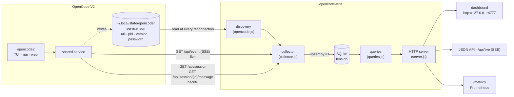
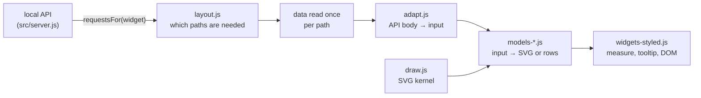

# Architecture

🌐 [Italiano](../architettura.md) · English · [Français](../fr/architettura.md)

OpenCode V2 runs a shared service in the background: the TUI, `opencode2 run` and the web client all talk to it. The lens connects to the same service as one more client, read-only towards OpenCode (it never writes anything to its service), and never sits between OpenCode and the providers.

Alongside the core run the **modules** (`modules/<id>/`, see [moduli.md](moduli.md)), all off by default. At startup `src/main.js` discovers them with `discoverModules`, the `ModuleRegistry` starts only those in `LENS_MODULES` giving each its own `ctx` (`src/module-kit.js`: narrow views of collector, store and log, never the whole object), and the server mounts the routes, static files (`/modules/<id>/<file>`) and metric families of the active modules after the core's. The core never imports a module's code.

## 1. Discovery

The lens reads `~/.local/state/opencode/service.json` (or `$XDG_STATE_HOME/opencode/service.json`, the same path used by `@opencode-ai/client`), which holds url, pid, version and password. It rereads it at every reconnection, because port and password can change when the service restarts; a `401` clears the endpoint and forces a new discovery.

Authentication is Basic, user `opencode`. The health state comes from `/api/health` (the documentation mentions `/api/info`, which answers 404 in the beta: the lens tries both).

With `OPENCODE_SERVER_URL` (and `OPENCODE_SERVER_PASSWORD`) discovery is skipped and the lens uses that server, for example an `opencode2 serve` or a `--standalone`. See [configurazione.md](configurazione.md).

## 2. Live: `/api/event`

The collector listens on `GET /api/event` and writes what arrives right away:

| Event | Use |
|---|---|
| `session.step.started` | model, provider, variant and agent of the step; `data.started` is the request to the provider (if missing, the event time is used, without reporting a drift); if the same ID starts again before finishing, it is a new attempt (it resets first output and end of the stream) |
| `session.text.started`, `session.reasoning.started` (and `session.tool.input.started`) | first output of the step's last attempt |
| `session.step.streamed` | end of the provider's stream (not the first token: it arrives when the model has finished answering) |
| `session.step.ended` | tokens, cost and outcome (`finish`) |
| `session.step.failed` | step error |
| `session.retry.scheduled` | retry, saved among the signals |
| `session.tool.input.started`, `session.tool.called`, `session.tool.success`, `session.tool.failed` | lifecycle of tool calls |
| `session.usage.updated` | session totals |
| `session.created`, `session.renamed`, `session.deleted` | session registry (project, folder, parent session, title) |
| `session.execution.interrupted` | signal with the reason (`user`, `superseded`, `inactivity`, `shutdown`), applied to the run whose `idle` has the same id as the event (`evt_…` → `msg_…`) |
| `session.usage.recorded` | signal with `source`; with `source: "title"` also an exact internal task of type title |
| `session.compaction.started`, `.ended`, `.failed` | signals with `reason` (`auto`, `manual`) and, for `ended`, the model; `ended` and `failed` with the usage become an exact internal task of type compaction, with the id of the `compaction` message and the instant of `started`. If the lens did not see `started`, it does not guess the id: that usage is brought by reading the messages, or stays in the estimate |
| `session.execution.failed`, `session.retry.scheduled` | signals |

The stream is considered dead if nothing arrives for 60 seconds, not even a heartbeat; reconnection uses a backoff from 1 to 30 seconds.

On every event the lens checks that the fields it relies on exist (the “contract” of `OPENCODE_READER` in `collector.js`, with the readers' common rules in `src/reader.js`). If they are missing, it records an API drift: a warning in the dashboard, in `/api/status` and in `/metrics`. As the event's sample it keeps only its shape (keys and value types), never the values, which may contain prompts or tool output. A session event without `sessionID` is reported as a drift and ignored. The same contract covers the REST responses, element by element: `GET /api/session` (`id`, `cost`, `tokens`, `time.updated`) and the messages `message:assistant`, `message:compaction`, `message:user`, `message:idle` (`finish` is not required; an assistant still open or failed, with `error`, need not have `cost` and `tokens`); an element is counted once, even if it is read again. See [troubleshooting.md](troubleshooting.md).

## 3. Authoritative backfill

At connection and every 2 minutes (`LENS_SCAN_INTERVAL`) the collector goes through `GET /api/session`. Every session whose totals, timestamp or title changed since the last sync is resynchronized by reading the messages (`GET /api/session/{id}/message`), from the most recent back to the saved resume point, less a 10-minute margin (see below). The same happens, with a 1.5 s delay, when a run ends (`session.execution.*`, `session.idle`, end of compaction, rename).

Only one scan runs at a time. A full resync (`--resync`) requested while a scan is in progress starts as soon as that one ends, and only after the full reread does the lens write “resync completed”.

This way the numbers are exact even after a disconnection or if the lens was off. The assistant message is the authoritative source: its values prevail over those that came from live. A step of which only the end arrives (`step.started` lost during a disconnection or a restart) stays without a start, and therefore without a duration, until the backfill brings it.

**The reader and the resume point.** The rules by which the lens reads a source live in `src/reader.js`, a leaf module with no imports: the reader's version, the contract of the fields and the resume point (watermark). OpenCode uses them with `OPENCODE_READER` (`collector.js`), IBM Bob with its module's reader (`ctx.readers`, `modules/bob/server/source.js`); the I/O stays with each source. The version is stored in the meta (`opencode_reader`; for Bob the module's meta, `module:bob:data:…`): a reader with a different version marks everything to be reread. For OpenCode the version is 1, also assumed when the meta is missing, so the update rereads nothing. A session's resume point (`sessions.msg_watermark`) is the end of the newest finished assistant message or, if it is older, the start (`time.created`) of the oldest message still open: an assistant without `time.completed` or a compaction with `status: "running"`. The next sync therefore rereads the session back to that message (less the 10-minute margin) and finds it finished: a long step, open when the sync read it, is no longer lost. That is why the resume point can also go down. A message open for more than 24 hours is an orphan (for example after an OpenCode crash) and does not hold the resume point. The rule rests on two properties verified on OpenCode 2.0.26: the message list is ordered by `time.created` and a finished message no longer changes; an integration test checks them. Bob uses the same reader with a 60-second margin and without the floor of open messages: its messages have no “open” state (see `bob-probe --checks` in [configurazione.md](configurazione.md#ibm-bob)).

For each session the sync:

1. takes a snapshot of the totals **before** reading the messages;
2. writes steps, tools and prompts in blocks of 500 messages, one transaction per block, as the pages arrive: a very long session does not stall the lens for hundreds of milliseconds. Runs, reconciliation and resume point are in the last transaction, so a sync interrupted halfway leaves the blocks already written (idempotent upserts) and the next sync rereads everything;
3. writes the exact compactions from the `compaction` messages that have model and usage;
4. compares the snapshot with *Σ steps + Σ internal tasks already recorded*. A positive delta is work OpenCode did without a visible step and without an exact row (title seen while the lens was off, old versions) and becomes an **estimated internal task** (“other”, `kind` NULL); a negative delta is transient (a live step or title that arrived before OpenCode updated the totals) and is ignored until the next sync, column by column: the positive columns of the same row are still recorded.

An exact row (title or compaction) that arrives **after** an estimate that already contained it, for example in the full reread of the migration, absorbs it. It is subtracted from the session's estimates recorded after the usage, preferably from a single one that covers it all, otherwise column by column from the oldest, never below zero; an estimate left at zero is deleted. This way internal tasks are never counted twice and Σ steps + Σ internal tasks stays equal to OpenCode's totals.

## 3b. Prompts, runs and tool details

The same sync reads from the messages:

- the **prompts** (`user` messages): only length and number of attachments;
- the **runs**: from the first prompt after the previous run to the `idle` message that closes it, with its `outcome`; prompts sent while the run is in progress stay in the same run. If the incremental sync stopped at the watermark before rereading the start of the run (a long run, over several pages of messages), the start comes from the database: the session's first prompt or step after the previous run. For messages in the format from before mid-October 2026 (no `idle`, no `time.streamed`, user without `metadata`/`files`/`agents`) the run is inferred from prompt to prompt;
- for each tool call: the session of the launched subagent (`metadata.sessionId` of the `task`/`subagent` tools), the bytes of text returned, whether the provider executed it (`executed`) and whether the shell command was a successful `git commit`.

Live, the **permissions** also arrive (`permission.asked`, `permission.replied`), which OpenCode does not keep once answered, and the prompt delivery mode (`session.inbox.enqueued`).

When the database schema changes (today it is version 6: `SCHEMA_VERSION` in `src/schema.js`, stored in `PRAGMA user_version`), the lens migrates at startup in a transaction. A database older than v5 (`REREAD_BELOW` in `schema.js`) also marks all sessions to be reread: the first scan rebuilds the history without losing anything. v3 removes the runs that 0.3.0 had wrongly inferred on current sessions and adds the `tools` indexes for the session detail. v4 adds to steps request, first output and end of the stream (`requested`, `first_output`, `streamed`), to runs the interruption reason (`reason`) and to internal tasks type, model and reason (`kind`, `provider`, `model`, `variant`, `reason`); the reread fills the steps' timings and the compactions from the messages, while titles and interruption reasons of the past stay unknown (OpenCode does not keep the events). v5 adds the `skill_uses` table (skill usage, see “Skill usage”) and the `skill_loads_since` meta; rereading all the sessions fills the history of the `skill`, `activated` and `lens-preset` channels. v6 adds `counter_offsets` (what deleted rows counted in `/metrics`, see [§4](#4-idempotency)) and `daily_steps`, `daily_tools` (the per-day sums of the steps and tools pruned by the retention): an O(1) operation, with no reread for a v5 database. The version bump also keeps an older lens out: 0.36 or earlier refuses a v6 database (it would ignore the offsets and write the pruned rows back), so after the update there is no going back without the safety copy ([aggiornamento.md](aggiornamento.md#restoring-a-safety-copy)).

## 4. Idempotency

Every write is an upsert by ID:

| Table | Key |
|---|---|
| `steps` | assistant message ID (retries reuse the same ID and increment `attempts`) |
| `tools` | `message:call` |
| `internal_usage` | estimates: `session:n`, one delta per row, numbered among themselves; title: id of the `session.usage.recorded` event; compaction: id of the `compaction` message |
| `signals` | OpenCode event ID |
| `prompts` | user message ID |
| `runs` | ID of the `idle` message that closes the run (`<prompt>:derived` for runs inferred from old sessions) |
| `permissions` | permission request ID |
| `sessions` | session ID |
| `skill_uses` | `message:call` (`skill` tool), `message:call:i` (the preset row of an `execute`), `message` (`skill` message), `message:skill:<id>` (`skills[]` of the user message), `mcp:<uuid>` (MCP delivery) and `mcp:<uuid>:<skill>` (one delivered skill); the collector's rows with the upsert that only fills missing fields (`COALESCE`), the MCP's with `INSERT … ON CONFLICT DO NOTHING` |

Live and backfill can overlap, and a full resync can go over everything again, without counting twice. In addition the collector discards events with an id already seen (the last 10,000), so an event repeated by the stream does not appear twice even in the live feed; duplicates are counted in `opencode_lens_duplicate_events_total`. Apart from internal task estimates already absorbed, which do not change the counters, rows are deleted only through `Store.deleteCompensated` ([Who touches the database](#who-touches-the-database)), today only by the optional retention of steps and tools ([Detail retention](configurazione.md#detail-retention)): what the deleted rows counted stays in `counter_offsets`, so the `/metrics` counters do not go down. When they can still go down is in [metriche.md](metriche.md#counters-that-do-not-go-down).

`npm run verify` (`scripts/verify.mjs`) checks that, for each session, *Σ steps + Σ internal tasks* matches the cost and tokens reported by OpenCode and that the number of steps matches the assistant messages. Run it with sessions idle: a running step shows up as misaligned.

With the retention on (`LENS_RETENTION_DAYS`) the steps and tools of a pruned day are first summed into `daily_steps` and `daily_tools` (by local day, session, provider, model, variant and agent; tools by name), in the same transaction as the deletion. The `retention_until` meta says how far pruning went: the Store does not rewrite older steps and tools (`stepFromMessage`, `tool`), so a resync neither brings them back nor counts them twice; `retention_from` is the start of the oldest pruned row, where “All” starts. `reconcileInternal` and `npm run verify` add `daily_steps` to the steps: *Σ steps + Σ pruned steps + Σ internal tasks* stays equal to OpenCode's totals.

### Skill usage

The `skill_uses` table counts how many times OpenCode loads a skill or a preset. It has four channels, and every load is written from **one** place only, so it is not counted twice:

| Channel | Who writes it | What is read (and nothing else) |
|---|---|---|
| `skill`: the native `skill` tool | the collector, from the message parts | `state.input.id` (or `state.input.name`, the old form); `state.metadata.directory` (or `dir`, the old form) only to derive `origin` (`lens` if it is under the lens's `skills/` folder, otherwise `native`) and the version, never saved as a path |
| `activated`: a skill activated by the user | the collector, from the backfill | the `skill` field of the `type: "skill"` message and `skills[].id` of the user message, never `text` |
| `lens-preset`: the `preset` tool | the preset row, the collector (`lens_preset` part, or `execute` with `toolCalls[]` of `lens.preset`); the per-skill rows, the MCP | `state.input.name` of the `lens_preset` part; `input.name` and `status` of the `lens.preset` toolCalls only |
| `lens-prompt`: the `/lens:<id>` command | the MCP (`prompts/get`): preset row and per-skill rows | preset id and delivered skills (with `full` and `version`); the session when the client sends `_meta["ai.opencode/sessionID"]` |

The collector writes no per-skill rows for `lens-preset`: it does not know which skills the MCP actually delivered (whole, cut, omitted), and resolving them against today's presets would rewrite history. So per-skill counts inside presets start on the day of the update (the `skill_loads_since` meta), while `skill`, `activated` and the preset row have the whole history thanks to the reread. A `skill` part still streaming (`input` is partial text) is skipped; a finished one with neither `id` nor `name` leaves no rows and records an API drift; one without `time` takes its message's time (`completed`, else `created`) and, if that is missing too, leaves no rows, since an empty time would make the read of the whole session fail; a `lens.preset` toolCall still `running` inside a finished `execute` does not count. A load is a `completed` row only, everywhere (page, `last`, metrics): `error` counts as an error; `session.skill.activated` is in the event contract. Native loads (`origin: native`) are saved and reach `/metrics`, but do not enter the Skill page. Rows are never deleted; the preset is saved by **id**: see [Skill usage](metriche.md#skill-usage). The `mcp:<uuid>` rows are written by the Skill module's `POST /api/skill-loads` route through `ctx.skillLoads.record`: with Skill off it answers 404 and the MCP does not count the delivery, while the collector's rows keep coming.

## 5. The dashboard: styles, models and adapters

The page is made of ES modules without a build. Three layers, from data to drawing:

- **Styles.** Every widget type with several models has in `STYLE_SETS` (layout.js) the list of styles it admits: the model ids (`G1`, `B3`, `T5`…) and, where it exists, the classic rendering (`classic`, `columns`/`line`, `semi`/`ring`). The layout validation uses the same list, so server and page agree on what is allowed. A widget without `style` uses the first of the list. The table settings (`cols`, `kinds`) are of a “set” setting type: an array without duplicates of allowed values.
- **Requests.** `requestsFor(widget, filters, now)` returns the paths a widget needs **according to its style** (for example B8 and C21 also ask for the `/api/breakdown` of the previous period, of equal length; C1 `/api/daily?days=31`). The page reads them only once per path, even if several widgets share them, and only for the visible view.
- **Adapters** (`adapt.js`). Pure functions, API body → model input. They touch neither the DOM nor the network; the color of a series (the slot) is passed by the caller, because it depends on the models present on the page.
- **Models.** A pure function `draw(input, { w, h, uid, label })` for the charts (SVG string, or `{ empty: "reason" }`) and `build(input, cfg, { rows, … })` for the tables (a description of rows). Each model declares `name`, the minimum size `min` and `compactBelow`: the width below which it switches to a reduced form, or `null` if it only scales. Tables have no `min`: their height is decided by the number of rows, derived from the widget's height (`runsPage`).
- **Drawing kernel** (`draw.js`). `esc()` for every text that ends up in an SVG string; `gid(box, name)` for the ids of gradients and filters, prefixed with the widget id, so two cards with the same style do not steal each other's gradients; `svgDoc()` for the wrapper with `viewBox` = the card's real size in px, so no zoom: texts and strokes stay in fixed px.
- **Widgets with styles** (`widgets-styled.js`). `styled(type, classic)` mounts the header (title, and the style id when it should be shown), a `<figure>` and, for prompts, the pager. At every refresh it adapts the data, measures the figure and redraws: a model's SVG string goes in with `innerHTML`, and therefore models never write a `style` attribute (the CSP blocks it) nor unescaped text. Tooltips are a single delegated listener on the elements with `data-tip`. If the type has a classic render and the style is `classic`, the widget is the usual one.
- **Tables.** `models-tables.js` produces descriptions (`table`, `cards`, `log`, `pareto`, cells with pills, bars, heat, sparklines); `widgets-tables.js` mounts them with `el()`, the text only via `textContent` and the bar shares via the CSSOM (`style.setProperty`), never in a `style` attribute in the markup. The settings (`cols`, `density`, `only`, `kinds`, `time`, `session`) apply on top of the family's starting values (`TABLE_DEFAULTS`); an empty list counts as the starting values.
- **Gallery.** `derive.js` generates a card for every (type, style) pair of `STYLE_SETS`, with the settings of the corresponding widget in the default layouts and the style's default size (`STYLE_SIZES`, `sizeOf`), and the page mounts them with the same `styled()` and the same adapters as the views: what you see in the Gallery is exactly what you would get by choosing the style.

The model modules are pure and also run in Node: `test/models-*.test.js` tests them, with the help of `test/models-helpers.js`, on fake data, empty data and a single point, at three sizes (220×150, 480×240, 1100×300), with two instances: no exception, no `NaN`, no `style` attribute, hostile text escaped, every color token defined in `style.css`, text bodies between 10 and 12 px and at most one big digit, gradient ids always prefixed by the instance.

**Pages and page kit.** `public/app.js` is only router and wiring: it keeps the shared `state` and the preferences, creates the `app` object and passes it to the factories of the dashboard modules (`createGrid`, `createLive`, `createGallery`, `createStatus`, `createShell`, `createSettingsPage`, `createNovitaPage`), mounts the pages with the director and shows them at every `hashchange`. The wiring is by injection: the modules do not import `app.js` nor each other, and use `app` only inside the functions they return. What the pages have in common is in the page kit, in two files:

- **`public/kit.js`**, pure and tested in Node: the clock, the timers, the storage and the tab's visibility come from outside.
  - `createPrefs`: the browser's preferences under `lens:`, as JSON (`get`, `set`) or raw text (`text`, `setText`, `remove`); `localStorage` is looked up at every call, inside try/catch, and without storage reads give the fallback. `createChoice`: a persisted, normalized choice, like the periods of Vibe Coding, Security, Skill and Bob.
  - `createSaveGate`: the `pendingSaves` and `seq` counters on the page's state, so that a read started before a save does not rewrite the document on screen (`canApply`; Vibe Coding projects and Skill presets).
  - `createRedraw`: the redraws of the Vibe Coding and Skill boards, put off while a menu is open, a name is being edited or a drag is under way; `flush` draws the last one asked for, once. `askFocus(value, ttl)` says what to focus again after the redraw, for a limited time.
  - `createDirector`: the pages of the sidebar, one at a time. A page is `{ id, refreshMs, quiet, setup, show, refresh, hide }`: `setup` runs once and binds the controls without reading; `show` reads and draws when the page opens; `refresh` is the poll; `hide` runs when the page is left (no page uses it today). The poll is armed only for the visible page, after its `show`, stops while the tab is in the background and is cancelled when the page changes. The pages must be exactly those of `PAGES` (`derive.js`), otherwise loading fails.
  - `pageError`: the banner's “Cannot read …” line, for a failed page read or poll (`quiet` pages, like System, show the error themselves).
- **`public/kit-dom.js`**: `bindRadio`, the `.seg` button groups (click, ←/→ arrows, roving tabIndex), with the options that keep the three behaviours of before: the Analysis filters press the button, the pages' periods choose, Bob's two groups answer only to clicks.

On load the dashboard modules do no work: DOM, `matchMedia`, `localStorage`, timers and observers live inside the factories or in `setup`, so they also import in Node without a DOM (`test/kit.test.js`). The `lens:*` keys are the same as always, in the same format, and `localStorage` appears only in `kit.js` and in a few motivated entries (a ratchet test: the list can only get shorter). The files all stay in `public/`, without subfolders, because the server serves only flat static files. The same holds for modules: the files of `modules/<id>/public/` are served at `/modules/<id>/<file>`, only if the module is active (see [moduli.md](moduli.md)).

## 6. Language and format

Italian is the base language: in the code the Italian text is also the catalog key, `t("Adesso")`. `public/i18n.js` (pure, shared by browser, server and tests) offers `t`, `tn` (plurals), `tc` (the same text with different meanings), `N_` (marks a text to translate later) and `Localized` (an error whose text is translated when it is shown). The catalogs are `public/lang-en.js` and `public/lang-fr.js`; a missing entry shows the Italian text.

- **Browser.** `public/boot.js` is the entrypoint: it reads `/api/lang` (the `LENS_LANG` and `LENS_LOCALE` choices from Settings), resolves `auto` with `navigator.languages`, loads the catalog, rebuilds the formatters of `ui.js` and translates the static text of `index.html` (`data-i18n*` attributes), then imports `app.js`. An unsupported language becomes English.
- **Server.** Every request carries the language and format chosen by the page in `X-Lens-Lang` and `X-Lens-Locale`; `src/i18n-request.js` keeps them in a per-request context (`AsyncLocalStorage`), so the texts meant for people (errors, descriptions, status) come out in the right language. Without the headers they stay in Italian. Logs, `/metrics` and the output of the MCP tool stay in Italian.
- **What's new.** `readChangelog(lang)` reads `CHANGELOG.en.md` or `CHANGELOG.fr.md`; a version not translated yet shows the Italian entry.
- **Checks.** `test/i18n-catalog.test.js` verifies that every text in the code has its translation, with no orphan entries, with the same placeholders and the same HTML tags, and that the glossary words stay in English. See [traduzioni.md](traduzioni.md).

## Who touches the database

The lens's database has a single owner: `src/store.js`, with `src/schema.js`. `schema.js` says *what* is there: tables, indexes, version, columns and indexes added by migrations, expressions the indexes are on. `store.js` says *how*: it opens the file, applies the schema, runs the migrations and every write. The other modules go through the `Store`'s methods: counts, database information, reads for OTLP traces, Bob's statements.

- **Declared readers.** `src/queries.js` reads on the Store's connection (`store.db`), read-only; `src/module-kit.js` is the second, the modules' reader (`ctx.reader`, see [moduli.md](moduli.md)). Their SQL contains no `INSERT`, `UPDATE … SET`, `DELETE`, `REPLACE`, `ALTER`, `CREATE` or `DROP`, and the same goes for the modules' Node side (`modules/<id>/server/`), which touches the database only through `ctx.reader`. They take the time expressions from `schema.js`, so a query does not drift away from its index.
- **Allowed separate connections.** `modules/bob/server/bobdb.js` opens IBM Bob's `bob.db` read-only (it does not receive `ctx`; with the probe `modules/bob/scripts/bob-probe.mjs` it is the only file in `modules/` allowed `new DatabaseSync(` and `.prepare(`, with the reason “only bob.db, read-only”). The lens's `bob_*` tables are written by the module with `ctx.writer`. `src/source-views.js` opens a second read-only connection to the lens's database, with TEMP views for a source's “Only” and “+” (see [moduli.md](moduli.md)). In “Only” `daily_steps` and `daily_tools` are empty views and `meta` is a view without `retention_from`: OpenCode's pruned days do not enter the source's numbers. A new read of `Queries` on a lens table must be added the same way. `scripts/verify.mjs` opens the database read-only: the Store would run migrations on the real database.
- **Deletions.** Rows leave the database only through `Store.deleteCompensated(snapshot, remove, margins)`, with all three arguments required. The DELETEs live in the body of `#prepareDeletes()` (steps and tools by time interval; today only the retention uses them, with `pruneSlice`), which is reachable only from there. In the same transaction the helper takes `Queries.counterSnapshot()` before and after the deletion (the caller passes snapshot and margins, because the Store cannot import `queries.js`) and writes into `counter_offsets` what each counter and summary series lost. Two DELETEs with a reason stay outside the helper: the one of the v3 migration of the wrongly derived runs (only on databases older than v3, where the snapshot cannot be taken) and `internalDelete`, which only removes an estimate already absorbed to zero by an exact row in the same transaction and does not change the counters. A future migration that deletes rows must run after startup, with the snapshot, not inside `#migrate()`.
- **The MCP process** (`opencode-lens mcp`) does not open the database and does not load `node:sqlite`: it is a client of the HTTP API.
- **The macOS app** (`extras/macos/`, [app-macos.md](app-macos.md)) does not open the database: it is an HTTP client of the lens on loopback.

Three tests hold these rules in place:

- `test/db-owner.test.js`: `.prepare(`, `store.db`, `new DatabaseSync(` and `db.exec(` appear only in the allowed files, each with its reason. An entry that is no longer needed fails the test, so the lists can only get shorter. The test also walks `modules/<id>/server/**`, but no file in `modules/` is allowed for `.prepare(` and `store.db` (R1 and R2); the only exceptions, for R1, R3 and R4, are `modules/bob/server/bobdb.js` and `modules/bob/scripts/bob-probe.mjs`, which open `bob.db` read-only. The declared readers (`queries.js`, `module-kit.js`) and the modules' Node side do not write (R5), except the writer check in `module-kit.js` and the `server/writes.js` of a module with `tables.js` (its SQL for `ctx.writer`). Rule R6 of the same test: `DELETE FROM`, `INSERT OR REPLACE`, `REPLACE INTO` and `DROP TABLE` (in any case) appear only in `src/store.js`, inside `#prepareDeletes()` (recognised by position, not by text) or as a whole line of the list with reasons, once each; `#prepareDeletes()` is called only from `deleteCompensated()`. It is a textual check: it does not see SQL built in pieces.
- `test/query-plans.test.js`: in every method of `Queries` (Bob's reads, `modules/bob/server/queries.js`, are checked the same way by the module's own test), a read that filters on an indexed expression uses that index (`EXPLAIN QUERY PLAN`: `SEARCH … USING INDEX`, never a `SCAN` of the table). The expressions are read from the indexes on `COALESCE(...)` in `sqlite_master`, not from the code. Each method has a minimum of recognised reads, and a new method must be checked or excluded with a reason.
- `test/import-cycles.test.js`: no cycle of static imports in `src/` and `scripts/`; in `public/` only the known cycle (`layout.js` ↔ `migrate.js`): the dashboard modules get `app` by injection and add none. The leaves (`log.js`, `period.js`, `reader.js`, `schema.js`, `url.js`, `version.js` and, of the MCP, `mcp/errors.js`, `mcp/text.js`, `mcp/instructions.js`) import no other module of the lens. The MCP process does not load `store.js`, `queries.js`, `otlp.js`, `collector.js`, `server.js` or `node:sqlite`, neither from the facade `src/mcp.js` nor from each module of `src/mcp/` taken on its own; no module of `src/mcp/` imports the facade.

## Components

| File | Role |
|---|---|
| `src/main.js` | entrypoint: Node version check, `--help`, `--check`, `--resync`, orderly start and shutdown |
| `src/config.js` | environment variables, default paths, `LENS_TOKEN` required outside localhost |
| `src/opencode.js` | service client: discovery, Basic auth, cursor pagination, SSE parser of `/api/event` |
| `src/collector.js` | connection loop, live event handling, API contract (`OPENCODE_READER`, with `src/reader.js`), scan and per-session sync, which starts again from the resume point ([§3](#3-authoritative-backfill)) |
| `src/reader.js` | the readers' protocol, a leaf with no imports: `defineReader` (name, version stored in the meta `<name>_reader`, version assumed without the meta, margin, maximum age of an open message, contract), `adoptReader` (a different version marks everything to be reread), `contractMisses` (the contract fields that are missing: a drift) and `Watermark` (where to read from, where to stop and the resume point, with the floor of open messages). `collector.js` uses it with `OPENCODE_READER`, IBM Bob with its module's reader (`ctx.readers`, `modules/bob/server/source.js`); the I/O stays with each source |
| `src/store.js` | the owner of the database ([Who touches the database](#who-touches-the-database)): opens SQLite (WAL), applies the schema from `schema.js` and runs the migrations, idempotent upserts, reconciliation of internal tasks. Exposes the reads other modules need: counts (`counts`), database information (`databaseInfo`), runs, steps, tools and lineage for OTLP traces; the modules' tables (`moduleTables` in the constructor: `applyModuleTables` creates them after the core's migration, errors in `moduleTableErrors`) and `changed`, where `ctx.live` starts; the only way to delete rows (`deleteCompensated`, with `counter_offsets`), the pruning of one day (`pruneSlice`, with the rollup into `daily_steps`/`daily_tools` and the `retention_until` guard of `stepFromMessage` and `tool`), `writeStamp` (changes at every write, also by another process) |
| `src/schema.js` | what the database is, with no imports: DDL of every core table and index, `SCHEMA_VERSION`, `REREAD_BELOW` (an older database rereads its sessions), columns and indexes added by migrations; the key expressions, which have an index or are used by several modules (`STEP_TS`, `TOOL_TS`, `PERMISSION_TS`, `STEP_START`, `MODEL_KEY`), with the builders for a table under an alias (`stepTs`, `toolTs`, `stepStart`); the columns of each table (`TABLE_COLUMNS`, for the sources' views and for `ctx.sql.COLUMNS`) and OpenCode's tables (`OPENCODE_TABLES`) |
| `src/queries.js` | declared reader, read-only on the Store's connection; aggregations for the dashboard: summary, time series, breakdown, tools, sessions, `/metrics`; for `/metrics` it adds `counter_offsets` to the series (`families`), gives the value of each series before and after a deletion (`counterSnapshot`) and the rounding margins of the REAL series (`counterMargins`); the summary counts the pruned days; sessions and runs also by key (keyset, `cursor`) |
| `src/retention.js` | the optional retention (`LENS_RETENTION_DAYS`): 60 s after startup and then every 6 h it prunes the days older than the limit (from local midnight), one day per transaction with `Store.pruneSlice`, leaving the event loop free between one day and the next; once per run it computes the rounding margins of the REAL series (`Queries.counterMarginsAsync`, in blocks of 10,000 rows) and computes them again if someone else wrote in the meantime. See [Detail retention](configurazione.md#detail-retention) |
| `src/server.js` | HTTP server: static dashboard, JSON API, `/api/live` (SSE), `/metrics`, checks on Host, method and token; the only writes are `POST /api/settings`, `POST /api/dashboard`, `POST /api/presets` and the update (`POST /api/update`, `POST /api/update/apply`) with the macOS app (`POST /api/macos-app/install`), loopback only (with the same Origin and token rules as the other writes); the `POST`s of active modules (today `POST /api/vibe-projects`, `POST /api/skills`, `POST /api/skills/<id>`, `POST /api/skill-presets`, `POST /api/skill-loads`) go through `writeRefusal` and the body limit the module declares, and a module route answers with an object (200) or a `Reply` (`ctx.reply`); a `POST` may have a raw body (`body: { type: "raw", types, max }`, content-types compared case-insensitively: 415 if different, 413 with `connection: close` if too large) or a prefix (`POST /api/x/*`, with `rest` as for the `GET`s), and a `POST` on an `/api` path of an off module, or that nobody serves, answers 404 (core paths stay 405) |
| `src/core-paths.js` | the `/api` paths the core serves (`CORE_PATHS`: `exact`, `prefixes`, `writes`), with no imports: the module registry drops a module's route that touches one, with any method. `test/core-paths.test.js` compares it with `src/server.js` |
| `src/modules.js` | the module registry: `discoverModules` reads `modules/<id>/module.js` and judges its manifest; `ModuleRegistry` starts only the modules in `LENS_MODULES` (`create(ctx)`, `start()`), stops them, collects routes, metric families and catalogs, and works out the notices after an upgrade (`hasData`). A module that does not load or start goes to `error`; the lens and the others carry on. The core never imports a module's code by name For every module found, on or off, it calls `configure(ctx)` (the variables the manifest declares in `settings`, with a restricted `ctx.env` and `ctx.paths`; the result becomes `ctx.settings`) and puts the one with invalid settings in `error`; `files()` also accepts `kind: "read"` (absolute paths only read). For every module it also asks for `tables()` (its `tables.js`, checked by `module-tables.js`, before the Store), gives an async `start()` 10 seconds, tells `unconfigured` from `error` and collects `status()` and `state()` (`statuses()`, `states()`). A module's `POST`s may have a raw body or a prefix; `files()` also accepts `kind: "dir"` and drops what equals `CORE_FILES` or `CORE_DIRS`; and the manifest's MCP fields are validated with `src/module-mcp-fields.js`. |
| `src/module-kit.js` | `moduleContext`: the frozen `ctx` a module gets in `create`, `hasData` and `files` (narrow views of collector, store and log, `meta` with the `module:<id>:` prefix); it is the only door on the Node side. For the database it gives `reader`, a declared reader: only `SELECT` and `WITH`, judged with `EXPLAIN` before it runs and then run under `PRAGMA query_only`, with the text cache capped at 256; with `sql`, `time`, `tokensOf`, `budgets.month`, `range`, `i18n`, `jsonStore` and `reply` a module imports nothing from the core. See [moduli.md](moduli.md) `settingsContext` builds the `ctx` of `configure` (`env` restricted to the module's variables plus `HOME` and `XDG_*`, `paths`, `i18n`). It also gives `writer` (only with `tables`: `statement` and `tx`, with the `EXPLAIN` check), `readers`, `live` and `sql.COLUMNS`. It also gives `zip` (zip reading and the extraction plan), `skillLoads` (`record(payload) → { rows }`, the MCP's deliveries into `skill_uses`) and `paths.dataDir`. It also gives `prices` (the `LENS_MODEL_PRICES` list). |
| `src/module-html.js` | `injectModules`: puts the menu entries, markup and stylesheet of the active modules into `public/index.html`, and nothing when none is active |
| `src/module-tables.js` | `checkModuleTables` judges a module's `tables.js` (closed list of statements, refused words, a check on an in-memory database) and `applyModuleTables` runs it for the Store, one `SAVEPOINT` per module; see [moduli.md](moduli.md#a-modules-tables) |
| `src/sql-text.js` | the SQL literal and comment scanner (`sqlStatements`), used by the tables check, `ctx.reader`, `ctx.writer` and a source's `select`s |
| `src/source-views.js` | the modules' alternative sources: checks the `select`s of `source()`, opens the two read-only connections with the TEMP views of “Only” and “+” and tries them one by one |
| `public/module-kit.js`, `public/module-list.js`, `public/settings-modules.js` | `/module-kit.js`, the only door on the browser side (`t`, `el`, `get`, `table`…); reading the list of active modules; the Modules section of Settings and the notice for off modules that have data |
| `src/mcp.js` | the facade of `opencode-lens mcp`: re-exports from the modules of `src/mcp/` 21 names, for `main.js` (`mcp`, `mcp install`) and for the tests |
| `src/mcp/` | `opencode-lens mcp`: MCP server on stdio for OpenCode, hand-written JSON-RPC protocol (revisions 2025-11-25 and 2026-07-28), tools `budget`, `errors`, `usage`, `sessions`, `security` and `preset` (the last two belong to the Security and Skill modules and exist with the module on), plus the prompts of the modules with `mcpPrompts` (with Skill, one for each skill preset: `prompts/list`, `prompts/get`), the modules' lines in the instructions (with Skill, the list of presets at the end) and `notifications/prompts/list_changed` when they change (checked every 30 s). It is a separate process and a client of the HTTP API: it does not open the database (the `Store` runs migrations) and writes only JSON-RPC frames to stdout. It is not read-only: after a successful `prompts/get` or `tools/call preset` it sends `POST /api/skill-loads` on the loopback (preset id and delivered skills, never texts); with a lens that is off, old (404) or slow the delivery still reaches the model and the count is silently lost. Port and token from the plist, with the `plutil` of `settings.js`; the session summary pages through `/api/sessions` with the cursor (`x-next-cursor`) and falls back to `offset` with a lens that does not send it. The modules: `run.js` (startup and `mcp install`), `protocol.js` (JSON-RPC, pure: a message in, the response out), `stdio.js` (line transport on stdin and stdout), `client.js` (HTTP client of the lens), `config.js` (port, token, plist and install line), `tools.js` (the tools), `periods.js` (their periods), `prompts.js` (the aggregator of the modules' prompts, with the watch for changes and the asynchronous lines of the instructions) and three leaves: `errors.js` (the error classes, only once, so `instanceof` holds across modules), `text.js` (numbers, dates and text cleaned for the model), `instructions.js`. The server (`main.js`) and `mcp-status.js` load only `config.js` |
| `src/mcp/modules.js`, `src/mcp/module-kit.js` | the modules' MCP tools. `modules.js` reads the manifests of `modules/<id>/module.js` (not the core's registry, which loads `node:sqlite`), asks `GET /api/modules` which modules are on (at startup and every 30 seconds), loads `tools(kit)` from `modules/<id>/mcp/` and lists only the tools of the modules that are on, keeping the last known state if the lens does not answer. A tool of an off module answers that the module is off; when the list changes it sends `notifications/tools/list_changed` (OpenCode does not reread it: it has to be restarted). `module-kit.js` builds the frozen `kit` the tools receive. For modules with `mcpPrompts` it also loads `prompts(kit)` (`PromptSource`) and keeps the set for `src/mcp/prompts.js`; the texts for an off, in-error or unconfigured module are three, the same for tools and prompts, and the manifest's MCP fields go through `src/module-mcp-fields.js` |
| `src/log.js` | logging to stdout/stderr with a level (`LENS_LOG_LEVEL`) |
| `src/version.js` | the lens's folder and version (`APP_DIR`, `VERSION` from `package.json`), with no module of the lens; it must stay in `src/`, because `APP_DIR` is the folder above the file |
| `src/url.js` | `redactUrl`: an endpoint without credentials or query string, to show or log; no imports |
| `src/period.js` | budget periods, with no imports: `periodBounds` (day from the reset hour, week, month), `MIDNIGHT`, `DAY_MS`; the MCP process and Settings use them without loading the queries |
| `src/prices.js` | the per-model price list: `parsePrice`, `formatPrice`, `baseModel` (strips `#variant`) and `priceList`, frozen, with `of(model)` and `estimate(model, kinds)` in dollars per million tokens; it is the modules' `ctx.prices` |
| `modules/sistema/server/system.js` | the System page (`/api/system`), in the System module: CPU from `os.cpus()`, memory, disk with `fs.statfs`, and on macOS `vm_stat`, `sysctl`, `pmset` and `launchctl list`; processes from `ps -o comm` (never the arguments) and ports from `lsof`, only for clients of this computer. `/api/system/live` gives CPU and memory every 2 seconds: the history of the last 4 minutes is in memory, CPU from `os.cpus()` and memory from `vm_stat` only while the page is watched. Commands with a 3 s timeout and cache (3 s `ps`, 15 s the others); a missing command gives `null` |
| `modules/security/server/audit.js` | the Security page (`/api/security`, `/api/security/<guard>`): discovers the DLP guards by file-name convention (`<name>.audit.jsonl` in OpenCode's data folder and in `security/`, then `<name>.json` and `plugins/<name>*` in the configuration folder), reads the audit line by line with limits and types (unreadable lines counted, an audit over 20 MiB read from the tail), cleans up the policy (secret keys left out, key-like strings masked), works out health and the check against the calls Lens saw, and reduces the rows for network clients. Read-only, no symbolic link followed, cached on modification date and size; it also provides the `opencode_lens_security_events` gauge. See [sicurezza.md](sicurezza.md) |
| `modules/security/server/index.js`, `modules/security/server/settings.js` | the Node side of the Security module: `create` mounts `GET /api/security` and `GET /api/security/*` and the `opencode_lens_security_events` family; `configure` works out the audit and configuration folders from `LENS_SECURITY_DIRS` and `LENS_SECURITY_CONFIG_DIR` (otherwise OpenCode's data and configuration folders); `hasData` only looks whether an audit exists and `files()` lists the folders with `kind: "read"`. Database queries go through `ctx.reader`, with `json_each` for lists |
| `modules/security/mcp/tools.js` | the `security` MCP tool (`tools(kit)`), which talks to the lens's `/api/security` and imports nothing |
| `modules/security/public/security-page.js`, `security-model.js`, `security-charts.js` | the Security page (`#security`): guard buttons, tiles, events table with detail, health and policy; the model (period, verdict, health rows, outcomes) is pure and tested in Node. Text that comes from the audit goes in only with `textContent`, colours only from CSS classes |
| `src/about.js` | version (from `version.js`), written and read paths, effective variables without secrets, database information (`store.databaseInfo()`): the Settings page (`/api/about`) |
| `src/settings.js` | editing variables from the Settings page: reading and writing the plist's `EnvironmentVariables` with `plutil`, validation with `config.js`, LaunchAgent reload (`/api/settings`); composes `LENS_MODEL_LIMITS` from the “Budget per model” card. It also composes `LENS_MODEL_PRICES` from the “Price list” card |
| `src/update.js` | update from a zip (Settings › Update): package check (one folder, required files, no `.git`, symlinks or paths that escape), version comparison and preview, extraction into `update/` next to the database; `apply` launches the zip's `install.sh` in a detached helper (like `reloadService`) with a cleaned environment, and derives the state of the last update from `update/last.json` and `last.exit` |
| `src/module-update.js` | the zip of user modules in the same field of Settings › Update (`ModuleUpdater`): recognized by its shape (at the root only `<id>/` folders with `module.js`), checked with `planEntries` and extracted with `extractPlan` of `src/update.js` into `update/upload-*`, without importing anything of the modules (the preview is static); `apply`, after the confirmation, judges each module with `checkUserModule` on the extracted copy (an error: `400` and nothing installed), then copies each module next to its place in the user modules folder, moves the old folder to `.backup/<id>-<date>/` and puts the new one in with a `rename`, then restarts the lens with `Settings.restart()` when it runs under launchd. Unsigned: the preview says so. `server.js` routes `POST /api/update` and `/api/update/apply` between this and `Updater` |
| `src/macos-app.js` | the optional macOS app (Settings › Update › macOS app): the installed app's version against the lens's, `extras/macos/app.sh check` cached for a minute, and `app.sh install` or `update` in a detached helper with `update.js`'s environment, state in `update/app.json`, `app.exit`, `app.log`; it starts only under the conditions of the zip update and never together with it. The only file of `src/` that names the app |
| `src/zip.js` | minimal zip reader for updates: central index, stored and deflate entries with a limit on the declared size and CRC check; no ZIP64 or encryption |
| `src/opencode-config.js` | models of OpenCode's global configuration (`~/.config/opencode`, JSONC), cached on the modification date: which per-model budgets are active and which historical |
| `src/presets.js` | personal presets of the dashboard layouts in `dashboard-presets.json` next to the database: validated read with `public/presets.js` (a broken file gives an empty list and a warning in the log), atomic write (`/api/presets`) |
| `modules/skill/server/library.js` | the skill library (`SkillStore`): each skill in `skills/<id>/<n>/` next to the database, one folder per version, and the `skills.json` index (id, name, description, current version, versions with date, source, files and bytes). The zip is read and its extraction planned with `ctx.zip` (the functions of `zip.js` and `update.js`) (safe names, no symlinks, extraction into a temporary folder and then `rename`, `wx` flag); import from a zip or from a lone `SKILL.md`, in three modes (`version`, `overwrite`, `new`); rollback, deletion of a version or of the skill; every version has a content `hash` (sha256 of the sorted files, bytes and modes: an import identical to the version in use creates no version and answers `unchanged`) and `mdChars` (characters of the `SKILL.md` body, for the preset weight); at startup `reconcile` drops from the index the versions without a folder, adopts the valid version folders that the index does not know (without following links), restores an interrupted overwrite, sweeps temporary leftovers and leaves an index it cannot read untouched. Limits: 100 skills, 20 versions per skill, 2000 entries per zip, 64 MiB unpacked, `SKILL.md` up to 1 MiB. Only `name`, `description` and `metadata` are read from the frontmatter; a skill is never run |
| `modules/skill/server/presets.js` | the skill presets in `skill-presets.json` next to the database, on the same `JsonStore` as `presets.js`: a broken file gives an empty list, a warning in the log and a copy `skill-presets.bad.json`; atomic write (`/api/skill-presets`) |
| `modules/vibecoding/` | the Vibe Coding module (see [moduli.md](moduli.md)). `server/vibe-queries.js` computes `/api/vibe-coding` (formerly `vibeCoding` in `queries.js`), reading the database only through `ctx.reader`; `server/projects.js` keeps the projects in `vibe-projects.json` next to the database, on `ctx.jsonStore` (the same `JsonStore` as `presets.js`: a broken file gives an empty list, a warning in the log and a copy `vibe-projects.bad.json`; atomic write) and declares `hasData` and `files`; `server/index.js` mounts `GET /api/vibe-coding`, `GET` and `POST /api/vibe-projects`. The rules (validation, moving folders, forecast and figures) are in the module's `public/vibe-projects.js`, `public/vibe-forecast.js` and `public/vibe-figures.js`, pure and shared with the server
| `modules/skill/public/preset-rules.js`, `modules/skill/public/skill-presets.js` | the rules of the skill presets, pure and shared with the server: validation (`validateSkillPresets`: id chosen by you, unique name, brief, skills), add, edit, duplicate, delete, `missingSkills` (the skills of a preset that the library no longer has), the weight (`presetWeight`, with the same 40,000-character cap as the MCP, pinned by a test) and the order (`moveSkill`, `toggleSkill`), plus `placeSkill` for drags: it adds, moves, copies, removes and reorders and returns the new document, so the old one stays for “Undo”. The rules the module's server also uses (limits, ids, validation, `missingSkills`) live in `preset-rules.js`, with no imports; `skill-presets.js` adds the edits and the weight |
| `modules/skill/public/skill-import.js`, `modules/skill/public/zip-writer.js` | importing several files and folders from the browser, without DOM: `groupItems` groups the files into skills (every folder with a `SKILL.md`), `buildSkillZip` makes a zip of one, `walkEntries` walks dropped folders; `zip-writer.js` is a pure zip writer (stored entries, CRC-32, UTF-8 names, Unix mode) read back in tests with `src/zip.js`. The upload route does not change: one request per skill |
| `modules/skill/public/skills-page.js`, `modules/skill/public/skills-hero.js`, `modules/skill/public/skills-board.js`, `modules/skill/public/skills-drawer.js`, `modules/skill/public/skill-figures.js`, `modules/skill/public/skill-presets-dialog.js` | the Skill page (`#skill`): hero with six tiles, board (Library column and one column per preset, drag and drop, keyboard menu, “Undo”), side panel of a skill and the “Import…” panel (files, folders, several items) with the three modes, the list of outcomes and the drop veil over the whole page; the presets dialog opens from “Edit” and “+ New preset”. `skill-figures.js` is pure: it computes tiles, “never used”, filters and orders. Text that comes from the data goes in only with `textContent`. From another computer the page is read-only |
| `modules/skill/` | the Skill module (see [moduli.md](moduli.md#skill)). `server/index.js` mounts `GET` and `POST` of `/api/skills`, `/api/skills/<id>`, `/api/skill-presets` and `/api/skill-loads`, and `GET /api/skill-usage` (answers, codes and texts are those of when they were the core's); `server/data.js` gives `hasData` and `files()` by only reading (never a `SkillStore` nor a `jsonStore`'s `read()`, which rewrite); `server/usage.js` computes the usage; `server/ids.js` repeats the ids of `src/skill-ids.js`; `mcp/tools.js` offers the `preset` tool and, with `mcpPrompts`, a `/lens:<id>` prompt for each preset. The MCP's deliveries enter `skill_uses` through `ctx.skillLoads` |
| `src/skill-uses.js`, `src/skill-ids.js` | stay in the core: the origin of a skill and the validation and writing of a delivery into `skill_uses` (`ctx.skillLoads`), and the ids (`SKILL_ID`, `MAX_ID`, `PRESET_ID`), because the collector writes `skill_uses` even with Skill off |
| `src/module-mcp-fields.js` | leaf with no imports: validates the manifest's MCP fields (`mcp`, `mcpTools`, `mcpInstructions`, `mcpExamples`, `mcpPrompts`) for the registry and for the MCP process |
| `src/dashboard.js` | v2 dashboard layout in `dashboard-v2.json` next to the database: validated read (if missing, it migrates the v1 `dashboard.json` in memory and never writes it), atomic write, `dashboard-v2.prev.json` copy at the first save with new styles or settings, restore that deletes only the v2 file (`/api/dashboard`) |
| `src/model-catalog.js` | models' context limits from the OpenCode service catalog (`GET /api/model`): reread at most every 10 minutes, checked with the API contract like the events; used for the context fill of the running prompt, after the limits of OpenCode's configuration |
| `src/changelog.js` | parser of `CHANGELOG.md` (hand-written or by release-please) for the What's new page (`/api/changelog`), also in English and French |
| `src/otlp.js` | optional OTLP/HTTP JSON export: metrics from the same families as `/metrics` (persistent delta state, by name and labels in canonical order; a drop sends 0), traces per run in recording order, run → step → tool, read with the Store's methods |
| `public/` | dashboard without a build or external libraries, in ES modules: `index.html`, `style.css` and the modules below |
| `public/app.js` | router and wiring of the dashboard: the shared `state` and the preferences (`createPrefs`), the `app` object passed by injection to the factories of the modules below, the Analysis filters (`bindSeg`), the source selector (`sources.js`), the director of the pages (`#adesso`, `#analisi`, `#monitor`, `#prompt`, `#sessioni`, `#galleria`, `#security`, `#skill`, `#impostazioni`, `#novita` and those of the active modules, such as `#sistema` and `#vibecoding`) with `showView` at every `hashchange`, the startup and the wiring of “Customize dashboard” and of the templates. No timers nor `localStorage`, at most 600 lines (two tests) |
| `public/sources.js` | the generic source selector (“OpenCode · + {label} · {label} only”): pure, with the `source` preference, the live kinds and the widgets' empty state |
| `public/kit.js` | the page kit, the pure side tested in Node (§5): the browser's preferences (`createPrefs`), persisted choices (`createChoice`), saves against reads (`createSaveGate`, `canApply`), the boards' put-off redraws (`createRedraw`, `askFocus`), the director of the pages (`createDirector`: `setup`, `show`, `refresh`, `hide`, poll only for the visible page), the banner's error line (`pageError`) |
| `public/kit-dom.js` | the page kit, the DOM side: `bindRadio`, the `.seg` button groups |
| `public/shell.js` | the sidebar: theme, pause and “Refresh”, “Collapse to icons”, counters, the menu of narrow screens; the titles' icons, the size of the widgets and Monitor's full screen |
| `public/shell-status.js` | the state of the lens: the badge at the foot of the sidebar, the banner, the footer, the context lines under the titles of Now, Analysis and Monitor and Monitor's clock, redrawn every 5 s |
| `public/dashboard-grid.js` | the widget grids (Now, Analysis, Monitor, the Prompts and Sessions pages, the Gallery's cards): layout and data read, mounting and updating of the widgets with their states, a `ResizeObserver` per card, the cursors of the prompts' and sessions' pages (`learnCursors`, `forgetCursors`) |
| `public/dashboard-live.js` | the live reads of the visible grid (all of it, or only what a tick touches), the feed, the `/api/live` stream with its reconnection, the pause and the timers: 60 s, return to the tab, 1 s stopwatches |
| `public/gallery-page.js` | the Gallery page: a card for every (type, style), a tab per view, search, “Only not in use”, comparison of styles, “Add to …” during “Customize dashboard” |
| `public/settings-page.js` | the Settings page: the lens's facts, files, “In the browser” (the `lens:*` keys), the MCP and Update cards (`settings-mcp.js`, `settings-update.js`); Bob's probes are in the module's panel (`modules/bob/public/settings.js`), the form of the LaunchAgent's variables and of the budgets |
| `public/settings-service.js` | the Service box of Settings › General: `serviceState` (pure) derives from `restart` in `/api/settings` whether «Restart the lens» can be pressed and why not; the click (confirmation, `POST /api/restart`, waiting for the new process) is in `settings-page.js` |
| `public/settings-macos-app.js` | the macOS app block of Settings › Update: `appCardState` (pure) derives state, button and notes from `/api/macos-app`; reads again every 2 s during a build |
| `public/novita-page.js` | the What's new page: the changelog with filters and search, what is new since the last visit, the release rhythm, the version in the sidebar with its dot |
| `public/live-refresh.js` | what a live tick reads again, pure and tested in Node: `KIND_PATHS` (kind of change → endpoints), `PATH_MIN_MS` (least interval per endpoint) and `planRead` (reads, owed reads and the next one due) |
| `public/layout.js` | model of the v2 layout (three views, each with its own grid), pure and shared with the server: type catalog, `STYLE_SETS` (the styles of each type), default layouts, validation (v1 or v2, single-value, list or free settings; result always v2, with Monitor as the start if missing), grid geometry (compaction, swap), rows per page of tables, `requestsFor` (the APIs a widget needs according to its style) |
| `public/migrate.js` | pure, deterministic migration of the v1 layout into the two views; the v1 catalog is frozen here |
| `public/registry.js` | widget type → render, for all the widget modules; types with styles go through `styled()`; a type without a render (from a newer version) stays in the layout without being drawn |
| `public/widgets.js` | classic render of the widgets (columns or line trend, summary, calendar, table, tools, sessions, gauge, feed): structure mounted once, data updated at every refresh; empty, error and loading states |
| `public/widgets-adesso.js` | the Now widgets: Today (hero), By model today, Indicators, Running prompt |
| `public/widgets-runs.js` | the prompt widgets: list, distribution and Interaction |
| `public/session-detail.js` | session detail with the timeline, shared by Sessions and by the prompt list |
| `public/draw.js` | SVG drawing kernel of the models, pure: text escaping (`esc`), per-instance unique ids (`gid`), gradients and glows, monotone curves, scales with “nice” ticks, arcs, labels without overlaps |
| `public/adapt.js` | pure adapters: from an API body (`/api/hourly`, `/api/budget`, `/api/daily`, `/api/rhythm`, `/api/runs`…) to a model's input, with the color slot passed by the caller |
| `public/models-time.js`, `models-dist.js`, `models-gauges.js`, `models-models.js`, `models-summary.js` | the catalog's SVG models (G, B, C): each one is `{ name, min, compactBelow, draw(input, box) }`, a pure function that returns an SVG string or `{ empty }`. `models-time` time (G1–G4, C2–C6), `models-dist` distributions and flows (G5–G12, C7–C13), `models-gauges` gauges, budget, indicators and state (B1–B5, B10–B12, C1, C14, C16–C20), `models-models` per model (B3, B6–B9, C8, C15, C21), `models-summary` the period summary (C22, C23, B13) |
| `public/models-tables.js`, `public/widgets-tables.js` | the table models T1–T12: `build(input, cfg, box)` returns a description of rows (`table`, `cards`, `log`, `pareto`…) and `widgets-tables.js` mounts it in the DOM, with texts only via `textContent` and shares via the CSSOM |
| `public/widgets-styled.js` | `styled(type, classic)`: chooses between the type's classic render and the style's model, feeds it with the adapter, measures the figure, attaches tooltips and rows (redrawing on resize is started by `dashboard-grid.js` with a `ResizeObserver` per card); `STYLE_NAMES` (the names come from the models) |
| `public/rhythm.js`, `public/token-units.js` | columns of the releases' rhythm in What's new; reading of “100M”, “1,5M”, “500k” (shared with `src/settings.js`) |
| `public/axis.js`, `public/derive.js` | “nice” axis ticks and data derivations for the charts, pure and tested in Node |
| `public/editor.js` | “Customize dashboard”: one session for the two views, dashed grid, drag and resize (Pointer Events), keyboard, catalog (“For this view”/“Others”), ⚙, save/cancel, restore of the visible view only |
| `public/gauge.js`, `public/curves.js` | reading of the gauges (budget and percentages) and monotone curves of the line, pure and tested in Node |
| `public/i18n.js`, `public/boot.js`, `public/lang-en.js`, `public/lang-fr.js` | language and format: `t`/`tn`/`tc`, resolution of `auto`, browser entrypoint, English and French catalogs |
| `src/i18n-request.js` | language and format of the request (`X-Lens-Lang`, `X-Lens-Locale`) in a per-request context, and loading of the catalogs in the server |
| `public/ui.js` | shared helpers: formatting by the chosen language and format, DOM construction, tooltips, API access |
| `scripts/verify.mjs` | reconciliation of the DB with OpenCode's totals, on a read-only connection, counting the pruned steps in `daily_steps` |
| `scripts/changelog.mjs` | consistency between `package.json`, `CHANGELOG.md` and tags; release notes; warning for versions not yet translated |
| `test/integration/` | tests against a real `opencode2 serve` with a fake OpenAI-compatible model |
| `extras/opencode/` | OpenCode plugin `lens-guard` (TypeScript loaded by OpenCode, no build): switches model when the provider cannot answer; it does not use the lens. See [Configuration](configurazione.md#plugin-lens-guard-switching-model-when-the-provider-does-not-answer) |
| `extras/macos/app.sh` | the optional macOS app ([app-macos.md](app-macos.md)): `build [--out DIR]`, `install`, `uninstall`, `test`, with the Command Line Tools only (`xcrun swiftc`, `iconutil`, `plutil`, `codesign`); builds on the Mac that uses it, ad-hoc signature with hardened runtime or with `LENS_APP_SIGN`, installs into `~/Applications/OpenCode Lens.app`. `install.sh` copies the sources and does not run them |
| `extras/macos/Sources/Core/` | the app's pure part, Foundation only, with its tests in `Tests/CoreTests.swift` (`app.sh test`): `LensEndpoint` (port, token, host and language from the LaunchAgent's plist; the plist's token only on its own port; non-loopback hosts refused), `NavigationPolicy` (only the lens's origin; external links in the browser only from a click), `TokenCookie` (the `lens_token` session cookie), `LoadFailure` (error page and retries), `BudgetAlerts` and `HealthTracker` (notifications and Dock badge), `LoginPlacement`, `Strings` (texts in Italian, English and French) |
| `extras/macos/Sources/App/` | the AppKit part: window with the `WKWebView` (no injected JavaScript), menus, native error page, `Poller` (`/healthz` and `/api/budget` once a minute, with the token in the header), `Notifier` (`UNUserNotificationCenter`), `LoginItem` (`SMAppService`); `Tools/MakeIcon.swift` generates the icon from the dashboard's mark |
| `src/service.js` | `opencode-lens service install\|uninstall\|start\|stop\|restart\|status`: macOS LaunchAgent `local.opencode-lens` in the user folder, stable `opt` path for Homebrew's Node, variables preserved |
| `src/upgrade.js` | started by launchd, the lens compares its version with the `package.json` of the startup path every minute and restarts when it changes (new zip extracted over the folder, or a pull in a clone) |
| `install.sh`, `uninstall.sh` | from an extracted zip: lists the previous installations (`--check` stops there), copies database and plist into `backup/`, copies the app into `~/Applications/opencode-lens`, downloads Node into `node/` if missing, `service install`, then moves the old app folder to the Trash; from a clone only backup and `service install`. `uninstall.sh` calls `service uninstall` |
