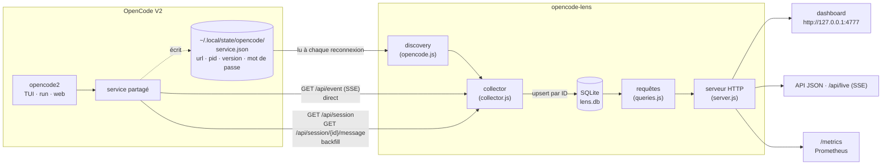
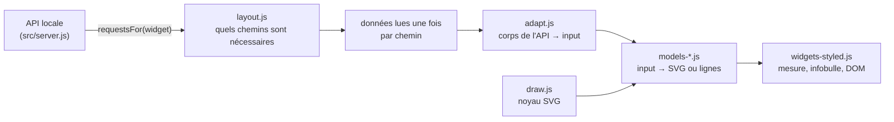

# Architecture

🌐 [Italiano](../architettura.md) · [English](../en/architettura.md) · Français

OpenCode V2 fait tourner un service partagé en arrière-plan : la TUI, `opencode2 run` et le client web parlent tous avec lui. La lens se connecte au même service comme un client de plus, en lecture seule envers OpenCode (il n'écrit jamais rien dans son service), et ne se met jamais entre OpenCode et les providers.

À côté du cœur tournent les **modules** (`modules/<id>/`, voir [moduli.md](moduli.md)), tous désactivés au départ. Au démarrage `src/main.js` les découvre avec `discoverModules`, le `ModuleRegistry` ne démarre que ceux de `LENS_MODULES` en donnant à chacun son `ctx` (`src/module-kit.js` : vues étroites de collector, store et log, jamais l'objet entier), et le serveur monte routes, fichiers statiques (`/modules/<id>/<file>`) et familles de métriques des modules actifs après celles du cœur. Le cœur n'importe jamais le code d'un module.

## 1. Discovery

La lens lit `~/.local/state/opencode/service.json` (ou `$XDG_STATE_HOME/opencode/service.json`, le même chemin que celui utilisé par `@opencode-ai/client`), qui contient url, pid, version et mot de passe. Elle le relit à chaque reconnexion, parce que le port et le mot de passe peuvent changer quand le service redémarre ; un `401` remet à zéro l'endpoint et force une nouvelle discovery.

L'authentification est Basic, utilisateur `opencode`. L'état de santé vient de `/api/health` (la documentation cite `/api/info`, qui répond 404 dans la bêta : la lens essaie les deux).

Avec `OPENCODE_SERVER_URL` (et `OPENCODE_SERVER_PASSWORD`) la discovery est sautée et la lens utilise ce serveur, par exemple un `opencode2 serve` ou un `--standalone`. Voir [configurazione.md](configurazione.md).

## 2. Direct : `/api/event`

Le collector reste à l'écoute sur `GET /api/event` et écrit tout de suite ce qui arrive :

| Événement | Usage |
|---|---|
| `session.step.started` | modèle, provider, variante et agent du step ; `data.started` est la requête au provider (s'il manque, on prend l'heure de l'événement, sans signaler de drift) ; si le même ID repart avant d'avoir fini, c'est une nouvelle tentative (remet à zéro première sortie et fin du stream) |
| `session.text.started`, `session.reasoning.started` (et `session.tool.input.started`) | première sortie de la dernière tentative du step |
| `session.step.streamed` | fin du stream du provider (pas le premier token : il arrive quand le modèle a fini de répondre) |
| `session.step.ended` | tokens, coût et résultat (`finish`) |
| `session.step.failed` | erreur du step |
| `session.retry.scheduled` | retry, enregistré parmi les signaux |
| `session.tool.input.started`, `session.tool.called`, `session.tool.success`, `session.tool.failed` | cycle de vie des appels de tools |
| `session.usage.updated` | totaux de session |
| `session.created`, `session.renamed`, `session.deleted` | registre de la session (projet, dossier, session parente, titre) |
| `session.execution.interrupted` | signal avec la raison (`user`, `superseded`, `inactivity`, `shutdown`), appliqué au run dont l'`idle` a le même id que l'événement (`evt_…` → `msg_…`) |
| `session.usage.recorded` | signal avec `source` ; avec `source: "title"` aussi une tâche interne exacte de type titre |
| `session.compaction.started`, `.ended`, `.failed` | signaux avec `reason` (`auto`, `manual`) et, pour `ended`, le modèle ; `ended` et `failed` avec la consommation deviennent une tâche interne exacte de type compaction, avec l'id du message `compaction` et l'instant de `started`. Si la lens n'a pas vu `started`, elle ne devine pas l'id : cette consommation vient de la lecture des messages, ou reste dans l'estimation |
| `session.execution.failed`, `session.retry.scheduled` | signaux |

Le stream est considéré comme mort si rien n'arrive pendant 60 secondes, pas même un heartbeat ; la reconnexion utilise un backoff de 1 à 30 secondes.

À chaque événement la lens vérifie que les champs sur lesquels elle s'appuie existent (le « contrat » de `OPENCODE_READER` dans `collector.js`, avec les règles communes des lecteurs dans `src/reader.js`). S'ils manquent, elle enregistre un drift de l'API : avertissement dans le dashboard, dans `/api/status` et dans `/metrics`. Comme échantillon de l'événement elle ne conserve que sa forme (clés et types des valeurs), jamais les valeurs, qui peuvent contenir des prompts ou des outputs de tools. Un événement de session sans `sessionID` est signalé comme drift et ignoré. Le même contrat couvre les réponses REST, élément par élément : `GET /api/session` (`id`, `cost`, `tokens`, `time.updated`) et les messages `message:assistant`, `message:compaction`, `message:user`, `message:idle` (`finish` n'est pas requis ; un assistant encore ouvert ou en échec, avec `error`, n'a pas besoin de `cost` ni `tokens`) ; un élément n'est compté qu'une fois, même relu. Voir [troubleshooting.md](troubleshooting.md).

## 3. Backfill faisant autorité

À la connexion et toutes les 2 minutes (`LENS_SCAN_INTERVAL`) le collector parcourt `GET /api/session`. Chaque session dont les totaux, l'horodatage ou le titre ont changé depuis la dernière synchro est resynchronisée en lisant les messages (`GET /api/session/{id}/message`), du plus récent jusqu'au point de reprise enregistré, moins 10 minutes de marge (voir plus bas). La même chose se produit, avec 1,5 s de retard, quand un run se termine (`session.execution.*`, `session.idle`, fin de compaction, renommage).

Un seul scan tourne à la fois. Le resync complet (`--resync`) demandé pendant qu'un scan est en cours démarre dès que celui-ci se termine, et ce n'est qu'après la relecture complète que la lens écrit « resync terminé ».

Ainsi les chiffres sont exacts même après une déconnexion ou si la lens était éteinte. Le message de l'assistant est la source faisant autorité : ses valeurs l'emportent sur celles arrivées en direct. Un step dont seule la fin arrive (`step.started` perdu pendant une déconnexion ou un redémarrage) reste sans début, donc sans durée, jusqu'à ce que le backfill l'apporte.

**Le lecteur et le point de reprise.** Les règles selon lesquelles la lens lit une source sont dans `src/reader.js`, un module feuille sans import : la version du lecteur, le contrat des champs et le point de reprise (watermark). OpenCode les utilise avec `OPENCODE_READER` (`collector.js`), IBM Bob avec le lecteur de son module (`ctx.readers`, `modules/bob/server/source.js`) ; les entrées-sorties restent propres à chaque source. La version est enregistrée dans la méta (`opencode_reader` ; pour Bob la méta du module, `module:bob:data:…`) : un lecteur d'une autre version marque tout à relire. Pour OpenCode la version est 1, supposée aussi quand la méta manque, donc la mise à jour ne relit rien. Le point de reprise d'une session (`sessions.msg_watermark`) est la fin du message assistant terminé le plus récent ou, s'il est plus ancien, le début (`time.created`) du plus ancien message encore ouvert : un assistant sans `time.completed` ou une compaction avec `status: "running"`. Le sync suivant relit donc la session jusqu'à ce message (moins les 10 minutes de marge) et le trouve terminé : un step long, ouvert quand le sync l'a lu, n'est plus perdu. C'est pourquoi le point de reprise peut aussi descendre. Un message ouvert depuis plus de 24 heures est orphelin (par exemple après un crash d'OpenCode) et ne retient pas le point de reprise. La règle repose sur deux propriétés vérifiées sur OpenCode 2.0.26 : la liste des messages est triée par `time.created` et un message terminé ne change plus ; un test d'intégration les contrôle. Bob utilise le même lecteur avec une marge de 60 secondes et sans le plancher des messages ouverts : ses messages n'ont pas d'état « ouvert » (voir `bob-probe --checks` dans [configurazione.md](configurazione.md#ibm-bob)).

Pour chaque session la synchro :

1. prend un instantané des totaux **avant** de lire les messages ;
2. écrit steps, tools et prompts par blocs de 500 messages, une transaction par bloc, à mesure que les pages arrivent : une session très longue ne bloque pas la lens pendant des centaines de millisecondes. Runs, réconciliation et point de reprise sont dans la dernière transaction, si bien qu'un sync interrompu à mi-chemin laisse les blocs déjà écrits (upserts idempotents) et le sync suivant relit tout ;
3. écrit les compactions exactes à partir des messages `compaction` qui ont modèle et consommation ;
4. compare l'instantané avec *Σ steps + Σ tâches internes déjà enregistrées*. Un delta positif est du travail fait par OpenCode sans step visible et sans ligne exacte (titre vu pendant que la lens était éteinte, anciennes versions) et devient une **tâche interne estimée** (« autre », `kind` NULL) ; un delta négatif est transitoire (un step ou un titre en direct arrivés avant qu'OpenCode ait mis à jour les totaux) et est ignoré jusqu'à la synchro suivante, colonne par colonne : les colonnes positives de la même ligne sont quand même enregistrées.

Une ligne exacte (titre ou compaction) qui arrive **après** une estimation qui la contenait déjà, par exemple dans la relecture complète de la migration, l'absorbe. On la retranche des estimations de la session enregistrées après la consommation, de préférence d'une seule qui la couvre entièrement, sinon colonne par colonne en partant de la plus ancienne, jamais en dessous de zéro ; une estimation restée à zéro est supprimée. Ainsi les tâches internes ne sont jamais comptées deux fois et Σ steps + Σ tâches internes reste égal aux totaux d'OpenCode.

## 3b. Prompts, runs et détails des tools

La même synchro lit dans les messages :

- les **prompts** (messages `user`) : seulement la longueur et le nombre de pièces jointes ;
- les **runs** : du premier prompt après le run précédent au message `idle` qui le ferme, avec son `outcome` ; les prompts envoyés pendant que le run est en cours restent dans le même run. Si la synchro incrémentale s'est arrêtée au watermark avant de relire le début du run (un run long, sur plusieurs pages de messages), le début vient de la base : le premier prompt ou step de la session après le run précédent. Pour les messages au format d'avant la mi-octobre 2026 (pas de `idle`, pas de `time.streamed`, utilisateur sans `metadata`/`files`/`agents`) le run est déduit de prompt en prompt ;
- pour chaque appel de tool : la session du subagent lancé (`metadata.sessionId` des tools `task`/`subagent`), les octets de texte renvoyés, si le provider l'a exécuté (`executed`) et si la commande shell était un `git commit` réussi.

En direct arrivent en plus les **permissions** (`permission.asked`, `permission.replied`), qu'OpenCode ne conserve pas une fois qu'on y a répondu, et le mode de livraison des prompts (`session.inbox.enqueued`).

Quand le schéma de la base change (aujourd'hui c'est la version 6 : `SCHEMA_VERSION` dans `src/schema.js`, enregistrée dans `PRAGMA user_version`), la lens migre au démarrage dans une transaction. Une base plus ancienne que la v5 (`REREAD_BELOW` dans `schema.js`) marque aussi toutes les sessions à relire : le premier scan reconstruit l'historique sans rien perdre. La v3 supprime les runs que la 0.3.0 déduisait par erreur sur les sessions actuelles et ajoute les index de `tools` pour le détail de la session. La v4 ajoute aux steps requête, première sortie et fin du stream (`requested`, `first_output`, `streamed`), aux runs la raison de l'interruption (`reason`) et aux tâches internes type, modèle et raison (`kind`, `provider`, `model`, `variant`, `reason`) ; la relecture remplit les temps des steps et les compactions à partir des messages, tandis que les titres et les raisons d'interruption du passé restent inconnus (OpenCode ne conserve pas les événements). La v5 ajoute la table `skill_uses` (l'utilisation des skills, voir « Utilisation des skills ») et la méta `skill_loads_since` ; la relecture de toutes les sessions remplit l'historique des canaux `skill`, `activated` et `lens-preset`. La v6 ajoute `counter_offsets` (ce que les lignes supprimées comptaient dans `/metrics`, voir [§4](#4-idempotence)) et `daily_steps`, `daily_tools` (les sommes par jour des steps et des tools élagués par la rétention) : une opération en O(1), sans relecture pour une base v5. Le changement de version tient aussi à l'écart une lens plus ancienne : la 0.36 ou antérieure refuse une base v6 (elle ignorerait les offsets et réécrirait les lignes élaguées), donc après la mise à jour on ne revient pas en arrière sans la copie de sécurité ([aggiornamento.md](aggiornamento.md#restaurer-une-copie-de-sécurité)).

## 4. Idempotence

Chaque écriture est un upsert par ID :

| Table | Clé |
|---|---|
| `steps` | ID du message de l'assistant (les retries réutilisent le même ID et incrémentent `attempts`) |
| `tools` | `message:call` |
| `internal_usage` | estimations : `session:n`, un delta par ligne, numérotées entre elles ; titre : id de l'événement `session.usage.recorded` ; compaction : id du message `compaction` |
| `signals` | ID de l'événement OpenCode |
| `prompts` | ID du message de l'utilisateur |
| `runs` | ID du message `idle` qui ferme le run (`<prompt>:derived` pour les runs déduits des anciennes sessions) |
| `permissions` | ID de la demande de permission |
| `sessions` | ID de la session |
| `skill_uses` | `message:call` (outil `skill`), `message:call:i` (la ligne du preset d'un `execute`), `message` (message `skill`), `message:skill:<id>` (`skills[]` du message utilisateur), `mcp:<uuid>` (livraison du MCP) et `mcp:<uuid>:<skill>` (une skill livrée) ; les lignes du collector avec l'upsert qui ne remplit que les champs manquants (`COALESCE`), celles du MCP avec `INSERT … ON CONFLICT DO NOTHING` |

Le direct et le backfill peuvent se chevaucher, et un resync complet peut tout repasser, sans compter deux fois. De plus le collector écarte les événements dont l'id a déjà été vu (les 10 000 derniers), si bien qu'un événement répété par le stream n'apparaît pas deux fois, même dans le flux en direct ; les doublons sont comptés dans `opencode_lens_duplicate_events_total`. À part les estimations de tâches internes déjà absorbées, qui ne changent pas les compteurs, les lignes ne sont supprimées qu'en passant par `Store.deleteCompensated` ([Qui touche la base de données](#qui-touche-la-base-de-données)), aujourd'hui seulement par la rétention facultative des steps et des tools ([Rétention des détails](configurazione.md#rétention-des-détails)) : ce que les lignes supprimées comptaient reste dans `counter_offsets`, si bien que les compteurs de `/metrics` ne baissent pas. Quand ils peuvent encore baisser est expliqué dans [metriche.md](metriche.md#des-compteurs-qui-ne-baissent-pas).

`npm run verify` (`scripts/verify.mjs`) contrôle que, pour chaque session, *Σ steps + Σ tâches internes* coïncide avec le coût et les tokens rapportés par OpenCode et que le nombre de steps coïncide avec les messages de l'assistant. À lancer avec les sessions à l'arrêt : un step en cours apparaît comme non aligné.

Avec la rétention active (`LENS_RETENTION_DAYS`) les steps et les tools d'un jour élagué sont d'abord additionnés dans `daily_steps` et `daily_tools` (par jour local, session, provider, modèle, variante et agent ; les tools par nom), dans la même transaction que la suppression. La méta `retention_until` dit jusqu'où on a élagué : le Store ne réécrit pas les steps et les tools plus anciens (`stepFromMessage`, `tool`), si bien qu'un resync ne les ramène pas et ne les compte pas deux fois ; `retention_from` est le début de la ligne élaguée la plus ancienne, d'où part « Tout ». `reconcileInternal` et `npm run verify` ajoutent `daily_steps` aux steps : *Σ steps + Σ steps élagués + Σ tâches internes* reste égal aux totaux d'OpenCode.

### Utilisation des skills

La table `skill_uses` compte combien de fois OpenCode charge une skill ou un preset. Elle a quatre canaux, et chaque chargement est écrit à **un seul** endroit, pour ne pas le compter deux fois :

| Canal | Qui l'écrit | Ce qui est lu (et rien d'autre) |
|---|---|---|
| `skill` : l'outil natif `skill` | le collector, depuis les parties des messages | `state.input.id` (ou `state.input.name`, ancienne forme) ; `state.metadata.directory` (ou `dir`, ancienne forme) seulement pour en tirer `origin` (`lens` s'il est sous le dossier `skills/` de la lens, sinon `native`) et la version, jamais enregistré comme chemin |
| `activated` : skill activée par l'utilisateur | le collector, depuis le backfill | le champ `skill` du message `type: "skill"` et `skills[].id` du message utilisateur, jamais `text` |
| `lens-preset` : l'outil `preset` | la ligne du preset, le collector (partie `lens_preset`, ou `execute` avec `toolCalls[]` de `lens.preset`) ; les lignes par skill, le MCP | `state.input.name` de la partie `lens_preset` ; `input.name` et `status` des seuls toolCalls `lens.preset` |
| `lens-prompt` : la commande `/lens:<id>` | le MCP (`prompts/get`) : ligne du preset et lignes par skill | id du preset et skills livrées (avec `full` et `version`) ; la session quand le client envoie `_meta["ai.opencode/sessionID"]` |

Le collector n'écrit pas de lignes par skill pour `lens-preset` : il ne sait pas quelles skills le MCP a vraiment livrées (entières, coupées, omises), et les résoudre sur les presets d'aujourd'hui réécrirait l'histoire. Les comptages par skill dans les presets partent donc du jour de la mise à jour (méta `skill_loads_since`), tandis que `skill`, `activated` et la ligne du preset ont tout l'historique grâce à la relecture. Une partie `skill` encore en streaming (`input` est du texte partiel) est sautée ; une partie terminée sans `id` ni `name` ne laisse aucune ligne et enregistre une dérive de l'API ; une partie sans `time` prend l'instant de son message (`completed`, sinon `created`) et, s'il manque aussi, ne laisse aucune ligne, car un instant vide ferait échouer la lecture de toute la session ; un toolCall `lens.preset` encore `running` dans un `execute` terminé ne compte pas. Un chargement est seulement une ligne `completed`, partout (page, `last`, métriques) : `error` compte comme une erreur ; `session.skill.activated` est dans le contrat des événements. Les chargements natifs (`origin: native`) sont enregistrés et arrivent dans `/metrics`, mais n'entrent pas dans la page Skill. Les lignes ne sont jamais supprimées ; le preset est enregistré par **id** : voir [Utilisation des skills](metriche.md#utilisation-des-skills). Les lignes `mcp:<uuid>` sont écrites par la route `POST /api/skill-loads` du module Skill via `ctx.skillLoads.record` : avec Skill désactivé elle répond 404 et le MCP ne compte pas la livraison, tandis que les lignes du collector continuent d'arriver.

## 5. Le dashboard : styles, modèles et adaptateurs

La page est faite de modules ES sans build. Trois couches, de la donnée au dessin :

- **Styles.** Chaque type de widget avec plusieurs modèles a dans `STYLE_SETS` (layout.js) la liste des styles qu'il admet : les ids des modèles (`G1`, `B3`, `T5`…) et, là où il existe, le rendu classique (`classic`, `columns`/`line`, `semi`/`ring`). La validation de la disposition utilise la même liste, donc serveur et page s'accordent sur ce qui est permis. Un widget sans `style` utilise le premier de la liste. Les paramètres des tableaux (`cols`, `kinds`) sont d'un type de réglage « ensemble » : un tableau sans doublons de valeurs permises.
- **Requêtes.** `requestsFor(widget, filtres, now)` renvoie les chemins dont un widget a besoin **selon son style** (par exemple B8 et C21 demandent aussi le `/api/breakdown` de la période précédente, de même longueur ; C1 `/api/daily?days=31`). La page les lit une seule fois par chemin, même si plusieurs widgets les partagent, et seulement pour la vue visible.
- **Adaptateurs** (`adapt.js`). Fonctions pures, corps de l'API → input du modèle. Elles ne touchent ni le DOM ni le réseau ; la couleur d'une série (le slot) est passée par l'appelant, parce qu'elle dépend des modèles présents dans la page.
- **Modèles.** Une fonction pure `draw(input, { w, h, uid, label })` pour les graphiques (chaîne SVG, ou `{ empty: "raison" }`) et `build(input, cfg, { rows, … })` pour les tableaux (une description de lignes). Chaque modèle déclare `name`, la taille minimale `min` et `compactBelow` : la largeur en dessous de laquelle il passe à une forme réduite, ou `null` s'il ne fait que s'adapter à l'échelle. Les tableaux n'ont pas de `min` : leur hauteur est décidée par le nombre de lignes, déduit de la hauteur du widget (`runsPage`).
- **Noyau de dessin** (`draw.js`). `esc()` pour chaque texte qui finit dans une chaîne SVG ; `gid(box, nom)` pour les ids de dégradés et de filtres, préfixés par l'id du widget, si bien que deux cartes avec le même style ne se volent pas les dégradés ; `svgDoc()` pour l'enveloppe avec `viewBox` = taille réelle de la carte en px, donc pas de zoom : textes et traits restent en px fixes.
- **Widgets avec styles** (`widgets-styled.js`). `styled(type, classic)` monte l'en-tête (titre, et l'id du style quand il doit être montré), une `<figure>` et, pour les prompts, le paginateur. À chaque refresh il adapte les données, mesure la figure et redessine : la chaîne SVG d'un modèle entre avec `innerHTML`, et donc les modèles n'écrivent jamais d'attribut `style` (la CSP le bloque) ni de texte non échappé. Les infobulles sont un seul écouteur délégué sur les éléments avec `data-tip`. Si le type a un rendu classique et que le style est `classic`, le widget est celui d'avant.
- **Tableaux.** `models-tables.js` produit des descriptions (`table`, `cards`, `log`, `pareto`, cellules avec pastilles, barres, chaleur, sparklines) ; `widgets-tables.js` les monte avec `el()`, le texte seulement via `textContent` et les parts des barres via le CSSOM (`style.setProperty`), jamais dans un attribut `style` du markup. Les paramètres (`cols`, `density`, `only`, `kinds`, `time`, `session`) s'appliquent au-dessus des valeurs de départ de la famille (`TABLE_DEFAULTS`) ; une liste vide vaut comme les valeurs de départ.
- **Galerie.** `derive.js` génère une carte pour chaque paire (type, style) de `STYLE_SETS`, avec les paramètres du widget correspondant dans les dispositions prédéfinies et la taille par défaut du style (`STYLE_SIZES`, `sizeOf`), et la page les monte avec le même `styled()` et les mêmes adaptateurs que les vues : ce que vous voyez dans la Galerie est exactement ce que vous obtiendriez en choisissant le style.

Les modules des modèles sont purs et tournent aussi dans Node : `test/models-*.test.js` les teste, avec l'aide de `test/models-helpers.js`, sur des données factices, vides et à un seul point, à trois tailles (220×150, 480×240, 1100×300), avec deux instances : aucune exception, aucun `NaN`, aucun attribut `style`, texte hostile échappé, chaque jeton de couleur défini dans `style.css`, corps de texte entre 10 et 12 px et au plus un grand chiffre, ids des dégradés toujours préfixés par l'instance.

**Pages et page-kit.** `public/app.js` n'est plus que routeur et câblage : il garde le `state` partagé et les préférences, crée l'objet `app` et le passe aux factories des modules du dashboard (`createGrid`, `createLive`, `createGallery`, `createStatus`, `createShell`, `createSettingsPage`, `createNovitaPage`), monte les pages avec le director et les affiche à chaque `hashchange`. Le câblage se fait par injection : les modules n'importent pas `app.js` et ne s'importent pas entre eux, et n'utilisent `app` que dans les fonctions qu'ils renvoient. Ce que les pages ont en commun est dans le page-kit, en deux fichiers :

- **`public/kit.js`**, pur et testé dans Node : l'horloge, les timers, le stockage et la visibilité de l'onglet lui arrivent de l'extérieur.
  - `createPrefs` : les préférences du navigateur sous `lens:`, en JSON (`get`, `set`) ou en texte brut (`text`, `setText`, `remove`) ; `localStorage` est cherché à chaque appel, dans un try/catch, et sans stockage les lectures donnent la valeur de départ. `createChoice` : un choix persistant et normalisé, comme les périodes de Vibe Coding, Sécurité, Skill et Bob.
  - `createSaveGate` : les compteurs `pendingSaves` et `seq` sur l'état de la page, pour qu'une lecture partie avant un enregistrement ne réécrive pas le document à l'écran (`canApply` ; projets de Vibe Coding et presets de Skill).
  - `createRedraw` : les redessins des tableaux de Vibe Coding et Skill, reportés tant qu'un menu est ouvert, qu'un nom est en cours de modification ou qu'un glisser est en cours ; `flush` dessine une seule fois le dernier demandé. `askFocus(valeur, ttl)` dit quoi remettre au focus après le redessin, pour un temps limité.
  - `createDirector` : les pages de la barre latérale, une à la fois. Une page est `{ id, refreshMs, quiet, setup, show, refresh, hide }` : `setup` tourne une seule fois et branche les contrôles sans lire ; `show` lit et dessine à l'ouverture ; `refresh` est le poll ; `hide` tourne quand on quitte la page (aucune ne l'utilise aujourd'hui). Le poll n'est armé que pour la page visible, après son `show`, s'arrête quand l'onglet est en arrière-plan et s'annule au changement de page. Les pages doivent être exactement celles de `PAGES` (`derive.js`), sinon le chargement échoue.
  - `pageError` : la ligne « Impossible de lire … » du bandeau, pour une lecture de page ou un poll échoués (les pages `quiet`, comme Système, affichent l'erreur elles-mêmes).
- **`public/kit-dom.js`** : `bindRadio`, les groupes de boutons `.seg` (clic, flèches ←/→, tabIndex tournant), avec les options qui gardent les trois comportements d'avant : les filtres d'Analyse appuient sur le bouton, les périodes des pages choisissent, les deux groupes de Bob ne répondent qu'au clic.

Au chargement les modules du dashboard ne font aucun travail : DOM, `matchMedia`, `localStorage`, timers et observers vivent dans les factories ou dans `setup`, si bien qu'ils s'importent aussi dans Node sans DOM (`test/kit.test.js`). Les clés `lens:*` sont celles de toujours, au même format, et `localStorage` n'apparaît que dans `kit.js` et dans quelques entrées motivées (un test à cliquet : la liste ne peut que raccourcir). Les fichiers restent tous dans `public/`, sans sous-dossiers, parce que le serveur ne sert que des fichiers statiques à plat. Il en va de même pour les modules : les fichiers de `modules/<id>/public/` sont servis à `/modules/<id>/<file>`, seulement si le module est actif (voir [moduli.md](moduli.md)).

## 6. Langue et format

L'italien est la langue de base : dans le code le texte italien est aussi la clé du catalogue, `t("Adesso")`. `public/i18n.js` (pur, partagé par navigateur, serveur et tests) offre `t`, `tn` (pluriels), `tc` (le même texte avec des sens différents), `N_` (marque un texte à traduire plus tard) et `Localized` (une erreur dont le texte se traduit au moment de l'afficher). Les catalogues sont `public/lang-en.js` et `public/lang-fr.js` ; une entrée manquante affiche le texte italien.

- **Navigateur.** `public/boot.js` est l'entrypoint : il lit `/api/lang` (les choix `LENS_LANG` et `LENS_LOCALE` de Paramètres), résout `auto` avec `navigator.languages`, charge le catalogue, reconstruit les formateurs de `ui.js` et traduit le texte statique d'`index.html` (attributs `data-i18n*`), puis importe `app.js`. Une langue non prise en charge devient l'anglais.
- **Serveur.** Chaque requête porte la langue et le format choisis par la page dans `X-Lens-Lang` et `X-Lens-Locale` ; `src/i18n-request.js` les garde dans un contexte par requête (`AsyncLocalStorage`), si bien que les textes destinés aux personnes (erreurs, descriptions, état) sortent dans la bonne langue. Sans les en-têtes ils restent en italien. Les logs, `/metrics` et la sortie de l'outil MCP restent en italien.
- **Nouveautés.** `readChangelog(lang)` lit `CHANGELOG.en.md` ou `CHANGELOG.fr.md` ; une version pas encore traduite affiche l'entrée italienne.
- **Contrôles.** `test/i18n-catalog.test.js` vérifie que chaque texte du code a sa traduction, sans entrées orphelines, avec les mêmes paramètres substituables et les mêmes balises HTML, et que les mots du glossaire restent en anglais. Voir [traduzioni.md](traduzioni.md).

## Qui touche la base de données

La base de données de la lens a un seul propriétaire : `src/store.js`, avec `src/schema.js`. `schema.js` dit *ce qu'*il y a : tables, index, version, colonnes et index ajoutés par les migrations, expressions sur lesquelles portent les index. `store.js` dit *comment* : il ouvre le fichier, applique le schéma, fait les migrations et toutes les écritures. Les autres modules passent par les méthodes du `Store` : comptages, informations sur la base, lectures des traces OTLP, statements de Bob.

- **Lecteurs déclarés.** `src/queries.js` lit sur la connexion du Store (`store.db`), en lecture seule ; `src/module-kit.js` est le second, le lecteur des modules (`ctx.reader`, voir [moduli.md](moduli.md)). Leur SQL ne contient ni `INSERT`, ni `UPDATE … SET`, ni `DELETE`, ni `REPLACE`, ni `ALTER`, ni `CREATE`, ni `DROP`, et il en va de même pour le côté Node des modules (`modules/<id>/server/`), qui ne touche la base que via `ctx.reader`. Ils prennent les expressions de temps dans `schema.js`, ainsi une requête ne s'éloigne pas de son index.
- **Connexions séparées admises.** `modules/bob/server/bobdb.js` ouvre le `bob.db` d'IBM Bob en lecture seule (il ne reçoit pas `ctx` ; avec la sonde `modules/bob/scripts/bob-probe.mjs` c'est le seul fichier de `modules/` admis pour `new DatabaseSync(` et `.prepare(`, avec le motif « seulement bob.db, lecture seule »). Les tables `bob_*` de la lens sont écrites par le module avec `ctx.writer`. `src/source-views.js` ouvre une deuxième connexion en lecture seule à la base de la lens, avec des vues TEMP pour « seul » et « + » d'une source (voir [moduli.md](moduli.md)). Dans « seul » `daily_steps` et `daily_tools` sont des vues vides et `meta` est une vue sans `retention_from` : les jours élagués d'OpenCode n'entrent pas dans les chiffres de la source. Une nouvelle lecture de `Queries` sur une table de la lens doit être ajoutée de la même façon. `scripts/verify.mjs` ouvre la base en lecture seule : le Store ferait des migrations sur la vraie base.
- **Suppressions.** Les lignes ne sortent de la base que par `Store.deleteCompensated(snapshot, remove, margins)`, avec les trois arguments obligatoires. Les DELETE sont dans le corps de `#prepareDeletes()` (steps et tools par intervalle de temps ; aujourd'hui seule la rétention les utilise, avec `pruneSlice`), qu'on n'atteint que depuis là. Dans la même transaction l'helper prend `Queries.counterSnapshot()` avant et après la suppression (l'appelant passe snapshot et marges, car le Store ne peut pas importer `queries.js`) et écrit dans `counter_offsets` ce que chaque série counter et summary a perdu. Deux DELETE motivées restent hors de l'helper : celle de la migration v3 des runs déduits à tort (seulement sur des bases plus anciennes que la v3, où le snapshot n'est pas possible) et `internalDelete`, qui ne retire qu'une estimation déjà absorbée à zéro par une ligne exacte dans la même transaction et ne change pas les compteurs. Une future migration qui supprime des lignes doit tourner après le démarrage, avec le snapshot, pas dans `#migrate()`.
- **Le processus MCP** (`opencode-lens mcp`) n'ouvre pas la base et ne charge pas `node:sqlite` : c'est un client de l'API HTTP.
- **L'app macOS** (`extras/macos/`, [app-macos.md](app-macos.md)) n'ouvre pas la base : c'est un client HTTP de la lens sur loopback.

Trois tests maintiennent ces règles :

- `test/db-owner.test.js` : `.prepare(`, `store.db`, `new DatabaseSync(` et `db.exec(` n'apparaissent que dans les fichiers admis, chacun avec son motif. Une entrée qui ne sert plus fait échouer le test, ainsi les listes ne peuvent que raccourcir. Le test parcourt aussi `modules/<id>/server/**`, mais aucun fichier de `modules/` n'est admis pour `.prepare(` et `store.db` (R1 et R2) ; les seules exceptions, pour R1, R3 et R4, sont `modules/bob/server/bobdb.js` et `modules/bob/scripts/bob-probe.mjs`, qui ouvrent `bob.db` en lecture seule. Les lecteurs déclarés (`queries.js`, `module-kit.js`) et le côté Node des modules n'écrivent pas (R5), sauf le contrôle de l'écrivain dans `module-kit.js` et le `server/writes.js` d'un module avec `tables.js` (son SQL pour `ctx.writer`). La règle R6 du même test : `DELETE FROM`, `INSERT OR REPLACE`, `REPLACE INTO` et `DROP TABLE` (en majuscules ou en minuscules) n'apparaissent que dans `src/store.js`, dans `#prepareDeletes()` (reconnu par sa position, pas par son texte) ou comme une ligne entière de la liste motivée, une seule fois chacune ; `#prepareDeletes()` n'est appelé que depuis `deleteCompensated()`. C'est un contrôle textuel : il ne voit pas le SQL construit par morceaux.
- `test/query-plans.test.js` : dans chaque méthode de `Queries` (les lectures de Bob, `modules/bob/server/queries.js`, sont contrôlées de la même façon par le test du module), une lecture qui filtre sur une expression indexée utilise cet index (`EXPLAIN QUERY PLAN` : `SEARCH … USING INDEX`, jamais de `SCAN` de la table). Les expressions sont lues dans les index sur `COALESCE(...)` de `sqlite_master`, pas dans le code. Chaque méthode a un minimum de lectures reconnues, et une nouvelle méthode doit être contrôlée ou exclue avec un motif.
- `test/import-cycles.test.js` : aucun cycle d'imports statiques dans `src/` et `scripts/` ; dans `public/` seulement le cycle connu (`layout.js` ↔ `migrate.js`) : les modules du dashboard reçoivent `app` par injection et n'en ajoutent pas. Les feuilles (`log.js`, `period.js`, `reader.js`, `schema.js`, `url.js`, `version.js` et, pour le MCP, `mcp/errors.js`, `mcp/text.js`, `mcp/instructions.js`) n'importent aucun autre module de la lens. Le processus MCP ne charge ni `store.js`, ni `queries.js`, ni `otlp.js`, ni `collector.js`, ni `server.js`, ni `node:sqlite`, ni depuis la façade `src/mcp.js` ni depuis chaque module de `src/mcp/` pris seul ; aucun module de `src/mcp/` n'importe la façade.

## Composants

| Fichier | Rôle |
|---|---|
| `src/main.js` | entrypoint : contrôle de la version de Node, `--help`, `--check`, `--resync`, démarrage et arrêt ordonnés |
| `src/config.js` | variables d'environnement, chemins par défaut, `LENS_TOKEN` obligatoire hors de localhost |
| `src/opencode.js` | client du service : discovery, Basic auth, pagination par curseur, parseur SSE de `/api/event` |
| `src/collector.js` | boucle de connexion, gestion des événements en direct, contrat de l'API (`OPENCODE_READER`, avec `src/reader.js`), scan et synchro par session, qui repart du point de reprise ([§3](#3-backfill-faisant-autorité)) |
| `src/reader.js` | le protocole des lecteurs, une feuille sans import : `defineReader` (nom, version enregistrée dans la méta `<nom>_reader`, version supposée sans méta, marge, âge maximal d'un message ouvert, contrat), `adoptReader` (une autre version marque tout à relire), `contractMisses` (les champs du contrat qui manquent : un drift) et `Watermark` (d'où lire, où s'arrêter et le point de reprise, avec le plancher des messages ouverts). `collector.js` l'utilise avec `OPENCODE_READER`, IBM Bob avec le lecteur de son module (`ctx.readers`, `modules/bob/server/source.js`) ; les entrées-sorties restent propres à chaque source |
| `src/store.js` | le propriétaire de la base ([Qui touche la base de données](#qui-touche-la-base-de-données)) : ouvre SQLite (WAL), applique le schéma de `schema.js` et fait les migrations, upserts idempotents, réconciliation des tâches internes. Expose les lectures dont d'autres modules ont besoin : comptages (`counts`), informations sur la base (`databaseInfo`), runs, steps, tools et généalogie pour les traces OTLP ; les tables des modules (`moduleTables` dans le constructeur : `applyModuleTables` les crée après la migration du noyau, erreurs dans `moduleTableErrors`) et `changed`, d'où part `ctx.live` ; la seule voie pour supprimer des lignes (`deleteCompensated`, avec `counter_offsets`), l'élagage d'un jour (`pruneSlice`, avec le récapitulatif dans `daily_steps`/`daily_tools` et la garde `retention_until` de `stepFromMessage` et `tool`), `writeStamp` (change à chaque écriture, même d'un autre processus) |
| `src/schema.js` | ce qu'est la base, sans import : DDL de toutes les tables du noyau et des index, `SCHEMA_VERSION`, `REREAD_BELOW` (une base plus ancienne relit ses sessions), colonnes et index ajoutés par les migrations ; les expressions clés, qui ont un index ou que plusieurs modules utilisent (`STEP_TS`, `TOOL_TS`, `PERMISSION_TS`, `STEP_START`, `MODEL_KEY`), avec les builders pour une table sous un alias (`stepTs`, `toolTs`, `stepStart`) ; les colonnes de chaque table (`TABLE_COLUMNS`, pour les vues des sources et pour `ctx.sql.COLUMNS`) et les tables d'OpenCode (`OPENCODE_TABLES`) |
| `src/queries.js` | lecteur déclaré, en lecture seule sur la connexion du Store ; agrégations pour le dashboard : résumé, séries temporelles, breakdown, tools, sessions, `/metrics` ; pour `/metrics` elle ajoute `counter_offsets` aux séries (`families`), donne la valeur de chaque série avant et après une suppression (`counterSnapshot`) et les marges d'arrondi des séries REAL (`counterMargins`) ; le résumé compte les jours élagués ; sessions et runs aussi par clé (keyset, `cursor`) |
| `src/retention.js` | la rétention facultative (`LENS_RETENTION_DAYS`) : 60 s après le démarrage puis toutes les 6 h elle élague les jours plus anciens que la limite (depuis minuit local), un jour par transaction avec `Store.pruneSlice`, en laissant l'event loop libre entre un jour et le suivant ; une fois par exécution elle calcule les marges d'arrondi des séries REAL (`Queries.counterMarginsAsync`, par blocs de 10 000 lignes) et les recalcule si quelqu'un d'autre a écrit entre-temps. Voir [Rétention des détails](configurazione.md#rétention-des-détails) |
| `src/server.js` | serveur HTTP : dashboard statique, API JSON, `/api/live` (SSE), `/metrics`, contrôles sur Host, méthode et token ; les seules écritures sont `POST /api/settings`, `POST /api/dashboard`, `POST /api/presets` et la mise à jour (`POST /api/update`, `POST /api/update/apply`) avec l'app macOS (`POST /api/macos-app/install`), uniquement depuis loopback (avec les mêmes règles d'Origin et de token que les autres écritures) ; les `POST` des modules actifs (aujourd'hui `POST /api/vibe-projects`, `POST /api/skills`, `POST /api/skills/<id>`, `POST /api/skill-presets`, `POST /api/skill-loads`) passent par `writeRefusal` et par la limite de corps que déclare le module, et une route de module répond avec un objet (200) ou un `Reply` (`ctx.reply`) ; un `POST` peut avoir un corps brut (`body: { type: "raw", types, max }`, content-type comparés sans tenir compte de la casse : 415 s'ils diffèrent, 413 avec `connection: close` si trop grand) ou un préfixe (`POST /api/x/*`, avec `rest` comme pour les `GET`), et un `POST` sur un chemin `/api` d'un module désactivé, ou que personne ne sert, répond 404 (les chemins du noyau restent 405) |
| `src/core-paths.js` | les chemins `/api` que le noyau sert (`CORE_PATHS` : `exact`, `prefixes`, `writes`), sans imports : le registre des modules écarte la route d'un module qui en touche un, avec n'importe quelle méthode. `test/core-paths.test.js` la compare à `src/server.js` |
| `src/modules.js` | le registre des modules : `discoverModules` lit `modules/<id>/module.js` et en juge le manifeste ; `ModuleRegistry` ne démarre que les modules de `LENS_MODULES` (`create(ctx)`, `start()`), les arrête, rassemble routes, familles de métriques et catalogues, et calcule les avis après une mise à jour (`hasData`). Un module qui ne se charge pas ou ne démarre pas passe en `error` ; la lens et les autres continuent. Le cœur n'importe jamais le code d'un module par son nom Pour chaque module trouvé, actif ou non, il appelle `configure(ctx)` (les variables que le manifeste déclare dans `settings`, avec un `ctx.env` restreint et `ctx.paths` ; le résultat devient `ctx.settings`) et met en `error` celui dont les réglages sont invalides ; `files()` accepte aussi `kind: "read"` (chemins absolus seulement lus). Pour chaque module il demande aussi `tables()` (son `tables.js`, contrôlé par `module-tables.js`, avant le Store), donne 10 secondes à un `start()` asynchrone, distingue `unconfigured` de `error` et collecte `status()` et `state()` (`statuses()`, `states()`). Les `POST` d'un module peuvent avoir un corps brut ou un préfixe ; `files()` accepte aussi `kind: "dir"` et écarte ce qui est égal à `CORE_FILES` ou `CORE_DIRS` ; et les champs MCP du manifeste sont validés avec `src/module-mcp-fields.js`. |
| `src/module-kit.js` | `moduleContext` : le `ctx` figé qu'un module reçoit dans `create`, `hasData` et `files` (vues étroites de collector, store et log, `meta` avec le préfixe `module:<id>:`) ; c'est la seule porte côté Node. Pour la base il donne `reader`, un lecteur déclaré : seulement `SELECT` et `WITH`, jugé avec `EXPLAIN` avant exécution puis exécuté sous `PRAGMA query_only`, avec le cache des textes limité à 256 ; avec `sql`, `time`, `tokensOf`, `budgets.month`, `range`, `i18n`, `jsonStore` et `reply` un module n'importe rien du cœur. Voir [moduli.md](moduli.md) `settingsContext` construit le `ctx` de `configure` (`env` restreinte aux variables du module plus `HOME` et `XDG_*`, `paths`, `i18n`). Il donne aussi `writer` (seulement avec `tables` : `statement` et `tx`, avec le contrôle de l'`EXPLAIN`), `readers`, `live` et `sql.COLUMNS`. Il donne aussi `zip` (la lecture des zip et le plan d'extraction), `skillLoads` (`record(payload) → { rows }`, les livraisons du MCP dans `skill_uses`) et `paths.dataDir`. Il donne aussi `prices` (la liste `LENS_MODEL_PRICES`). |
| `src/module-html.js` | `injectModules` : met dans `public/index.html` les entrées de menu, le markup et la feuille de style des modules actifs, et rien s'il n'y en a pas |
| `src/module-tables.js` | `checkModuleTables` juge le `tables.js` d'un module (liste fermée d'instructions, mots refusés, contrôle sur une base en mémoire) et `applyModuleTables` l'exécute pour le Store, un `SAVEPOINT` par module ; voir [moduli.md](moduli.md#les-tables-dun-module) |
| `src/sql-text.js` | le scanner de littéraux et de commentaires SQL (`sqlStatements`), utilisé par le contrôle des tables, `ctx.reader`, `ctx.writer` et les `select` d'une source |
| `src/source-views.js` | les sources alternatives des modules : contrôle les `select` de `source()`, ouvre les deux connexions en lecture seule avec les vues TEMP de « seul » et « + » et les essaie une par une |
| `public/module-kit.js`, `public/module-list.js`, `public/settings-modules.js` | `/module-kit.js`, la seule porte côté navigateur (`t`, `el`, `get`, `table`…) ; la lecture de la liste des modules actifs ; la section Modules des Paramètres et l'avis pour les modules éteints qui ont des données |
| `src/mcp.js` | la façade d'`opencode-lens mcp` : réexporte depuis les modules de `src/mcp/` 21 noms, pour `main.js` (`mcp`, `mcp install`) et pour les tests |
| `src/mcp/` | `opencode-lens mcp` : serveur MCP sur stdio pour OpenCode, protocole JSON-RPC écrit à la main (révisions 2025-11-25 et 2026-07-28), outils `budget`, `errors`, `usage`, `sessions`, `security` et `preset` (les deux derniers sont des modules Sécurité et Skill et existent avec le module actif), plus les prompts des modules avec `mcpPrompts` (avec Skill, un par preset de skills : `prompts/list`, `prompts/get`), les lignes des modules dans les instructions (avec Skill, la liste des presets à la fin) et `notifications/prompts/list_changed` quand ils changent (contrôle toutes les 30 s). C'est un processus à part et un client de l'API HTTP : il n'ouvre pas la base (le `Store` fait des migrations) et n'écrit sur stdout que des frames JSON-RPC. Il n'est pas en lecture seule : après un `prompts/get` ou un `tools/call preset` réussis il envoie `POST /api/skill-loads` sur le loopback (id du preset et des skills livrées, jamais de textes) ; avec une lens éteinte, ancienne (404) ou lente la livraison arrive quand même au modèle et le comptage se perd en silence. Port et token depuis le plist, avec le `plutil` de `settings.js` ; le récapitulatif des sessions parcourt `/api/sessions` avec le curseur (`x-next-cursor`) et se replie sur `offset` avec une lens qui ne l'envoie pas. Les modules : `run.js` (démarrage et `mcp install`), `protocol.js` (JSON-RPC, pur : un message entre, la réponse sort), `stdio.js` (transport par lignes sur stdin et stdout), `client.js` (client HTTP de la lens), `config.js` (port, token, plist et ligne d'installation), `tools.js` (les outils), `periods.js` (leurs périodes), `prompts.js` (l'agrégateur des prompts des modules, avec la surveillance des changements et les lignes asynchrones des instructions) et trois feuilles : `errors.js` (les classes d'erreur, une seule fois, pour que `instanceof` tienne entre les modules), `text.js` (nombres, dates et texte nettoyé pour le modèle), `instructions.js`. Le serveur (`main.js`) et `mcp-status.js` ne chargent que `config.js` |
| `src/mcp/modules.js`, `src/mcp/module-kit.js` | les outils MCP des modules. `modules.js` lit les manifestes de `modules/<id>/module.js` (pas le registre du noyau, qui charge `node:sqlite`), demande à `GET /api/modules` quels modules sont actifs (au démarrage puis toutes les 30 secondes), charge `tools(kit)` depuis `modules/<id>/mcp/` et ne liste que les outils des modules actifs, en gardant le dernier état connu si la lens ne répond pas. Un outil d'un module désactivé répond que le module est désactivé ; quand la liste change il envoie `notifications/tools/list_changed` (OpenCode ne la relit pas : il faut le redémarrer). `module-kit.js` construit le `kit` figé que reçoivent les outils. Pour les modules avec `mcpPrompts` il charge aussi `prompts(kit)` (`PromptSource`) et en garde l'ensemble pour `src/mcp/prompts.js` ; les textes pour un module désactivé, en erreur ou à configurer sont trois, les mêmes pour outils et prompts, et les champs MCP du manifeste passent par `src/module-mcp-fields.js` |
| `src/log.js` | logs sur stdout/stderr avec niveau (`LENS_LOG_LEVEL`) |
| `src/version.js` | dossier et version de la lens (`APP_DIR`, `VERSION` depuis `package.json`), sans module de la lens ; il doit rester dans `src/`, car `APP_DIR` est le dossier au-dessus du fichier |
| `src/url.js` | `redactUrl` : un endpoint sans identifiants ni query string, à afficher ou à écrire dans les logs ; sans import |
| `src/period.js` | périodes des budgets, sans import : `periodBounds` (jour depuis l'heure de reset, semaine, mois), `MIDNIGHT`, `DAY_MS` ; le processus MCP et Paramètres les utilisent sans charger les requêtes |
| `src/prices.js` | la liste de prix par modèle : `parsePrice`, `formatPrice`, `baseModel` (retire `#variante`) et `priceList`, figée, avec `of(modèle)` et `estimate(modèle, genres)` en dollars par million de tokens ; c'est le `ctx.prices` des modules |
| `modules/sistema/server/system.js` | la page Système (`/api/system`), dans le module Système : CPU depuis `os.cpus()`, mémoire, disque avec `fs.statfs`, et sur macOS `vm_stat`, `sysctl`, `pmset` et `launchctl list` ; processus depuis `ps -o comm` (jamais les arguments) et ports depuis `lsof`, uniquement pour les clients de cet ordinateur. `/api/system/live` donne CPU et mémoire toutes les 2 secondes : l'historique des 4 dernières minutes est en mémoire, la CPU depuis `os.cpus()` et la mémoire depuis `vm_stat` seulement tant que la page est regardée. Commandes avec timeout de 3 s et cache (3 s `ps`, 15 s les autres) ; une commande qui manque donne `null` |
| `modules/security/server/audit.js` | la page Sécurité (`/api/security`, `/api/security/<guard>`) : découvre les guards DLP par convention de nom (`<nom>.audit.jsonl` dans le dossier de données d'OpenCode et dans `security/`, puis `<nom>.json` et `plugins/<nom>*` dans le dossier de configuration), lit l'audit ligne par ligne avec limites et types (lignes illisibles comptées, audit de plus de 20 Mio lu par la fin), nettoie la politique (clés secrètes omises, chaînes de type clé masquées), calcule la santé et la comparaison avec les appels vus par Lens et réduit les lignes pour les clients du réseau. Lecture seule, aucun lien symbolique suivi, cache sur la date de modification et la taille ; fournit aussi le gauge `opencode_lens_security_events`. Voir [sicurezza.md](sicurezza.md) |
| `modules/security/server/index.js`, `modules/security/server/settings.js` | le côté Node du module Sécurité : `create` monte `GET /api/security` et `GET /api/security/*` et la famille `opencode_lens_security_events` ; `configure` détermine les dossiers des audits et de la configuration depuis `LENS_SECURITY_DIRS` et `LENS_SECURITY_CONFIG_DIR` (sinon les dossiers de données et de configuration d'OpenCode) ; `hasData` regarde seulement s'il y a un audit et `files()` liste les dossiers avec `kind: "read"`. Les requêtes sur la base passent par `ctx.reader`, avec `json_each` pour les listes |
| `modules/security/mcp/tools.js` | l'outil MCP `security` (`tools(kit)`), qui parle à `/api/security` de la lens et n'importe rien |
| `modules/security/public/security-page.js`, `security-model.js`, `security-charts.js` | la page Sécurité (`#security`) : boutons des guards, tuiles, tableau des événements avec détail, santé et politique ; le modèle (période, verdict, lignes de santé, résultats) est pur et testé dans Node. Les textes qui viennent de l'audit n'entrent que par `textContent`, les couleurs que par des classes CSS |
| `src/about.js` | version (depuis `version.js`), chemins écrits et lus, variables effectives sans secrets, informations sur la base (`store.databaseInfo()`) : la page Paramètres (`/api/about`) |
| `src/settings.js` | modification des variables depuis la page Paramètres : lecture et écriture des `EnvironmentVariables` du plist avec `plutil`, validation avec `config.js`, rechargement du LaunchAgent (`/api/settings`) ; compose `LENS_MODEL_LIMITS` à partir de la carte « Budget par modèle » ; compose aussi `LENS_MODEL_PRICES` depuis la carte « Liste de prix » |
| `src/update.js` | mise à jour depuis un zip (Paramètres › Mise à jour) : vérification du paquet (un dossier, fichiers requis, pas de `.git`, de symlink ni de chemins qui sortent), comparaison des versions et aperçu, extraction dans `update/` à côté de la base ; `apply` lance l'`install.sh` du zip dans un helper détaché (comme `reloadService`) avec un environnement nettoyé, et déduit l'état de la dernière mise à jour de `update/last.json` et `last.exit` |
| `src/module-update.js` | le zip des modules de l'utilisateur dans le même champ de Paramètres › Mise à jour (`ModuleUpdater`) : reconnu à sa forme (à la racine uniquement des dossiers `<id>/` avec `module.js`), vérifié avec `planEntries` et extrait avec `extractPlan` de `src/update.js` dans `update/upload-*`, sans rien importer des modules (l'aperçu est statique) ; `apply`, après la confirmation, juge chaque module avec `checkUserModule` sur la copie extraite (une erreur : `400` et rien d'installé), puis copie chaque module à côté de sa place dans le dossier des modules de l'utilisateur, déplace l'ancien dossier dans `.backup/<id>-<date>/` et met le nouveau avec un `rename`, puis redémarre la lens avec `Settings.restart()` si elle tourne sous launchd. Non signé : l'aperçu le dit. `server.js` répartit `POST /api/update` et `/api/update/apply` entre celui-ci et `Updater` |
| `src/macos-app.js` | l'app macOS facultative (Paramètres › Mise à jour › App macOS) : version de l'app installée face à celle de la lens, `extras/macos/app.sh check` en cache une minute, et `app.sh install` ou `update` dans un helper détaché avec l'environnement de `update.js`, état dans `update/app.json`, `app.exit`, `app.log` ; ne se lance qu'aux conditions de la mise à jour par zip et jamais en même temps qu'elle. Le seul fichier de `src/` qui nomme l'app |
| `src/zip.js` | lecteur zip minimal pour les mises à jour : index central, entrées stored et deflate avec limite sur la taille déclarée et contrôle CRC ; ni ZIP64 ni chiffrement |
| `src/opencode-config.js` | modèles de la configuration globale d'OpenCode (`~/.config/opencode`, JSONC), avec cache sur la date de modification : quels budgets par modèle sont actifs et lesquels historiques |
| `src/presets.js` | presets personnels des modèles de dashboard dans `dashboard-presets.json` à côté de la base : lecture validée avec `public/presets.js` (un fichier cassé donne une liste vide et un avertissement dans le log), écriture atomique (`/api/presets`) |
| `modules/skill/server/library.js` | la bibliothèque de skills (`SkillStore`) : chaque skill dans `skills/<id>/<n>/` à côté de la base, un dossier par version, et l'index `skills.json` (id, nom, description, version actuelle, versions avec date, origine, fichiers et octets). Le zip se lit et son extraction se planifie avec `ctx.zip` (les fonctions de `zip.js` et `update.js`) (noms sûrs, pas de symlink, extraction dans un dossier temporaire puis `rename`, flag `wx`) ; import depuis un zip ou depuis un `SKILL.md` seul, en trois modes (`version`, `overwrite`, `new`) ; retour à une version, suppression d'une version ou de la skill ; chaque version a un `hash` du contenu (sha256 des fichiers triés, octets et modes : un import identique à la version en usage ne crée pas de version et répond `unchanged`) et `mdChars` (caractères du corps de `SKILL.md`, pour le poids des presets) ; au démarrage `reconcile` retire de l'index les versions sans dossier, adopte les dossiers de version valides que l'index ne connaît pas (sans suivre les liens), rétablit un écrasement interrompu, balaie les restes temporaires et ne touche pas à un index qu'il ne sait pas lire. Limites : 100 skills, 20 versions par skill, 2000 entrées par zip, 64 Mio décompressés, `SKILL.md` jusqu'à 1 Mio. Du frontmatter on ne lit que `name`, `description` et `metadata` ; une skill n'est jamais exécutée |
| `modules/skill/server/presets.js` | les presets de skills dans `skill-presets.json` à côté de la base, sur le même `JsonStore` que `presets.js` : un fichier cassé donne une liste vide, un avertissement dans le log et une copie `skill-presets.bad.json` ; écriture atomique (`/api/skill-presets`) |
| `modules/vibecoding/` | le module Vibe Coding (voir [moduli.md](moduli.md)). `server/vibe-queries.js` calcule `/api/vibe-coding` (avant `vibeCoding` dans `queries.js`) en lisant la base seulement via `ctx.reader` ; `server/projects.js` garde les projets dans `vibe-projects.json` à côté de la base, sur `ctx.jsonStore` (le même `JsonStore` que `presets.js` : un fichier cassé donne une liste vide, un avertissement dans le log et une copie `vibe-projects.bad.json` ; écriture atomique) et déclare `hasData` et `files` ; `server/index.js` monte `GET /api/vibe-coding`, `GET` et `POST /api/vibe-projects`. Les règles (validation, déplacement des dossiers, prévision et chiffres) sont dans `public/vibe-projects.js`, `public/vibe-forecast.js` et `public/vibe-figures.js` du module, pures et partagées avec le serveur
| `modules/skill/public/preset-rules.js`, `modules/skill/public/skill-presets.js` | les règles des presets de skills, pures et partagées avec le serveur : validation (`validateSkillPresets` : id choisi par vous, nom unique, brief, skills), ajout, modification, duplication, suppression, `missingSkills` (les skills d'un preset que la bibliothèque n'a plus), le poids (`presetWeight`, avec le même plafond de 40 000 caractères que le MCP, fixé par un test) et l'ordre (`moveSkill`, `toggleSkill`), plus `placeSkill` pour les glissements : il ajoute, déplace, copie, retire et réordonne et renvoie le nouveau document, si bien que l'ancien reste pour « Annuler ». Les règles que le serveur du module utilise aussi (limites, ids, validation, `missingSkills`) sont dans `preset-rules.js`, sans imports ; `skill-presets.js` ajoute les modifications et le poids |
| `modules/skill/public/skill-import.js`, `modules/skill/public/zip-writer.js` | l'import de plusieurs fichiers et dossiers depuis le navigateur, sans DOM : `groupItems` regroupe les fichiers en skills (chaque dossier avec un `SKILL.md`), `buildSkillZip` en fait un zip, `walkEntries` parcourt les dossiers glissés ; `zip-writer.js` est un écrivain de zip pur (entrées stored, CRC-32, noms UTF-8, mode Unix) relu en test avec `src/zip.js`. La route de téléversement ne change pas : une requête par skill |
| `modules/skill/public/skills-page.js`, `modules/skill/public/skills-hero.js`, `modules/skill/public/skills-board.js`, `modules/skill/public/skills-drawer.js`, `modules/skill/public/skill-figures.js`, `modules/skill/public/skill-presets-dialog.js` | la page Skill (`#skill`) : hero avec six tuiles, tableau (colonne Bibliothèque et une colonne par preset, glisser-déposer, menu au clavier, « Annuler »), panneau latéral d'une skill et panneau « Importer… » (fichiers, dossiers, plusieurs éléments) avec les trois modes, la liste des résultats et le voile de dépôt sur toute la page ; la boîte des presets s'ouvre depuis « Modifier » et « + Nouveau preset ». `skill-figures.js` est pur : il calcule tuiles, « jamais utilisées », filtres et tris. Les textes qui viennent des données n'entrent que par `textContent`. Depuis un autre ordinateur la page est en lecture seule |
| `modules/skill/` | le module Skill (voir [moduli.md](moduli.md#skill)). `server/index.js` monte `GET` et `POST` de `/api/skills`, `/api/skills/<id>`, `/api/skill-presets` et `/api/skill-loads`, et `GET /api/skill-usage` (réponses, codes et textes sont ceux d'avant, quand ils étaient du noyau) ; `server/data.js` donne `hasData` et `files()` en lisant seulement (jamais un `SkillStore` ni le `read()` d'un `jsonStore`, qui réécrivent) ; `server/usage.js` calcule l'usage ; `server/ids.js` répète les ids de `src/skill-ids.js` ; `mcp/tools.js` offre l'outil `preset` et, avec `mcpPrompts`, un prompt `/lens:<id>` pour chaque preset. Les livraisons du MCP entrent dans `skill_uses` via `ctx.skillLoads` |
| `src/skill-uses.js`, `src/skill-ids.js` | restent du noyau : l'origine d'une skill et la validation et l'écriture d'une livraison dans `skill_uses` (`ctx.skillLoads`), et les ids (`SKILL_ID`, `MAX_ID`, `PRESET_ID`), car le collector écrit `skill_uses` même avec Skill désactivé |
| `src/module-mcp-fields.js` | feuille sans import : valide les champs MCP du manifeste (`mcp`, `mcpTools`, `mcpInstructions`, `mcpExamples`, `mcpPrompts`) pour le registre et pour le processus MCP |
| `src/dashboard.js` | disposition du dashboard v2 dans `dashboard-v2.json` à côté de la base : lecture validée (s'il manque, il migre en mémoire le `dashboard.json` v1, qu'il n'écrit jamais), écriture atomique, copie `dashboard-v2.prev.json` à la première sauvegarde avec styles ou paramètres nouveaux, restauration qui supprime seulement le fichier v2 (`/api/dashboard`) |
| `src/model-catalog.js` | limites de contexte des modèles depuis le catalogue du service OpenCode (`GET /api/model`) : relu au plus toutes les 10 minutes, contrôlé avec le contrat de l'API comme les événements ; sert au remplissage du contexte du prompt en cours, après les limites de la configuration d'OpenCode |
| `src/changelog.js` | parseur de `CHANGELOG.md` (écrit à la main ou par release-please) pour la page Nouveautés (`/api/changelog`), aussi en anglais et en français |
| `src/otlp.js` | export facultatif OTLP/HTTP JSON : métriques des mêmes familles que `/metrics` (état delta persistant, par nom et étiquettes dans l'ordre canonique ; une baisse envoie 0), traces par run dans l'ordre d'enregistrement, run → step → tool, lues avec les méthodes du Store |
| `public/` | dashboard sans build ni bibliothèques externes, en modules ES : `index.html`, `style.css` et les modules ci-dessous |
| `public/app.js` | routeur et câblage du dashboard : le `state` partagé et les préférences (`createPrefs`), l'objet `app` passé par injection aux factories des modules ci-dessous, les filtres d'Analyse (`bindSeg`), le sélecteur de la source (`sources.js`), le director des pages (`#adesso`, `#analisi`, `#monitor`, `#prompt`, `#sessioni`, `#galleria`, `#security`, `#skill`, `#impostazioni`, `#novita` et celles des modules actifs, comme `#sistema` et `#vibecoding`) avec `showView` à chaque `hashchange`, le démarrage et le câblage de « Personnaliser le dashboard » et des modèles. Ni timers ni `localStorage`, au plus 600 lignes (deux tests) |
| `public/sources.js` | le sélecteur générique des sources (« OpenCode · + {label} · {label} seul ») : pur, avec la préférence `source`, les types live et l'état vide des widgets |
| `public/kit.js` | le page-kit, la partie pure et testée dans Node (§5) : préférences du navigateur (`createPrefs`), choix persistants (`createChoice`), enregistrements contre lectures (`createSaveGate`, `canApply`), redessins reportés des tableaux (`createRedraw`, `askFocus`), le director des pages (`createDirector` : `setup`, `show`, `refresh`, `hide`, poll seulement pour la page visible), la ligne d'erreur du bandeau (`pageError`) |
| `public/kit-dom.js` | le page-kit, la partie DOM : `bindRadio`, les groupes de boutons `.seg` |
| `public/shell.js` | la barre latérale : thème, pause et « Actualiser », « Réduire en icônes », compteurs, menu des écrans étroits ; les icônes des titres, la taille des widgets et le plein écran de Monitor |
| `public/shell-status.js` | l'état de la lens : le badge en bas de la barre latérale, le bandeau, le pied de page, les lignes de contexte sous les titres de Maintenant, Analyse et Monitor et l'horloge de Monitor, redessinés toutes les 5 s |
| `public/dashboard-grid.js` | les grilles de widgets (Maintenant, Analyse, Monitor, les pages Prompts et Sessions, les cartes de la Galerie) : disposition et données lues, montage et mise à jour des widgets avec leurs états, un `ResizeObserver` par carte, les curseurs des pages de prompts et de sessions (`learnCursors`, `forgetCursors`) |
| `public/dashboard-live.js` | les lectures en direct de la grille visible (toute, ou seulement ce que touche un tick), le flux, le stream `/api/live` avec sa reconnexion, la pause et les timers : 60 s, retour à l'onglet, chronomètres d'1 s |
| `public/gallery-page.js` | la page Galerie : une carte pour chaque (type, style), un onglet par vue, recherche, « Seulement les non utilisés », comparaison des styles, « Ajouter à … » pendant « Personnaliser le dashboard » |
| `public/settings-page.js` | la page Paramètres : faits de la lens, fichiers, « Dans le navigateur » (les clés `lens:*`), les cartes MCP et Mise à jour (`settings-mcp.js`, `settings-update.js`) ; les sondes de Bob sont dans le panneau du module (`modules/bob/public/settings.js`), le formulaire des variables du LaunchAgent et des budgets |
| `public/settings-service.js` | l'encadré Service de Paramètres › Général : `serviceState` (pure) déduit de `restart` dans `/api/settings` si « Redémarrer la lens » est utilisable et pourquoi non ; le clic (confirmation, `POST /api/restart`, attente du nouveau processus) est dans `settings-page.js` |
| `public/settings-macos-app.js` | le bloc App macOS de Paramètres › Mise à jour : `appCardState` (pure) déduit état, bouton et notes de `/api/macos-app` ; relit toutes les 2 s pendant une compilation |
| `public/novita-page.js` | la page Nouveautés : le changelog avec filtres et recherche, ce qui est nouveau depuis la dernière visite, le rythme des versions, la version dans la barre latérale avec son point |
| `public/live-refresh.js` | ce que relit un tick en direct, pur et testé dans Node : `KIND_PATHS` (type de modification → endpoints), `PATH_MIN_MS` (intervalle minimal par endpoint) et `planRead` (lectures, lectures dues et prochaine échéance) |
| `public/layout.js` | modèle de la disposition v2 (trois vues, chacune avec sa grille), pur et partagé avec le serveur : catalogue des types, `STYLE_SETS` (les styles de chaque type), dispositions prédéfinies, validation (v1 ou v2, paramètres à valeur unique, à liste ou libres ; résultat toujours v2, avec Monitor au départ s'il manque), géométrie de la grille (compactage, échange), lignes par page des tableaux, `requestsFor` (les API dont un widget a besoin selon son style) |
| `public/migrate.js` | migration pure et déterministe de la disposition v1 dans les deux vues ; le catalogue v1 est figé ici |
| `public/registry.js` | type de widget → rendu, pour tous les modules de widgets ; les types avec styles passent par `styled()` ; un type sans rendu (d'une version plus récente) reste dans la disposition sans se dessiner |
| `public/widgets.js` | rendu classique des widgets (tendance en colonnes ou ligne, résumé, calendrier, tableau, tools, sessions, gauge, flux) : structure montée une fois, données mises à jour à chaque refresh ; états vide, erreur et chargement |
| `public/widgets-adesso.js` | les widgets de Maintenant : Aujourd'hui (hero), Par modèle aujourd'hui, Indicateurs, Prompt en cours |
| `public/widgets-runs.js` | les widgets des prompts : liste, distribution et Interaction |
| `public/session-detail.js` | détail de la session avec la timeline, partagé par Sessions et par la liste des prompts |
| `public/draw.js` | noyau de dessin SVG des modèles, pur : échappement du texte (`esc`), ids uniques par instance (`gid`), dégradés et halos, courbes monotones, échelles avec graduations « jolies », arcs, étiquettes sans chevauchements |
| `public/adapt.js` | adaptateurs purs : du corps d'une API (`/api/hourly`, `/api/budget`, `/api/daily`, `/api/rhythm`, `/api/runs`…) à l'input d'un modèle, avec le slot de couleur passé par l'appelant |
| `public/models-time.js`, `models-dist.js`, `models-gauges.js`, `models-models.js`, `models-summary.js` | les modèles SVG du catalogue (G, B, C) : chacun est `{ name, min, compactBelow, draw(input, box) }`, une fonction pure qui renvoie une chaîne SVG ou `{ empty }`. `models-time` temps (G1–G4, C2–C6), `models-dist` distributions et flux (G5–G12, C7–C13), `models-gauges` gauges, budget, indicateurs et état (B1–B5, B10–B12, C1, C14, C16–C20), `models-models` par modèle (B3, B6–B9, C8, C15, C21), `models-summary` le résumé de la période (C22, C23, B13) |
| `public/models-tables.js`, `public/widgets-tables.js` | les modèles de tableau T1–T12 : `build(input, cfg, box)` renvoie une description de lignes (`table`, `cards`, `log`, `pareto`…) et `widgets-tables.js` la monte dans le DOM, avec textes seulement via `textContent` et parts via le CSSOM |
| `public/widgets-styled.js` | `styled(type, classic)` : choisit entre le rendu classique du type et le modèle du style, l'alimente avec l'adaptateur, mesure la figure, accroche infobulles et lignes (le redessin au redimensionnement est lancé par `dashboard-grid.js` avec un `ResizeObserver` par carte) ; `STYLE_NAMES` (les noms viennent des modèles) |
| `public/rhythm.js`, `public/token-units.js` | colonnes du rythme des releases dans Nouveautés ; lecture de « 100M », « 1,5M », « 500k » (partagée avec `src/settings.js`) |
| `public/axis.js`, `public/derive.js` | graduations « jolies » des axes et dérivations des données pour les graphiques, purs et testés dans Node |
| `public/editor.js` | « Personnaliser le dashboard » : une session pour les deux vues, grille en pointillés, glisser et redimensionner (Pointer Events), clavier, catalogue (« Pour cette vue »/« Autres »), ⚙, enregistrer/annuler, restauration de la seule vue visible |
| `public/gauge.js`, `public/curves.js` | lecture des gauges (budget et pourcentages) et courbes monotones de la ligne, purs et testés dans Node |
| `public/i18n.js`, `public/boot.js`, `public/lang-en.js`, `public/lang-fr.js` | langue et format : `t`/`tn`/`tc`, résolution de `auto`, entrypoint du navigateur, catalogues anglais et français |
| `src/i18n-request.js` | langue et format de la requête (`X-Lens-Lang`, `X-Lens-Locale`) dans un contexte par requête, et chargement des catalogues dans le serveur |
| `public/ui.js` | helpers partagés : formatage selon la langue et le format choisis, construction du DOM, infobulles, accès à l'API |
| `scripts/verify.mjs` | réconciliation de la DB avec les totaux d'OpenCode, sur une connexion en lecture seule, en comptant les steps élagués de `daily_steps` |
| `scripts/changelog.mjs` | cohérence entre `package.json`, `CHANGELOG.md` et tags ; notes de release ; avertissement pour les versions pas encore traduites |
| `test/integration/` | tests contre un vrai `opencode2 serve` avec un faux modèle compatible OpenAI |
| `extras/opencode/` | plugin OpenCode `lens-guard` (TypeScript chargé par OpenCode, pas de build) : change de modèle quand le provider ne peut pas répondre ; il n'utilise pas la lens. Voir [Configuration](configurazione.md#plugin-lens-guard--changement-de-modèle-quand-le-provider-ne-répond-pas) |
| `extras/macos/app.sh` | l'app macOS facultative ([app-macos.md](app-macos.md)) : `build [--out DIR]`, `install`, `uninstall`, `test`, avec les seuls Command Line Tools (`xcrun swiftc`, `iconutil`, `plutil`, `codesign`) ; compile sur le Mac qui l'utilise, signature ad hoc avec hardened runtime ou avec `LENS_APP_SIGN`, installe dans `~/Applications/OpenCode Lens.app`. `install.sh` copie les sources et ne les exécute pas |
| `extras/macos/Sources/Core/` | la partie pure de l'app, Foundation seulement, avec ses tests dans `Tests/CoreTests.swift` (`app.sh test`) : `LensEndpoint` (port, token, hôte et langue depuis le plist du LaunchAgent ; le token du plist seulement sur son port ; hôtes non loopback refusés), `NavigationPolicy` (seulement l'origine de la lens ; liens externes dans le navigateur seulement après un clic), `TokenCookie` (le cookie de session `lens_token`), `LoadFailure` (page d'erreur et nouveaux essais), `BudgetAlerts` et `HealthTracker` (notifications et pastille du Dock), `LoginPlacement`, `Strings` (textes en italien, anglais et français) |
| `extras/macos/Sources/App/` | la partie AppKit : fenêtre avec la `WKWebView` (aucun JavaScript injecté), menus, page d'erreur native, `Poller` (`/healthz` et `/api/budget` une fois par minute, avec le token dans l'en-tête), `Notifier` (`UNUserNotificationCenter`), `LoginItem` (`SMAppService`) ; `Tools/MakeIcon.swift` génère l'icône depuis la marque du dashboard |
| `src/service.js` | `opencode-lens service install\|uninstall\|start\|stop\|restart\|status` : LaunchAgent macOS `local.opencode-lens` dans le dossier utilisateur, chemin stable `opt` pour le Node de Homebrew, variables conservées |
| `src/upgrade.js` | démarrée par launchd, la lens compare chaque minute sa version avec le `package.json` du chemin de démarrage et redémarre quand elle change (nouveau zip extrait sur le dossier, ou un pull dans un clone) |
| `install.sh`, `uninstall.sh` | depuis un zip extrait : liste les installations précédentes (`--check` s'arrête là), copie base et plist dans `backup/`, copie l'app dans `~/Applications/opencode-lens`, télécharge Node dans `node/` s'il manque, `service install`, puis met à la Corbeille l'ancien dossier de l'app ; depuis un clone seulement la sauvegarde et `service install`. `uninstall.sh` appelle `service uninstall` |
